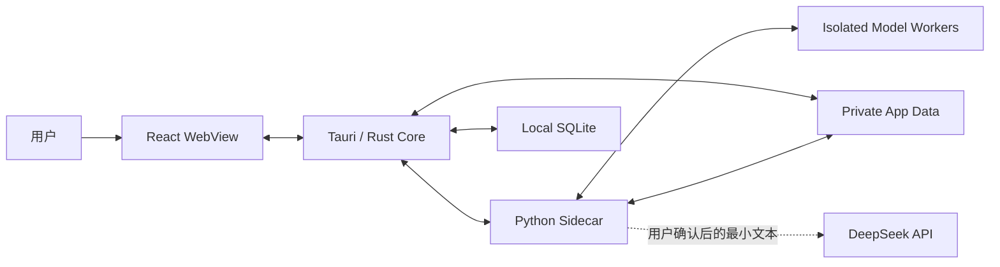
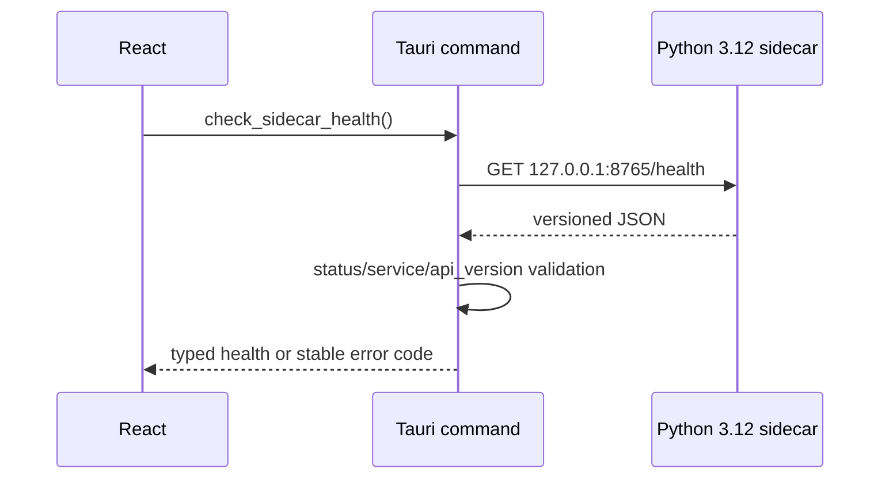
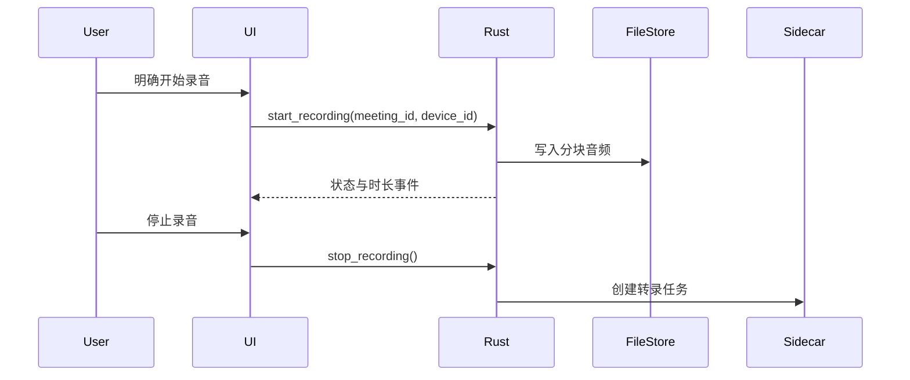

# MeetingLens 架构设计

## 1. 架构目标

MeetingLens 采用“轻量桌面壳 + 本地处理 sidecar + 隔离模型 worker + 本地数据库 + 可选外部 AI”的结构。Tauri/Rust 控制系统权限和进程生命周期，React 负责交互，Python 3.12 sidecar 编排语音、文档和 NLP 处理，SQLite 保存结构化元数据。

核心目标是明确权限边界、允许处理模块独立替换，并让原始会议数据默认不离开本机。

## 2. 系统上下文



## 3. 组件职责

### 3.1 React WebView

- 显示会议、录音状态、处理进度、转录、翻译和摘要。
- 只通过定义明确的 Tauri commands 访问系统能力。
- 不直接读取 `.env`、SQLite、任意文件路径或操作系统凭据。
- 不直接启动 sidecar，也不持有长期 API key。

### 3.2 Tauri / Rust Core

- 作为 WebView 与本机资源之间的权限边界。
- 管理窗口、文件选择、音频设备权限和应用生命周期。
- 启动/停止已打包 sidecar，生成每次启动的端口与会话令牌。
- 对 IPC 输入做类型、路径和大小校验。
- 负责数据库迁移、原子写入和删除协调。

### 3.3 Python Sidecar

- 提供版本化 loopback API。
- 承载转录、文档提取、翻译、说话人分离和摘要预处理。
- 任务处理器按接口解耦，单个模型失败不影响其他模块。
- 首轮只实现无运行时第三方依赖的 `/health`，后续使用经过锁定和验证的打包方案生成 Windows sidecar 二进制。
- Diart、WhisperX 等不兼容模型不得装入同一个 Python 环境，由独立 worker 进程和版本化消息协议隔离。

### 3.4 SQLite 与本地文件

- SQLite 保存元数据、片段、任务状态、摘要和同意事件。
- 大型音频与上传文件保存于应用私有数据目录，数据库只保存受控相对路径和哈希。
- 凭据不进入 SQLite；开发阶段使用已忽略的 `.env`，发布阶段使用系统凭据库。

### 3.5 外部 AI 适配器

- DeepSeek 是首个翻译/摘要适配器，但业务层依赖统一 provider 接口。
- 适配器只接收用户确认的文本范围，并记录提供商、模型和请求时间，不保存密钥。
- 外部调用失败时保留本地数据和可重试任务，不阻塞会议浏览。
- 默认模型为实时翻译 `deepseek-v4-flash`、最终摘要 `deepseek-v4-pro`；base URL 可配置，默认 `https://api.deepseek.com`。

## 4. 信任边界

| 边界            | 高信任侧        | 低信任侧       | 主要控制                                        |
| --------------- | --------------- | -------------- | ----------------------------------------------- |
| WebView → Rust  | Rust core       | UI 输入        | Tauri capabilities、command allowlist、结构校验 |
| Rust → Sidecar  | Rust supervisor | 本地 HTTP 进程 | loopback、随机端口、临时 bearer token、超时     |
| Sidecar → 文件  | 应用私有目录    | 上传内容       | 规范化路径、MIME/大小限制、沙箱式工作目录       |
| 本地 → DeepSeek | 本地数据        | 外部服务       | 明示同意、最小文本、脱敏、TLS、超时             |

## 5. Sidecar API

### 5.1 首轮健康检查

`GET /health`

```json
{
  "status": "ok",
  "service": "meetinglens-sidecar",
  "version": "0.1.0",
  "api_version": "v1"
}
```

约束：

- 默认绑定 `127.0.0.1`。
- 返回值不包含主机名、路径、环境变量、模型列表或凭据信息。
- 非法路径返回 JSON 404。
- 后续除 `/health` 外的端点都要求每次启动生成的 bearer token。

首轮调用链：



Rust 使用 1 秒连接超时、2 秒总超时、禁止重定向，并且不把底层网络错误、路径或响应正文回显给 WebView。固定端口仅用于首轮开发验证；进入应用骨架阶段后改为 Rust 启动时选择随机端口并注入高熵会话 token。

### 5.2 规划端点

- `POST /v1/jobs/transcribe`
- `POST /v1/jobs/translate`
- `POST /v1/jobs/diarize`
- `POST /v1/jobs/extract-document`
- `POST /v1/jobs/summarize`
- `GET /v1/jobs/{job_id}`
- `DELETE /v1/jobs/{job_id}`

任务请求只传受控 artifact ID 或应用私有目录中的相对引用，不接受任意绝对路径。

## 6. 关键数据流

### 6.1 录音



### 6.2 外部摘要

1. 用户在 UI 选择转录范围并查看发送预览。
2. Rust 读取被允许的片段并执行基础脱敏。
3. Sidecar 通过 provider adapter 调用 DeepSeek。
4. 返回结果连同模型、提示模板版本和来源片段 ID 写入 SQLite。
5. UI 将 AI 输出标记为可编辑草稿，而非事实来源。

## 7. 仓库结构

```text
MeetingLens/
├── src/                       # React + TypeScript UI
├── src-tauri/                 # Tauri/Rust core 与 capabilities
├── sidecar/
│   ├── meetinglens_sidecar/   # Python 服务
│   └── tests/                 # Sidecar 自动化测试
├── .github/workflows/         # CI
├── PRODUCT_SPEC.md
├── ARCHITECTURE.md
├── DATA_MODEL.md
├── SECURITY.md
└── DEVELOPMENT_PLAN.md
```

## 8. 进程与打包策略

1. 开发阶段可使用 `python -m sidecar.meetinglens_sidecar.server` 独立启动服务。
2. 发布阶段使用锁定版本并经 Windows 11 验证的打包工具构建 sidecar 二进制。
3. 二进制按 Tauri target triple 命名，并配置到 `bundle.externalBin`。
4. Rust 使用 sidecar API 启动进程，不允许 WebView 获得任意 shell 执行能力。
5. 应用退出、崩溃恢复和更新时，Rust 负责回收孤儿 sidecar。

首轮不提前写入 `externalBin`，因为仓库尚无可验证的平台二进制；这样避免生成一个无法打包的虚假配置。

## 9. 可观测性

- 结构化日志只记录事件类型、任务 ID、耗时、状态码和匿名错误分类。
- 默认不记录转录正文、提示词正文、文件名、参会者、密钥或外部响应全文。
- UI 展示面向用户的错误；开发日志使用 request/correlation ID 串联 Rust 和 sidecar。
- 健康指标包括队列长度、任务耗时、重试次数和 sidecar 重启次数。

## 10. 架构决策

- **Tauri 2 + React + TypeScript**：小型桌面壳、明确 IPC 边界、前端生态成熟。
- **Python sidecar**：便于接入语音和文档处理生态，与 UI/Rust 生命周期解耦。
- **SQLite**：单机事务和迁移简单，适合本地优先元数据。
- **本地 HTTP + 会话令牌**：便于 Python 服务化测试，同时限制未授权本机进程访问。
- **Provider adapter**：避免业务逻辑与 DeepSeek 单点绑定。

## 11. 依赖兼容性与采用门槛

以下结论基于 2026-07-27 的官方仓库、包元数据和发行信息。这里记录候选版本，不代表本轮安装。

| 组件           | 候选基线                                | 结论与门槛                                                                                |
| -------------- | --------------------------------------- | ----------------------------------------------------------------------------------------- |
| Tauri / Rust   | Tauri `2.11.5`，Tauri build `2.6.3`     | 首轮已精确锁定；Windows CI 执行 fmt/test/check。                                          |
| Python         | `3.12.x`                                | 项目统一基线；业务 sidecar 后续不得静默退回其他版本。                                     |
| DeepSeek       | `deepseek-v4-flash` / `deepseek-v4-pro` | 官方当前模型；旧模型名已弃用。启用前复核价格、数据条款和 base URL。                       |
| Docling        | `2.115.0`                               | 支持 Python 3.12 与 Windows；模型下载、格式覆盖、内存和冷启动需在文档处理分支实测。       |
| Diart          | `0.9.2`                                 | 依赖 `numpy<2`，其参考环境偏向 Python 3.10，并建议旧版 pyannote；不能直接进入主 sidecar。 |
| WhisperX       | `3.8.6`                                 | Python `>=3.10,<3.14`，但要求 `numpy>=2.1`、`pyannote-audio>=4`；与 Diart 当前依赖冲突。  |
| faster-whisper | `1.2.1`                                 | 可用 CPU int8；GPU 路径要求 CUDA 12/cuDNN 9 并受 CTranslate2 兼容性约束。                 |
| Screenpipe     | app `2.5.139`                           | 上游变化快；商业用途需要单独核验/取得许可。采集接入前必须完成授权与隐私复审。             |

### 11.1 强制隔离决策

Diart 的 `numpy<2` / 较旧 pyannote 约束与 WhisperX 的 `numpy>=2.1` / pyannote 4 约束不能在同一 Python 环境满足。因此后续采用以下边界：

```text
Tauri/Rust supervisor
└── orchestration sidecar (Python 3.12, lightweight API/database coordination)
    ├── realtime-diarization worker (Diart-compatible locked environment)
    ├── post-meeting-alignment worker (WhisperX-compatible locked environment)
    └── document worker (Docling-compatible locked environment)
```

worker 之间只交换受控文件引用和版本化 JSON，不共享 site-packages。每个 worker 必须有独立 lockfile、许可清单、资源上限和合成数据测试。

### 11.2 延后决策

- Screenpipe 不在第一轮或 Phase 1 默认安装；商业授权、采集范围和 Windows 资源占用需要用户决定。
- WhisperX 的 diarization 模型可能需要 Hugging Face token 和模型条款同意；不得把该 token 写入配置或仓库。
- DeepSeek、Docling 和本地模型的真实调用/下载均在对应功能分支进行，本轮不产生费用或下载大模型。

## 12. 参考

- [Tauri 2 创建项目](https://v2.tauri.app/start/create-project/)
- [Tauri sidecar 指南](https://v2.tauri.app/develop/sidecar/)
- [Tauri capabilities](https://v2.tauri.app/security/capabilities/)
- [Tauri security](https://v2.tauri.app/security/)
- [DeepSeek 模型与定价](https://api-docs.deepseek.com/quick_start/pricing/)
- [DeepSeek 模型列表](https://api-docs.deepseek.com/api/list-models)
- [Docling](https://github.com/docling-project/docling)
- [Diart](https://github.com/juanmc2005/diart)
- [WhisperX](https://github.com/m-bain/whisperX)
- [faster-whisper](https://github.com/SYSTRAN/faster-whisper)
- [Screenpipe](https://github.com/screenpipe/screenpipe)
