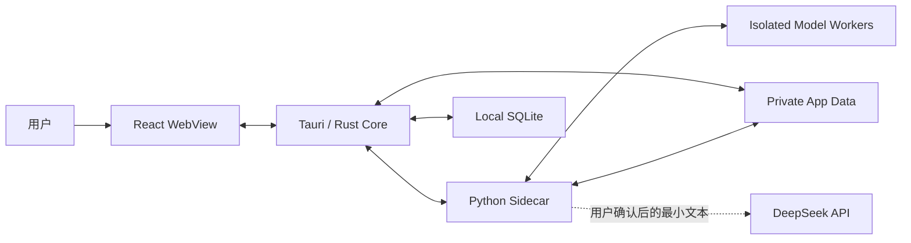
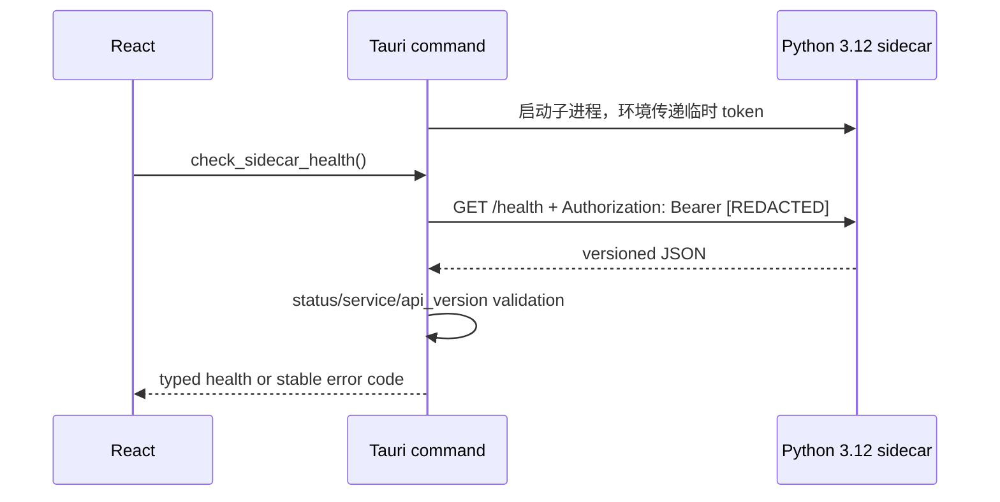
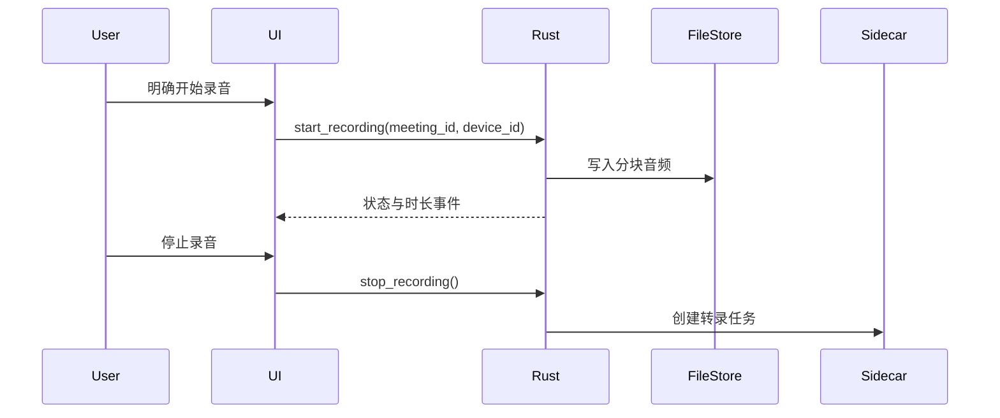

# MeetingLens 架构设计

## 1. 架构目标

MeetingLens 采用“轻量桌面壳 + 本地处理 sidecar + 隔离模型 worker + 本地数据库 + 可选外部 AI”的结构。Tauri/Rust 控制系统权限和进程生命周期，React 负责交互，Python 3.12 sidecar 编排语音、文档和 NLP 处理，SQLite 保存结构化元数据。

核心目标是明确权限边界、允许处理模块独立替换，并让原始会议数据默认不离开本机。

## 2. 系统上下文



## 3. 组件职责

### 3.1 React WebView

- 显示会议、录音状态、处理进度、转录、翻译和摘要。
- 只通过定义明确的 Tauri commands 访问系统能力。
- 不直接读取 `.env`、SQLite、任意文件路径或操作系统凭据。
- 不直接启动 sidecar，也不持有长期 API key。

### 3.2 Tauri / Rust Core

- 作为 WebView 与本机资源之间的权限边界。
- 管理窗口、文件选择、音频设备权限和应用生命周期。
- 生成每次应用启动的会话令牌，并作为唯一授权调用方管理 Sidecar 通信。
- MVP 1A-3B-1 取得安全传递令牌所需的最小开发 Sidecar 启停所有权；完整打包、监控、崩溃恢复和孤儿进程回收仍属于 MVP 1C。
- 通过 Tauri App State 管理 `SecretStore`，并在 Windows 使用当前用户的 Credential Manager；WebView 只能写入、查询配置状态和删除，不能读回值。
- 对 IPC 输入做类型、路径和大小校验。
- 负责数据库迁移、原子写入和删除协调。

### 3.3 Python Sidecar

- 提供版本化 loopback API。
- 承载转录、文档提取、翻译、说话人分离和摘要预处理。
- 任务处理器按接口解耦，单个模型失败不影响其他模块。
- Sidecar 保持无运行时第三方依赖的窄 HTTP 服务；MVP 1A-3B-1 为所有路由增加会话认证，MVP 1C 才实现 supervisor、崩溃恢复、孤儿进程回收和 Windows sidecar 打包生命周期。
- Diart、WhisperX 等不兼容模型不得装入同一个 Python 环境，由独立 worker 进程和版本化消息协议隔离。

### 3.4 SQLite 与本地文件

- SQLite 保存元数据、片段、任务状态、摘要和同意事件。
- 大型音频与上传文件保存于应用私有数据目录，数据库只保存受控相对路径和哈希。
- 凭据不进入 SQLite；开发阶段使用已忽略的 `.env`，发布阶段使用系统凭据库。

### 3.5 外部 AI 适配器

- DeepSeek 是首个翻译/摘要适配器，但业务层依赖统一 provider 接口。
- 适配器只接收用户确认的文本范围，并记录提供商、模型和请求时间，不保存密钥。
- 外部调用失败时保留本地数据和可重试任务，不阻塞会议浏览。
- 默认模型为实时翻译 `deepseek-v4-flash`、最终摘要 `deepseek-v4-pro`；base URL 可配置，默认 `https://api.deepseek.com`。

### 3.6 Provider 契约与 Runtime

MVP 1A-3A 在 React/TypeScript 应用边界定义五类能力契约：Capture、Transcription、Translation、Summary 和 DocumentParser。每个契约明确输入、输出、统一状态、稳定错误、取消和清理行为；页面只通过应用拥有的 `ProviderRegistry` 获取能力，不直接实例化第三方实现。

当前只有确定性的纯内存 Mock Provider：不访问设备、文件系统或网络，不持久化转录/翻译/摘要/文档结果，并在设置页明确标为 Mock/未启用。旧 `MockTranscriptSource` 已迁移为 `MockTranscriptionProvider`，避免两套模拟字幕架构并存。Registry 不是全局单例，可由测试注入或重置，并在应用页面关闭时统一 dispose。

本阶段契约只位于 TypeScript，因为尚无真实 Provider RPC。Rust 继续负责系统权限、Tauri command、数据库和未来进程/凭据边界；Python 继续只提供现有 sidecar 健康契约。真实实现出现时再在所属层增加版本化 adapter，不为形式对称提前复制无调用方的 Rust/Python 接口。

未来替换关系保持可选：Screenpipe 只能是 Capture Provider；Whisper/Diart 属于 Transcription Provider；DeepSeek 只能实现 Translation/Summary Provider；Docling 只能实现 DocumentParser Provider。会话认证由 MVP 1A-3B-1 建立；MVP 1A-3B-2 在 Rust 信任边界建立 SecretStore，但不启用真实 DeepSeek Provider；随机端口和完整 supervisor 留在 MVP 1C。

## 4. 信任边界

| 边界                  | 高信任侧           | 低信任侧       | 主要控制                                                      |
| --------------------- | ------------------ | -------------- | ------------------------------------------------------------- |
| WebView → Rust        | Rust core          | UI 输入        | Tauri capabilities、command allowlist、结构校验               |
| WebView → SecretStore | Rust core          | API key 输入   | `main` 窗口 permission set、SecretKind 白名单、无读回 command |
| Rust → Sidecar        | Rust session owner | 本地 HTTP 进程 | loopback、临时 bearer token、集中 Header、超时                |
| Sidecar → 文件        | 应用私有目录       | 上传内容       | 规范化路径、MIME/大小限制、沙箱式工作目录                     |
| 本地 → DeepSeek       | 本地数据           | 外部服务       | 明示同意、最小文本、脱敏、TLS、超时                           |

## 5. Sidecar API

### 5.1 Phase 0 健康检查

`GET /health`

```json
{
  "status": "ok",
  "service": "meetinglens-sidecar",
  "version": "0.1.0",
  "api_version": "v1"
}
```

约束：

- 默认绑定 `127.0.0.1`。
- 返回值不包含主机名、路径、环境变量、模型列表或凭据信息。
- 非法路径返回 JSON 404。
- 所有端点（包括 `/health`）都要求每次启动生成的 bearer token。

Phase 0 调用链：



Rust 使用 1 秒连接超时、2 秒总超时、禁止重定向，并且不把底层网络错误、路径、Header 或响应正文回显给 WebView。MVP 1A-3B-1 保留固定开发端口，但锁死 `127.0.0.1` 并启用每次启动轮换的高熵 token；随机端口、打包二进制和完整 supervisor 由 MVP 1C 接线。

### 5.2 规划端点

- `POST /v1/jobs/transcribe`
- `POST /v1/jobs/translate`
- `POST /v1/jobs/diarize`
- `POST /v1/jobs/extract-document`
- `POST /v1/jobs/summarize`
- `GET /v1/jobs/{job_id}`
- `DELETE /v1/jobs/{job_id}`

任务请求只传受控 artifact ID 或应用私有目录中的相对引用，不接受任意绝对路径。

## 6. 关键数据流

### 6.1 录音



### 6.2 外部摘要

1. 用户在 UI 选择转录范围并查看发送预览。
2. Rust 读取被允许的片段并执行基础脱敏。
3. Sidecar 通过 provider adapter 调用 DeepSeek。
4. 返回结果连同模型、提示模板版本和来源片段 ID 写入 SQLite。
5. UI 将 AI 输出标记为可编辑草稿，而非事实来源。

### 6.3 Meeting command 边界

MVP 1A-2-1 先建立独立的 Meeting Tauri Command API，再由 MVP 1A-2-2 的页面使用。WebView 只调用集中封装的 TypeScript `meetingApi`；Tauri command 负责 DTO 校验和稳定错误映射，再调用 Rust service，command 内不得包含 SQL。

创建会议后状态为 `draft`。`start_meeting` 执行 `draft → recording`，`end_meeting` 在合成会议阶段执行 `recording → ready`；两个生命周期时间戳均由 Rust 以 UTC ISO 8601 写入。`processing` 保留给后续受信任的异步处理流程，普通更新 command 不得修改状态或时间戳。非法转换返回 `meeting_invalid_state`，不得泄漏 SQL、路径或底层数据库错误。

`delete_meeting` 复用 service 的事务边界，只允许删除 `draft` 或 `ready`。`recording` 以及当前不可进入的 `processing`、`failed`、`archived` 返回 `meeting_invalid_state`；不存在的会议返回 `meeting_not_found`。对外协议不使用含义重复的 `invalid_state_transition`。

### 6.4 SecretStore command 边界

`SecretKind` 当前只允许 `deepseek_api_key`，并由 Rust 固定映射为 `com.gray.meetinglens/secret/deepseek-api-key`。Windows 后端直接使用 Credential Manager Generic Credential；测试使用随机隔离 target，非 Windows 平台返回 unsupported/unavailable，绝不回退到文件、SQLite 或浏览器存储。

前端只暴露 `get_secret_status`、`set_secret` 和 `delete_secret`。`get_for_backend` 只供未来受信任 Rust Provider 使用，不注册为 Tauri command；当前也不把 key 传给 Python Sidecar。Secret response 只包含配置状态、可用性和固定后端标识，不包含值、target、路径或原生错误。

## 7. 仓库结构

```text
MeetingLens/
├── src/                       # React + TypeScript UI
│   └── providers/             # Provider 契约、Registry 与纯内存 Mock
├── src-tauri/                 # Tauri/Rust core 与 capabilities
├── sidecar/
│   ├── meetinglens_sidecar/   # Python 服务
│   └── tests/                 # Sidecar 自动化测试
├── .github/workflows/         # CI
├── PRODUCT_SPEC.md
├── ARCHITECTURE.md
├── DATA_MODEL.md
├── SECURITY.md
└── DEVELOPMENT_PLAN.md
```

## 8. 进程与打包策略

1. MVP 1A-3B-1 开始，`npm run tauri dev` 由 Rust 启动 Python 3.12 Sidecar，并通过子进程环境传递当前会话 token；WebView 不启动进程也不持有 token。
2. 独立启动仅用于受控协议测试，缺少父进程提供的 token 时必须 fail closed。
3. 发布阶段使用锁定版本并经 Windows 11 验证的打包工具构建 sidecar 二进制。
4. 二进制按 Tauri target triple 命名，并配置到 `bundle.externalBin`。
5. Rust 使用固定程序/module allowlist 启动进程，不允许 WebView 获得任意 shell 执行能力。
6. 当前只在正常窗口/应用退出时终止所拥有的子进程；崩溃恢复、健康监控、重启和孤儿进程回收属于 MVP 1C。

Phase 0 不提前写入 `externalBin`，因为仓库尚无可验证的平台二进制；MVP 1C 的 `feat/sidecar-supervisor` 必须在产生可验证 Windows 二进制后再接入。

## 9. 可观测性

- 结构化日志只记录事件类型、任务 ID、耗时、状态码和匿名错误分类。
- 默认不记录转录正文、提示词正文、文件名、参会者、密钥或外部响应全文。
- UI 展示面向用户的错误；开发日志使用 request/correlation ID 串联 Rust 和 sidecar。
- 健康指标包括队列长度、任务耗时、重试次数和 sidecar 重启次数。

## 10. 架构决策

- **Tauri 2 + React + TypeScript**：小型桌面壳、明确 IPC 边界、前端生态成熟。
- **Python sidecar**：便于接入语音和文档处理生态，与 UI/Rust 生命周期解耦。
- **SQLite**：单机事务和迁移简单，适合本地优先元数据。
- **本地 HTTP + 会话令牌**：便于 Python 服务化测试，同时限制未授权本机进程访问。
- **Provider adapter**：避免业务逻辑与 DeepSeek 单点绑定。

### 10.1 实施顺序与模块所有权

| 阶段        | 架构交付                                                       | 明确不包含                                  |
| ----------- | -------------------------------------------------------------- | ------------------------------------------- |
| MVP 1A-1    | SQLite、迁移、meeting repository/service、删除语义和持久化     | UI、Provider、worker                        |
| MVP 1A-2-1  | Meeting Tauri commands、DTO、状态机和 TypeScript `meetingApi`  | 完整页面、模拟字幕、Provider                |
| MVP 1A-2-2  | React 页面、模拟转写和完整合成会议数据流                       | 真实音频、外部 API                          |
| MVP 1A-3A   | TypeScript Provider 契约、Registry、纯内存 Mock 与模拟会议迁移 | 凭据、令牌、真实 Provider                   |
| MVP 1A-3B-1 | Sidecar 会话认证、Loopback、稳定错误与基础日志脱敏             | SecretStore、真实 Provider                  |
| MVP 1A-3B-2 | SecretStore、WinCred、最小 Tauri permissions 与安全配置        | DeepSeek 调用、Python 传密钥、Docling、音频 |
| MVP 1B-1    | 隔离的 Docling document worker 和来源映射                      | 总结模型                                    |
| MVP 1B-2    | DeepSeek summary adapter、证据引用和导出                       | 文档解析器变更                              |
| MVP 1C      | Sidecar supervisor、崩溃/孤儿进程回收、WASAPI 和实时 ASR       | 翻译、说话人、屏幕                          |
| MVP 2       | 隔离的翻译、Diart 和 WhisperX worker                           | 屏幕采集                                    |
| MVP 3       | Window context、accessibility/OCR 和可选 Capture Provider      | 核心强绑定 Screenpipe                       |
| MVP 4       | Windows 打包、签名、升级、诊断和产品加固                       | 新核心业务范围                              |

每一行仍须按 `DEVELOPMENT_PLAN.md` 拆成指定的小型 PR。上游阶段只能通过版本化接口为下游提供能力，不得把下游实现提前塞入当前 PR。

## 11. 依赖兼容性与采用门槛

以下结论基于 2026-07-31 的官方文档、包元数据和锁定依赖。标为已采用的依赖已经通过 Windows 本机编译与测试；其余候选仍须在所属阶段复核。

| 组件            | 候选基线                                | 结论与门槛                                                                                     |
| --------------- | --------------------------------------- | ---------------------------------------------------------------------------------------------- |
| Tauri / Rust    | Tauri `2.11.5`，Tauri build `2.6.3`     | Phase 0 已精确锁定；Windows CI 执行 fmt/test/check。                                           |
| WinCred binding | `windows 0.61.3`                        | 已采用；复用 Tauri lock graph 版本，MIT/Apache-2.0，MSRV 1.74，只启用 Foundation/Credentials。 |
| Secret memory   | `zeroize 1.9.0`                         | 已采用；无运行时依赖，MIT/Apache-2.0，MSRV 1.85，当前 Rust 1.97.1 满足。                       |
| Python          | `3.12.x`                                | 项目统一基线；业务 sidecar 后续不得静默退回其他版本。                                          |
| DeepSeek        | `deepseek-v4-flash` / `deepseek-v4-pro` | 官方当前模型；旧模型名已弃用。启用前复核价格、数据条款和 base URL。                            |
| Docling         | `2.115.0`                               | 支持 Python 3.12 与 Windows；模型下载、格式覆盖、内存和冷启动需在文档处理分支实测。            |
| Diart           | `0.9.2`                                 | 依赖 `numpy<2`，其参考环境偏向 Python 3.10，并建议旧版 pyannote；不能直接进入主 sidecar。      |
| WhisperX        | `3.8.6`                                 | Python `>=3.10,<3.14`，但要求 `numpy>=2.1`、`pyannote-audio>=4`；与 Diart 当前依赖冲突。       |
| faster-whisper  | `1.2.1`                                 | 可用 CPU int8；GPU 路径要求 CUDA 12/cuDNN 9 并受 CTranslate2 兼容性约束。                      |
| Screenpipe      | app `2.5.139`                           | 上游变化快；商业用途需要单独核验/取得许可。采集接入前必须完成授权与隐私复审。                  |

### 11.1 强制隔离决策

Diart 的 `numpy<2` / 较旧 pyannote 约束与 WhisperX 的 `numpy>=2.1` / pyannote 4 约束不能在同一 Python 环境满足。因此后续采用以下边界：

```text
Tauri/Rust supervisor
└── orchestration sidecar (Python 3.12, lightweight API/database coordination)
    ├── realtime-diarization worker (Diart-compatible locked environment)
    ├── post-meeting-alignment worker (WhisperX-compatible locked environment)
    └── document worker (Docling-compatible locked environment)
```

worker 之间只交换受控文件引用和版本化 JSON，不共享 site-packages。每个 worker 必须有独立 lockfile、许可清单、资源上限和合成数据测试。

### 11.2 延后决策

- Screenpipe 在 MVP 3 也只能作为可替换的 Capture Provider；核心窗口选择、权限、事件模型和删除语义不得依赖它。采用前需用户决定商业授权、采集范围和 Windows 资源预算。
- WhisperX 的 diarization 模型可能需要 Hugging Face token 和模型条款同意；不得把该 token 写入配置或仓库。
- Docling 只在 MVP 1B-1 引入，DeepSeek 只在 MVP 1B-2 引入；不得在同一 PR 同时改变解析与总结管线。真实调用/下载需要对应阶段授权。

### 11.3 Windows 本地验收门槛

CI 负责自动化构建与测试，但不能证明 WebView2 窗口、凭据库、文件对话框、音频设备、权限或进程回收在用户机器上可用。任何涉及上述能力的 PR 必须记录本机 `npm run tauri dev` 及阶段专用验收结果；没有本地证据时只能报告“CI 通过，本地验收待完成”。

## 12. 参考

- [Tauri 2 创建项目](https://v2.tauri.app/start/create-project/)
- [Tauri sidecar 指南](https://v2.tauri.app/develop/sidecar/)
- [Tauri capabilities](https://v2.tauri.app/security/capabilities/)
- [Tauri security](https://v2.tauri.app/security/)
- [Windows Credential Manager APIs](https://learn.microsoft.com/en-us/windows/win32/api/wincred/)
- [Rust `windows` bindings](https://github.com/microsoft/windows-rs)
- [RustCrypto `zeroize`](https://docs.rs/zeroize/1.9.0/zeroize/)
- [DeepSeek 模型与定价](https://api-docs.deepseek.com/quick_start/pricing/)
- [DeepSeek 模型列表](https://api-docs.deepseek.com/api/list-models)
- [Docling](https://github.com/docling-project/docling)
- [Diart](https://github.com/juanmc2005/diart)
- [WhisperX](https://github.com/m-bain/whisperX)
- [faster-whisper](https://github.com/SYSTRAN/faster-whisper)
- [Screenpipe](https://github.com/screenpipe/screenpipe)
