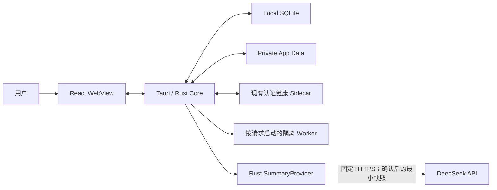
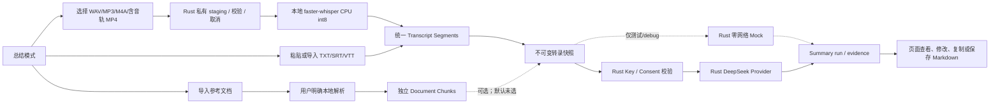
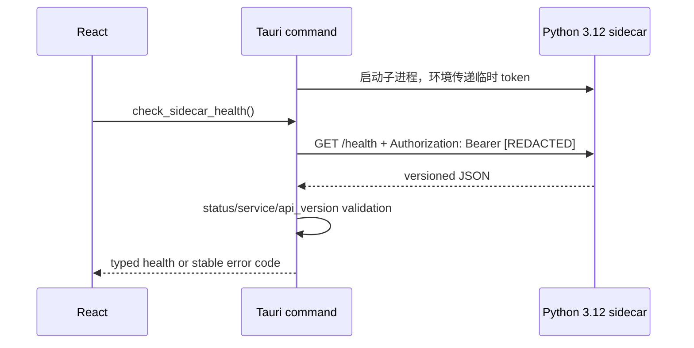
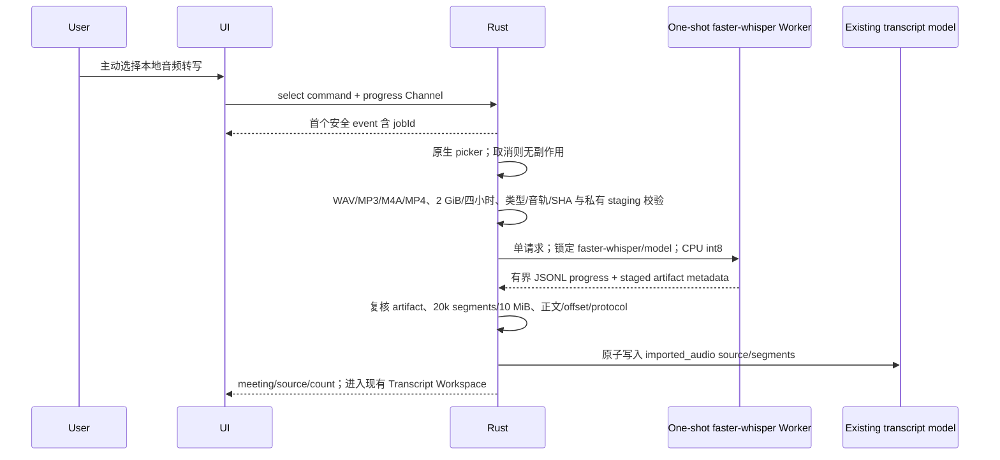
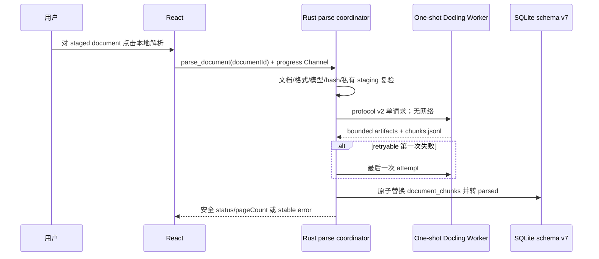
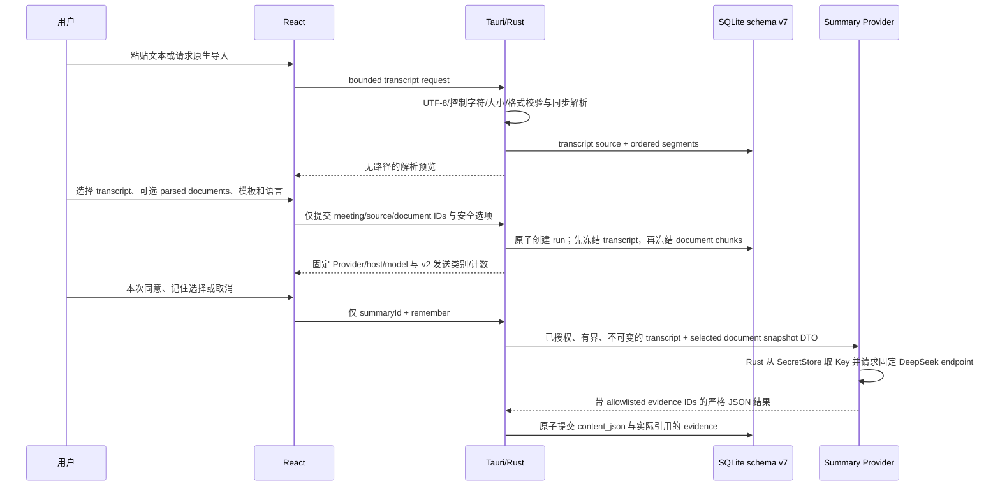
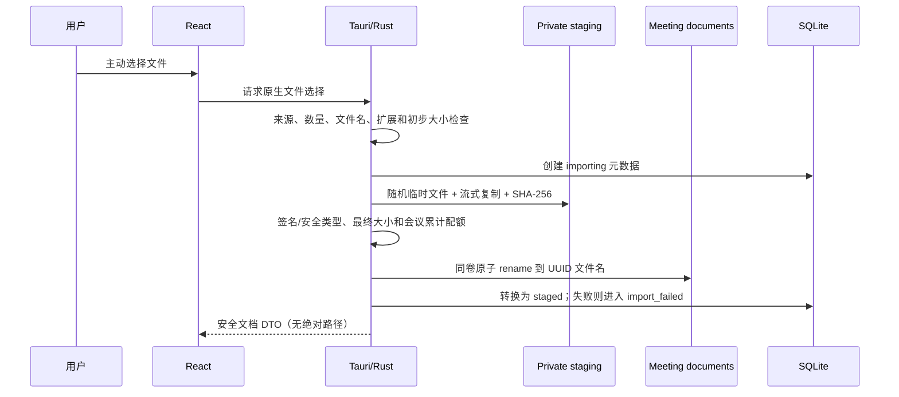
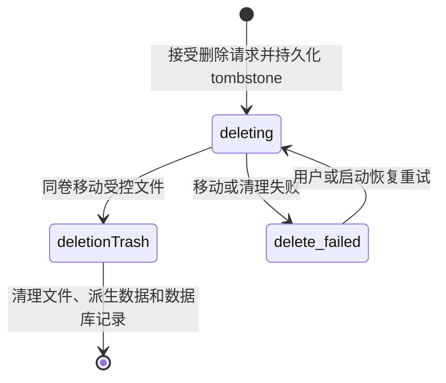

# MeetingLens 架构设计

当前 `fix/transcript-turns` 修复已合并 PR #27 后的 TXT 分段问题：Rust 仅在至少两组一致的“姓名 / 中文时长与时钟 / 重复姓名与时长”标题建立格式后识别导出发言，写入既有 speaker_label/start_offset_ms；同秒发言保留，结束时间未知时为空。普通 TXT 保持原段落解析，未知正文和前言保留。Summary 继续冻结既有字段；Evidence 界面显示可用的起始时间，不新增 Provider 请求或来源读取权限。

## 1. 架构目标

MeetingLens 当前采用 Personal Edition / 自用版基线：“轻量桌面壳 + 本地转录工作区 + Rust Summary 执行边界 + 本地数据库 + 按需受控 Worker + 可选外部 AI”。Tauri/Rust 控制系统权限、转录导入、SQLite、SecretStore、持久 Summary run 和 Provider 调用，React 负责交互；Python 只用于现有认证健康 Sidecar 和按功能启动的隔离 Worker。

核心目标是明确权限边界、允许处理模块独立替换，并让原始会议数据默认不离开本机。

当前近期产品只推进总结模式：用户可粘贴、导入 TXT/SRT/VTT，或通过本地一次性 faster-whisper Worker 转写 WAV/MP3/M4A/含音轨 MP4；当前 `feat/document-parsing-orchestration` 再允许用户对 PDF/DOCX/PPTX/XLSX/TXT/MD/CSV/PNG/JPG/JPEG 明确启动本地 Docling 解析，并把已解析文档作为默认未选的可选 Summary reference。Summary 仍必须包含至少一个 transcript，只有用户明确生成并通过 Consent v2 后，Rust DeepSeek Provider 才可发送已选冻结范围。

总结、翻译和会议模式的长期愿景仍共享同一引擎，不建立三个应用或三套后端；但翻译模式、实时能力和独立会议模式工作区当前均为 Frozen / Deferred。现行持久化真相是 meeting、transcript source/segment、summary snapshot/evidence、最小 Provider Consent 当前偏好和 deletion pipeline；不得把未来 translation、checkpoint 或通用 Consent 审计设计描述为当前 schema 事实。

## 2. 系统上下文



### 2.1 Personal Edition 当前处理主线



翻译、实时字幕、checkpoint 和独立会议工作区属于 Deferred；若未来解冻，仍只能作为共享管线上的派生能力。最终纪要继续以原始 segment revision 和不可变输入快照为准，Provider 失败不得破坏已有本地转录。

## 3. 组件职责

### 3.1 React WebView

- 显示会议、转录、参考文档和统一 Minutes 工作区；编排来源/模板/语言、显式 Generate/Continue/Cancel、Consent、运行状态、revision/stale、五区结果、typed evidence、编辑和 Markdown 操作。音频和文档解析入口只显示安全 policy/progress/cancel/error/result DTO；不接收源/临时/模型路径、媒体、原始 Worker artifact 或通过这些 Command 返回全文 chunks/segments。实时录音、实时翻译和独立会议工作区属于 Deferred。
- 只通过定义明确的 Tauri commands 访问系统能力。
- 不直接读取 `.env`、SQLite、任意文件路径或操作系统凭据。
- 不直接启动 sidecar，也不持有长期 API key。
- 只在用户明确点击时写剪贴板，不读取剪贴板；结果、evidence 和 Markdown 使用文本节点/纯文本预览，不执行模型 HTML。React 不选择、传入或接收 Markdown 保存路径。

界面国际化集中在 `src/i18n`：`i18next` 与 `react-i18next` 在应用入口初始化，`zh-CN`/`en-US` JSON 资源随 Vite bundle 打包，`en-US` 是可靠 fallback，不加载远程语言包。React 页面只使用稳定 translation key；集中 formatters 按当前 UI locale 和用户本地时区显示日期、数字与文件大小。设置页只把允许的 locale 枚举写入 `meetinglens.uiLocale`，不使用 SecretStore 或 SQLite，也不将 UI locale 复用为未来 Summary 输出语言。

### 3.2 Tauri / Rust Core

- 作为 WebView 与本机资源之间的权限边界。
- 管理窗口、文件选择和应用生命周期；未来如解冻设备采集，仍由 Rust 管理权限。
- 生成每次应用启动的会话令牌，并作为唯一授权调用方管理现有 Sidecar 健康通信。
- MVP 1A-3B-1 已取得安全传递令牌所需的最小开发 Sidecar 启停所有权；完整实时 Sidecar supervisor、监控和孤儿进程回收当前为 Deferred。
- 通过 Tauri App State 管理 `SecretStore`，并在 Windows 使用当前用户的 Credential Manager；WebView 只能写入、查询配置状态和删除，不能读回值。
- 对 IPC 输入做类型、路径和大小校验。
- 负责数据库迁移、原子写入和删除协调。
- 在 Rust DeepSeek Provider 内执行最小首次外发确认、remember/revoke、SecretStore 消费和请求取消；麦克风、系统音频、持续翻译和实时屏幕采集的独立会话同意仅作为 Deferred 安全边界保留，应用启动不得自动申请权限。
- 从 typed `SummaryContent` 派生 `contentVersion`，在事务内执行受限正文更新、精确 evidence 归属校验，并通过同一确定性 renderer 生成 canonical Markdown。
- 只在 Rust 打开 Markdown Save As，对目标与 reparse/symlink 做防护，并在所选目录使用临时文件和原子替换；不把路径写入 DTO、SQLite 或日志。
- 拥有五个 audio transcription commands、原生 picker、扩展名/媒体/音轨校验、2 GiB/四小时等上限、UUID 私有 staging、Worker/model 验证、单 job 互斥、typed progress、并行取消、Windows 进程树/资源限制、输出复核、原子 `imported_audio` workflow 和启动清理。
- 拥有 document parsing policy/start/status/cancel commands；只对已导入 staged document 明确启动，在 Rust 受控 staging 中运行一次性无网络 Docling Worker，严格验证 `chunks.jsonl` 后原子提交；只有 retryable 错误有一次自动重试，取消与重启均不自动续跑。

### 3.3 Python Sidecar

- 提供版本化 loopback 健康 API；当前只提供认证健康契约，不接收用户文件、凭据或会议正文。
- Sidecar 保持无运行时第三方依赖的窄 HTTP 服务；MVP 1A-3B-1 已为所有路由增加会话认证。
- 录音文件转录不扩展为实时 Sidecar 栈，而是使用独立锁定环境，由 Rust 为每次任务启动一次性 faster-whisper Worker。Worker 只消费一个 stdin JSON 请求并输出有界 JSONL 进度/终态元数据，不监听端口、不继承凭据或 proxy、不访问 SQLite/SecretStore。
- 完整 supervisor、实时 ASR、翻译和说话人分离当前为 Deferred；若未来解冻，不兼容模型仍必须使用独立环境和版本化消息协议隔离。

### 3.4 SQLite 与本地文件

- 当前功能分支的 SQLite schema v7 保存 meeting、document、document chunks、transcript（含 `imported_audio`）、Summary run/转录快照/文档快照/typed evidence、删除状态，以及 schema v5 引入的最小 `provider_consent_preferences` remembered Consent 当前偏好。
- 当前上传文档保存在应用私有数据目录，数据库只保存受控相对路径和哈希。音频源文件只在每个 job 的 Rust 私有 staging 中临时复制，终态后清理；SQLite 只保存既有 transcript source/segments 的显示元数据、时间偏移和正文，不保存原录音、内部路径或通用 audio artifact 行。
- 凭据不进入 SQLite、`.env`、环境变量、日志、Python 或命令行参数。DeepSeek key 保存在 Windows Credential Manager，只能由受信任 Rust 代码通过 `SecretStore` 读取。
- 用户源文件保持不变；MeetingLens 使用 document UUID 生成内部文件名，不把源绝对路径或原始文件名用于存储路径拼接。
- 文件导入通过应用私有 staging 目录流式复制并计算 SHA-256，校验成功后在同一卷原子 rename；失败时清理临时文件。
- SQLite schema v2 已新增 `documents` 与统一 `deletion_jobs`；应用持有 `meeting-data/.meetinglens-storage.lock` 的生命周期独占锁，第二个写入实例 fail closed，进程内 mutation mutex 串行化导入、删除与恢复。
- schema v3 已由 PR #18 引入 `transcript_sources` 与 `transcript_segments`。粘贴文本和 TXT/SRT/VTT 使用轻量同步解析器进入 SQLite，不经过 DocumentService、Docling 或 Python Sidecar；原始转录文件首版不长期复制。
- PR #21 已通过 `feat/summary-run-core` 追加 schema v4：`summaries` 保存 run/series/revision 与状态，`summary_sources` 保存真实复制的 transcript snapshot 正文和元数据，`evidence_items` 只保存当前 run 实际引用的 transcript evidence。snapshot source/segment UUID 是历史值而非 live FK，因此终态 source 删除不会级联破坏已有结果。
- schema v5 只追加 `provider_consent_preferences(provider, policy_version, policy_fingerprint, consented_at, updated_at)`；一次性 Consent 不写数据库，按 run 在 Rust 内存中保留 10 分钟并单次消费。撤销删除 remembered 行并清空全部未消费一次性授权。
- schema v6 通过事务性 append-only migration 只扩展 `transcript_sources.source_type` 与 `summary_sources.source_type_snapshot` 约束以允许 `imported_audio`，保留既有表、索引、外键与数据；v1–v5 不改写。
- schema v7 追加 `document_chunks`、Summary 文档计数、`summary_document_sources` 不可变快照和 `document_evidence_items`；它不改写 v1–v6，不把 document chunk 塞入 transcript 表，也不建立通用 processing job 调度表。

### 3.5 外部 AI 适配器

- DeepSeek 是首个外部 Summary 适配器；实时翻译 Provider 为 Deferred。新 production identity 固定为 `deepseek/external/deepseek-v4-pro/summary-deepseek-v2`，WebView 不能选择 Provider、model、host 或 URL。历史同 provider/mode/model 的 v1 terminal run 仍可创建 child revision；parent 保留 v1 provenance，child 冻结当前 v2。
- 适配器由 Rust `SummaryProvider` 实现，只接收用户确认的不可变最小快照范围；文档解析本身不外发，原始文件永不进入 Provider request。API key 只在执行前由 Rust 从 SecretStore 读回，WebView 只能 set/status/delete，key 不进入 SQLite、日志、Python 或命令行。
- Rust transport 固定 `https://api.deepseek.com/chat/completions`，使用 rustls，禁止重定向和环境 proxy，连接/总超时分别为 10/180 秒，请求体上限 2 MiB、响应体上限 1 MiB；非流式、thinking disabled、JSON object、单次请求且不自动重试。
- Provider 严格解析固定 model/finish reason/JSON schema、大小/数量和 evidence allowlist；失败与取消不提交部分结果。自动验收只使用 fake transport；PR #25 基线上另有一次用户明确授权的极短纯合成 live smoke 通过，不自动重复也不作为持续服务保证。

### 3.6 Provider 契约与 Runtime

MVP 1A-3A 在 React/TypeScript 应用边界定义五类能力契约：Capture、Transcription、Translation、Summary 和 DocumentParser。每个契约明确输入、输出、统一状态、稳定错误、取消和清理行为；页面只通过应用拥有的 `ProviderRegistry` 获取能力，不直接实例化第三方实现。

TypeScript Provider Registry 继续只有确定性的纯内存 Mock，用于页面能力预览，不是持久 Summary run 的执行者。Rust `SummaryProvider` trait 同时承载 production `DeepSeekSummaryProvider` 和仅测试/debug 的 `DeterministicMockSummaryProvider`；二者只接收从 schema v4 snapshot 重建的有界 DTO，不自行改变 run 状态。Summary service 独占快照、状态转换、输出/evidence 校验和原子持久化；WebView 不能提交 Provider 结果。

`TranscriptionSegment` 契约和 schema v3 已统一使用可空 `startOffsetMs/endOffsetMs`，并在 source 上使用可空 `baseStartedAt`；SRT/VTT 与 schema-v6 `imported_audio` 都归一化为相对毫秒，没有时间戳时以稳定 ordinal 定位证据，不保存两套竞争的时间真相。音频首版不推断 speaker，speaker/confidence 为 null。现有内存 Mock 与持久化 DTO 使用同一时间语义。

Capture、Transcription、Translation 和 DocumentParser 的预览契约仍主要位于 TypeScript；持久 Summary run 已使用独立 Rust `SummaryProvider` trait。Rust 继续负责系统权限、Tauri command、数据库、进程、SecretStore 和外部 Summary 调用，Python 继续只提供现有 Sidecar 健康契约或受控的一次性 Worker。真实实现出现时再在所属层增加版本化 adapter，不为形式对称提前复制无调用方的接口。

替换关系继续保持清晰：DeepSeek 只实现 Rust Summary Provider；Docling 只实现 DocumentParser Worker；faster-whisper 只实现本地批量 Transcription Worker。Screenpipe、实时 Translation、Diart/WhisperX 和完整 Sidecar supervisor 均为 Deferred。会话认证由 MVP 1A-3B-1 建立，MVP 1A-3B-2 建立的 SecretStore 现在只由受信任 Rust DeepSeek 执行路径消费，音频 Worker 永远不接收它。

## 4. 信任边界

| 边界                     | 高信任侧           | 低信任侧         | 主要控制                                                                                           |
| ------------------------ | ------------------ | ---------------- | -------------------------------------------------------------------------------------------------- |
| WebView → Rust           | Rust core          | UI 输入          | Tauri capabilities、command allowlist、结构校验                                                    |
| WebView → SecretStore    | Rust core          | API key 输入     | `main` 窗口 permission set、SecretKind 白名单、无读回 command                                      |
| Native picker → Rust     | Rust core          | 不可信源文件     | allowlist、签名/类型、配额、UUID 路径和流式复制                                                    |
| Transcript input → Rust  | Rust core          | 粘贴/TXT/SRT/VTT | 严格 UTF-8、大小/片段上限、控制字符拒绝、同步解析、无执行/网络                                     |
| Rust → Audio Worker      | Rust coordinator   | 不可信媒体/进程  | 私有 job staging、固定程序/模型、清空环境、资源/超时/取消、协议与输出复核                          |
| Rust → Sidecar           | Rust session owner | 本地 HTTP 进程   | loopback、临时 bearer token、集中 Header、超时                                                     |
| Rust → Document Worker   | Rust coordinator   | 不可信文档       | 私有 UUID staging、一次性无网络进程、清空环境、固定模型/协议、取消/超时/资源和 artifact/chunk 复验 |
| Rust → user Markdown     | Rust core          | 用户选择的目标   | 原生 Save As、`.md`、reparse/symlink 防护、同目录临时文件与原子替换、无路径 DTO                    |
| Audio device → Rust      | Rust core          | 麦克风/系统音频  | Deferred；未来仍须手动启停、来源指示、句柄回收、可选保存                                           |
| Window/screen → Rust     | Rust core          | 屏幕像素/结构树  | 可选阶段；单应用优先、目标身份复核、本地变化检测、临时帧删除                                       |
| Rust Provider → DeepSeek | Rust core          | 外部服务         | 固定 host/model、明确确认、最小快照、SecretStore、TLS、无重定向/代理、超时/取消                    |

## 5. Sidecar API

### 5.1 Phase 0 健康检查

`GET /health`

```json
{
  "status": "ok",
  "service": "meetinglens-sidecar",
  "version": "0.1.0",
  "api_version": "v1"
}
```

约束：

- 默认绑定 `127.0.0.1`。
- 返回值不包含主机名、路径、环境变量、模型列表或凭据信息。
- 非法路径返回 JSON 404。
- 所有端点（包括 `/health`）都要求每次启动生成的 bearer token。

Phase 0 调用链：



Rust 使用 1 秒连接超时、2 秒总超时、禁止重定向，并且不把底层网络错误、路径、Header 或响应正文回显给 WebView。MVP 1A-3B-1 保留固定开发端口，但锁死 `127.0.0.1` 并启用每次启动轮换的高熵 token；随机端口、打包二进制和完整 supervisor 当前为 Deferred。

### 5.2 Deferred 端点

原规划的通用 transcribe/translate/diarize/summarize HTTP job 栈不属于当前 Personal Edition 路线。近期录音文件转录和 Docling 解析均由 Rust 启动一次性隔离 Worker，真实 Summary 则由 Rust Provider 直接调用 DeepSeek；任何未来本地任务协议仍只能传受控 artifact ID 或应用私有目录中的相对引用，不接受任意绝对路径。

## 6. 关键数据流

### 6.1 录音文件批量转录（已完成）



五个 command 是 `get_audio_transcription_policy`、`get_audio_transcription_status`、`select_audio_and_create_meeting`、`select_and_add_audio_to_meeting` 和 `cancel_audio_transcription`。公开 DTO 只包含固定格式/限制/CPU-int8/model 可用性/busy、job ID、阶段、状态、byte/time progress、stable error code，以及最终 meeting/source/segment count；最终 source 可以包含经 Rust 校验、有界且仅作文本显示的 `displayName`/`originalFilename` 元数据，但不含源/临时/模型路径、音频、Worker artifact、正文或 segments。Rust 在 picker 之后于阻塞线程执行长任务，第一条 Channel event 暴露 opaque job ID，使独立 cancel command 可并行唤醒运行中的 job。全局只允许一个 active job。

Worker 环境与固定模型分别由 `setup-transcription-worker.ps1` 和 `provision-transcription-model.ps1` 显式准备。Provisioning 固定模型 repo/revision/inventory/hash并保存在仓库外；runtime 使用离线模型且不自动联网。Worker 不监听端口，也不接收凭据、proxy、数据库或用户/前端提供的任意路径；应用协议与当前实现只传入并使用 Rust 创建、验证的 input/output/model 路径，音频 artifact 只在该 job staging 中交换。Rust 使用 4 GiB Windows Job Object、六小时 hard timeout、有界 stdout/stderr 处理、取消和完整进程树回收；正常完成、失败和取消都清理 staging，启动时协调清理遗留 job。任何失败都在数据库提交前终止，因此不产生部分 transcript。这个边界不是 AppContainer、restricted token 或 ACL 文件系统沙箱；同一 Windows 用户权限的 Worker 若被解码器漏洞利用，理论上仍可能访问其他用户可访问资源，因此不可信媒体解码仍是开发预览的残余风险。

该阶段不实现实时音频、WASAPI、实时字幕、实时 ASR、视频帧处理或实时 diarization。MP4 仅作为含音轨容器输入。

### 6.2 Summary run 与外部摘要

1. Rust 验证 meeting、按用户给定顺序排列的 transcript sources、可选 parsed document IDs、模板和输出语言；资格允许 `draft/recording/ready`，但拒绝删除态、空 transcript、非 parsed/跨 meeting document 和无法安全冻结的输入。文档在 UI 中默认未选。
2. 单个事务创建 series/revision 和 queued run，并复制不可变 transcript snapshots 与已选 document snapshots。global ordinal 始终先排 transcript segments，document chunks 从 transcript count 继续；combined 最多 20,000 items/10 MiB。Provider 运行期间不再读取 live segment/chunk。
3. production run 固定为 DeepSeek policy v2。Rust 先返回不含正文的 disclosure，列出 transcript/document 数量、chunks/bytes 和八个类别；用户可选择本次同意、记住选择或取消。v1 remembered fingerprint 因发送范围新增 document text/structure 而失效。没有有效确认、key、transcript 或有效冻结范围时均在网络前 fail closed。
4. `DeepSeekSummaryProvider` 只在执行前从 SecretStore 取 key，并从上述 snapshot 构造固定 JSON request；运行中取消通过 active-provider registry 唤醒并丢弃 HTTP future。历史 Mock 结果仍可读取/导出但严格只读，确定性 Mock 只通过测试/debug 注入运行，release WebView 不可选择。
5. transcript/document snapshot UUID 共同构成 run-local evidence allowlist。Rust 拒绝未知、重复、跨 run ID 及超出版本化 schema/大小/数量边界的输出；每个 decision/action item 必须至少引用一个 transcript evidence，document evidence 只能作为背景/风险/未决问题等补充。WebView 不能提交 Provider 输出或 evidence。
6. 校验通过后，结构化 `content_json` 与实际引用的 evidence 在同一事务写入并转为 completed；失败写稳定安全错误，取消丢弃未提交结果，不产生部分 evidence。
7. 重新生成只允许 latest terminal DeepSeek revision，创建同一 `series_id` 的下一 revision并重新冻结当前输入，不覆盖旧 run，也不把编辑后的结果发给 Provider。历史 Mock 严格只读。segment revision 漂移标 `segment_revised` stale 并允许用户明确重新生成；`source_deleted` 保留历史结果但禁止同 series regenerate。启动恢复把遗留 running 标为 `failed + summary_interrupted`，queued run 不自动执行。
8. completed 内容固定为 `overview/decisions/actionItems/risks/openQuestions` 五区。Rust 从同一次 typed content 读取派生 SHA-256 `contentVersion`；受限编辑只能 overlay 现有正文和 action item owner/due date，保留 evidence/status/order/schema/provenance，并在 IMMEDIATE 事务和 SQL CAS 下更新 `content_json` / `is_user_edited`。`contentVersion` 不持久化；schema v7 没有改变该编辑契约。
9. Evidence 列表合并 transcript/document typed union 并继续有界分页；点击 citation 使用 meeting/summary/evidence 三元组精确读取，并验证 evidence 仍被当前 content 引用。React 仅以文本节点显示 excerpt 以及 transcript offset/speaker 或 document page/section/table locator。
10. Rust 的同一纯函数 renderer 生成预览、复制和文件保存的 canonical Markdown。显式复制只调用 write-only clipboard；原生 Save As 从 Rust 打开，React 不接收路径。外部 `.md` 和 clipboard 副本不纳入 MeetingLens 删除协调。

上述最小 Consent 只适用于单人自用的 Personal Edition，不足以作为向团队、客户或公众分发时的企业合规方案。

统一 Minutes 页面只通过集中式 TypeScript `summaryApi` 调用固定 policy/run/Consent/evidence/edit/Markdown commands。所有 wire DTO（含 typed evidence union）统一 camelCase 并严格解析；run/evidence 列表使用默认 50、最大 100 的 keyset 分页。新增命令只授予本地 `main` 窗口，不增加通用 HTTP、dialog、文件系统、shell 或 process 能力；原生保存对话框由 Rust command 内部打开。

### 6.3 Meeting command 边界

MVP 1A-2-1 先建立独立的 Meeting Tauri Command API，再由 MVP 1A-2-2 的页面使用。WebView 只调用集中封装的 TypeScript `meetingApi`；Tauri command 负责 DTO 校验和稳定错误映射，再调用 Rust service，command 内不得包含 SQL。

创建会议后状态为 `draft`。`start_meeting` 执行 `draft → recording`，`end_meeting` 在合成会议阶段执行 `recording → ready`；两个生命周期时间戳均由 Rust 以 UTC ISO 8601 写入。`processing` 保留给后续受信任的异步处理流程，普通更新 command 不得修改状态或时间戳。非法转换返回 `meeting_invalid_state`，不得泄漏 SQL、路径或底层数据库错误。

`delete_meeting` 复用 service/deletion coordinator，不在 command 层访问文件系统。`draft`/`ready` 接受请求并持久化 `deleting` tombstone；`recording`、`processing`、`failed`、`archived` 拒绝；`deleting` 返回 `meeting_delete_pending`；`delete_failed` 可重试。文件和删除任务清理完成后才删除数据库记录，失败返回 `meeting_delete_failed`；不存在的会议返回 `meeting_not_found`。

### 6.4 SecretStore command 边界

`SecretKind` 当前只允许 `deepseek_api_key`，并由 Rust 固定映射为 `com.gray.meetinglens/secret/deepseek-api-key`。Windows 后端直接使用 Credential Manager Generic Credential；测试使用随机隔离 target，非 Windows 平台返回 unsupported/unavailable，绝不回退到文件、SQLite 或浏览器存储。

前端只暴露 `get_secret_status`、`set_secret` 和 `delete_secret`。`get_for_backend` 只供受信任 Rust DeepSeek Provider 在执行前使用，不注册为 Tauri command，也不把 key 传给 Python Sidecar。Secret response 只包含配置状态、可用性和固定后端标识，不包含值、target、路径或原生错误。

### 6.5 安全文档存储核心与原生导入边界

MVP 1B-1A 提供受信任 Rust 调用栈复用的 `DocumentService`；MVP 1B-1B 在其上注册六个最小 Document Tauri Commands，并由集中、可 mock 的 TypeScript `documentApi` 使用。文件入口只有 Rust 打开的 MeetingLens 原生文件选择器：React 只发送 meeting/document ID，不传入路径，也不取得对话框或任意文件系统权限；选择结果和源绝对路径只在 Rust 导入调用期间使用，不写入数据库，也不返回 WebView。

`select_and_import_documents` 使用有类型的 Tauri `Channel` 返回每个文件的安全阶段、已处理字节与总字节；终态 response DTO 只包含 document ID、清理后的显示名、检测类型、大小、状态、UTC 时间和稳定错误码。其他 commands 提供 list/get/delete/retry 和固定导入策略。Command 层不包含 SQL、复制或路径拼接，所有最终状态、类型、配额、去重和删除规则仍由 `DocumentService` 执行。

现有 TypeScript `DocumentParserProvider`/`DocumentReference` 和 `MockDocumentParserProvider` 只是 MVP 1A-3A 的纯内存预览契约，不授权 WebView 读取 `artifactId` 或任意文件。生产解析通过另一组窄 Tauri commands 仅接收 document/job ID，该边界以 `PRODUCT_SPEC.md` 的 100 MiB、300 页、UTF-8 byte 限制和完整 allowlist 为准。Rust Worker client 只接受由 DocumentService 注册、哈希复验且位于受控 staging 根的私有副本。

### 6.6 本地 Docling 解析与 document chunks

PR #14 将文档解析器放在 `workers/docling` 的独立 Python 3.12/uv lock 环境，而不是现有 HTTP Sidecar。当前编排保持该边界：Worker 不监听端口、不读取 SQLite/SecretStore，也不向 WebView 暴露文件或进程能力。Rust 每次 attempt 启动一个 `python -I -m meetinglens_docling_worker` 子进程，清空继承环境后只加入离线运行所需 allowlist，并通过有界 JSON Lines stdin/stdout 完成一次 health、capabilities 或 parse 操作。

Windows 上子进程在写入请求前加入启用 `KILL_ON_JOB_CLOSE` 与内存上限的 Job Object；成功、失败、取消、150 秒超时或协议异常都会回收完整进程树。Worker protocol v2 在既有 `document.json`/Markdown/text/manifest 之外固定交付 `chunks.jsonl`；每行使用 chunk schema v1、连续 ordinal、`heading/paragraph/list_item/table`、正文 hash 和 page/section/table locator。Rust 只会提交经过路径、大小、hash、未知字段、locator 和总量复验的 chunks；任何绝对路径、UNC、ADS、遍历、未知产物或不匹配都 fail closed。

Docling 运行模式固定为 CPU-only、无远程服务、无插件、无隐式模型下载。模型只能通过显式脚本写入仓库外的版本化应用目录，manifest 固定 layout、TableFormer 和 RapidOCR 来源 revision 并列出每个文件的哈希。无模型时 TXT/Markdown/CSV/Office 仍可解析，PDF/图片/OCR fail closed。一次用户请求最多两个 attempt：只有 Worker 明确标记 retryable 才自动重试一次，第二次失败进入 `parse_failed` 并建议删除/重新导入。取消回到 `staged`；启动恢复把遗留 `parsing` 标为中断失败而不重放。不建立通用任务调度器、多级恢复、长期 checkpoint 或企业监控面板。



### 6.7 转录输入与纪要快照边界

粘贴文本由 WebView 作为有界 UTF-8 DTO 交给 Rust；TXT/SRT/VTT 只能由 Rust 原生选择器选择，源绝对路径不返回 WebView、不写 SQLite。解析器只识别文本、明确 `姓名: 内容` 和标准 SRT/VTT cue，不执行 URL/代码/指令，不调用网络或 Docling，不猜测说话人或时间。

PR #19 已把上述边界暴露为集中式 `transcriptApi`：原子创建 draft meeting + transcript、向既有 meeting 添加、source/segment 查询、revision 修正和 source 删除。`feat/summary-mode-input-ui` 在该 API 上增加的最小分页仍由 Rust/SQLite 按稳定 ordinal 执行，production 单页不超过 200；React 不先读取全部 20,000 条。source-level 说话人命名只原子更新匹配 segment 的 `speaker_name`、revision 与 `corrected_at`，保留 `speaker_label`，不建立身份档案。



上图展示已合并底层与当前功能分支的统一边界。Generate 只能由用户明确点击；有 remembered Consent 也不能在页面加载或重启后自动外发。解析与 Summary 外发是两个独立动作：Docling 始终本地无网络，只有已选、已冻结的 document text/structure 可在用户通过 v2 Consent 后进入 DeepSeek。React 仍不能直接请求 Provider、提交结果/evidence、处理保存路径或取得内部路径/artifact。

转录 source 删除会处理其 segments，但不影响用户原始文件。queued/running Summary run 使用该 source 时删除稳定拒绝 `transcript_source_in_use`；terminal run 不阻塞删除。删除事务保留已实际引用的 evidence excerpt、speaker、offset/ordinal 和 revision并标 `source_deleted`，清理 `summary_sources` 中完整正文与非必要显示元数据，再删除 live source/segments；结果不会被静默改写。segment 修正增加 revision，并把依赖旧输入的 run 标为 `segment_revised` stale；运行中的 Mock 仍完成旧快照，后台不得静默重新生成。

文档删除使用对应语义：若被 active queued/running Summary 的 document snapshot 引用则拒绝；terminal run 不阻塞。删除前把结果标为 source-deleted/stale，清除 `summary_document_sources` 中完整 text、display name 和 section path，但保留已引用 `document_evidence_items` 的 excerpt、page range、section/table locator 和 parser provenance。live `document_chunks` 与原始私有文件随受控删除协调清理。



允许格式和配额以 `PRODUCT_SPEC.md` 为准。扩展名不是唯一判断依据；PDF/PNG/JPEG 使用签名识别，文本格式需拒绝二进制内容，OOXML 只做容器/类型基础识别且在导入阶段不解压。完整 OOXML 结构校验和内容解析留给隔离 Docling Worker。类型不一致、空文件、双重扩展、未知格式或超额输入全部 fail closed。

同一会议内以 SHA-256 识别完全相同的内容：重复导入不创建第二条记录或物理副本，而是返回已有 document ID 和稳定结果。不同会议首版不做物理去重；哈希不代表恶意软件检测。

### 6.8 文件删除协调

MVP 1B-1A 已将同步硬删除演进为持久、幂等、可恢复的协调流程：



接受会议删除后先取消该会议的 active Docling/audio/Summary 工作并等待句柄/进程树结束，再进入 `deleting`，冻结编辑、文件集合和新纪要任务。协调器枚举原始文档、document chunks、transcripts、summaries、两类 snapshots/evidence 及受控 staging，将文件安全移动到应用私有 `deletion-trash`（或实现等价的可恢复边界），成功后才最终删除数据库记录。失败进入 `delete_failed`、保留安全错误码并允许重试；重复请求返回稳定 pending 状态。不得先删数据库再尽力删文件，也不得先删文件再尝试删除数据库。

单文档删除使用同样模式：先进入 `deleting`，成功清理文件和 artifacts 后才移除元数据，失败进入 `delete_failed`。处于 `importing`/`parsing` 的文档必须先取消或等待安全终止。删除永远不影响用户源文件。

## 7. 仓库结构

```text
MeetingLens/
├── src/                       # React + TypeScript UI
│   └── providers/             # Provider 契约、Registry 与纯内存 Mock
├── src-tauri/                 # Tauri/Rust core、data/document service 与 capabilities
│   └── tests/                 # Windows 原生存储 smoke harness（合成文件）
├── sidecar/
│   ├── meetinglens_sidecar/   # Python 服务
│   └── tests/                 # Sidecar 自动化测试
├── workers/docling/           # 独立离线解析 Worker、锁文件与测试
├── workers/transcription/     # 独立离线 faster-whisper Worker、锁文件与测试
├── scripts/                   # Worker 环境/模型显式准备脚本
├── .github/workflows/         # CI
├── PRODUCT_SPEC.md
├── ARCHITECTURE.md
├── DATA_MODEL.md
├── SECURITY.md
└── DEVELOPMENT_PLAN.md
```

## 8. 进程与打包策略

1. MVP 1A-3B-1 开始，`npm run tauri dev` 由 Rust 启动 Python 3.12 Sidecar，并通过子进程环境传递当前会话 token；WebView 不启动进程也不持有 token。
2. 独立启动仅用于受控协议测试，缺少父进程提供的 token 时必须 fail closed。
3. Docling 与音频转写都使用 Rust 启动的独立、一次性隔离 Worker；两者不共享环境或模型，也不扩展常驻实时 Sidecar。当前两个 Worker resolver 均只在源码 checkout 的 debug/`tauri dev` 构建中启用；release build 会报告 unavailable，Worker/模型发布包布局仍属 Frozen。Docling 模型必须显式 provision 到普通 app-data 和仓库之外的 `%LOCALAPPDATA%\MeetingLens\docling\models\2.117.0`。
4. Rust 使用固定程序/module allowlist 启动进程，不允许 WebView 获得任意 shell 执行能力。
5. 当前只在正常窗口/应用退出时终止所拥有的 Sidecar 子进程；完整实时 supervisor、崩溃重启和孤儿进程回收为 Deferred。
6. 安装包完善、代码签名、SBOM、自动更新、托盘和商业分发为 Frozen / Deferred；已有构建能力保留，但不是 Personal Edition 日常可用的前置条件。

Phase 0 未写入 `externalBin`，因为仓库尚无可验证的平台二进制。未来若解冻分发能力，必须先产生并验证 Windows 二进制，再接入打包配置。

## 9. 可观测性

- 结构化日志只记录事件类型、任务 ID、耗时、状态码和匿名错误分类。
- 默认不记录转录正文、提示词正文、文件名、参会者、密钥或外部响应全文。
- UI 展示面向用户的错误；开发日志使用 request/correlation ID 串联 Rust 和 sidecar。
- 安全诊断只包含本地组件可用性、active 操作状态、耗时和有界 attempt 计数；不建立解析队列、通用调度监控或正文遥测。

## 10. 架构决策

- **Tauri 2 + React + TypeScript**：小型桌面壳、明确 IPC 边界、前端生态成熟。
- **Python sidecar**：便于接入语音和文档处理生态，与 UI/Rust 生命周期解耦。
- **SQLite**：单机事务和迁移简单，适合本地优先元数据。
- **本地 HTTP + 会话令牌**：便于 Python 服务化测试，同时限制未授权本机进程访问。
- **Provider adapter**：避免业务逻辑与 DeepSeek 单点绑定。

### 10.1 实施顺序与模块所有权

| 状态             | 阶段                                       | 架构交付                                                                                                    |
| ---------------- | ------------------------------------------ | ----------------------------------------------------------------------------------------------------------- |
| Implemented      | 已完成基础与 PR #16                        | meeting、Sidecar auth、SecretStore、安全文件导入、隔离 Docling Worker、zh-CN/en-US                          |
| Implemented      | PR #18–#20                                 | schema v3、Transcript commands、粘贴/TXT/SRT/VTT、转录工作区、分页与 speaker 修正                           |
| Implemented      | `feat/summary-run-core`（PR #21）          | schema v4、run/series/revision、不可变正文快照、evidence allowlist、stale/cancel/recovery、Rust 零网络 Mock |
| Implemented      | `docs/personal-edition-descope`（PR #23）  | Personal Edition 定位、冻结项、简化流程和风险分级验收                                                       |
| Implemented      | `feat/summary-provider-deepseek`（PR #24） | schema v5、Rust DeepSeek、SecretStore、一次性/记住/撤销、严格 JSON/evidence、安全错误与取消                 |
| Implemented      | `feat/summary-mode-minutes`（PR #25）      | 正式 Generate/Consent/状态、五区结果/evidence、contentVersion 编辑、revision/stale、Markdown 复制/原生保存  |
| Implemented      | `feat/audio-file-transcription` (PR #26)   | schema v6、WAV/MP3/M4A/MP4、本地 faster-whisper CPU int8、进度/取消/清理、既有 Transcript Workspace         |
| Current delivery | `feat/document-parsing-orchestration`      | schema v7、显式本地 Docling、document chunks/snapshots/evidence、Consent v2、一次 retryable 重试、删除脱敏  |
| Optional next    | `feat/window-context`                      | 仅在用户确认经常需要时实现明确窗口选择、身份复核和默认不保存帧                                              |
| Frozen/Deferred  | 实时与商业产品路线                         | 实时采集/ASR/翻译/diarization、checkpoint、翻译浮窗、独立会议工作区、structured visuals、DOCX/PDF、商业分发 |

一个 PR 仍只完成一个明确用户能力；当数据模型和边界已经清晰时，可以在同一功能 PR 中交付必要的数据层、Rust Commands、TypeScript API 和 UI。schema、安全或真实网络变更必须重点审查，上游阶段不得夹带无关下游能力。

## 11. 依赖兼容性与采用门槛

以下结论基于 2026-07-31 的官方文档、包元数据和锁定依赖。标为已采用的依赖已经通过 Windows 本机编译与测试；其余候选仍须在所属阶段复核。

| 组件            | 候选基线                               | 结论与门槛                                                                                                   |
| --------------- | -------------------------------------- | ------------------------------------------------------------------------------------------------------------ |
| Tauri / Rust    | Tauri `2.11.5`，Tauri build `2.6.3`    | Phase 0 已精确锁定；Windows CI 执行 fmt/test/check。                                                         |
| WinCred binding | `windows 0.61.3`                       | 已采用；复用 Tauri lock graph 版本，MIT/Apache-2.0，MSRV 1.74，只启用 Foundation/Credentials。               |
| Secret memory   | `zeroize 1.9.0`                        | 已采用；无运行时依赖，MIT/Apache-2.0，MSRV 1.85，当前 Rust 1.97.1 满足。                                     |
| Document hash   | `sha2 0.11.0`                          | 已采用；纯 RustCrypto 实现，MIT/Apache-2.0；只用于完整性与同会议去重。                                       |
| OOXML container | `zip 8.6.0`，关闭默认 features         | 已采用；MIT、MSRV 1.88；仅有界读取中央目录元数据，不解压 payload，也不启用压缩后端。                         |
| Storage lock    | Rust `std::fs::File::try_lock`         | 已采用；Rust 1.89 稳定 API，Windows 使用原生文件锁，无新增依赖；第二写入实例 fail closed。                   |
| Native dialog   | `tauri-plugin-dialog 2.7.2`            | 已采用并精确锁定；MIT/Apache-2.0。只从 Rust 打开选择器，WebView 未获得 dialog/fs permission。                |
| Python          | `3.12.x`                               | 项目统一基线；业务 sidecar 后续不得静默退回其他版本。                                                        |
| DeepSeek        | `deepseek-v4-pro` / `api.deepseek.com` | Rust Provider 已固定官方 host/model；PR #25 后一次授权合成 smoke 通过，价格/条款与未来服务状态仍由用户确认。 |
| HTTP transport  | `reqwest 0.13.4` + rustls              | 已精确锁定；无重定向/环境代理、固定 HTTPS、流式有界读取、超时/取消、无自动重试。                             |
| docling-slim    | `2.117.0`                              | Python 3.12/Windows 独立环境；只启用所需格式、本地模型和 RapidOCR ONNX extras。                              |
| Diart           | `0.9.2`                                | 依赖 `numpy<2`，其参考环境偏向 Python 3.10，并建议旧版 pyannote；不能直接进入主 sidecar。                    |
| WhisperX        | `3.8.6`                                | Python `>=3.10,<3.14`，但要求 `numpy>=2.1`、`pyannote-audio>=4`；与 Diart 当前依赖冲突。                     |
| faster-whisper  | `1.2.1`                                | 已在独立 Worker 精确锁定；CPU int8，固定 small 模型 revision/manifest，显式 provisioning、runtime 离线。     |
| Screenpipe      | app `2.5.139`                          | 上游变化快；商业用途需要单独核验/取得许可。采集接入前必须完成授权与隐私复审。                                |

### 11.1 Worker 隔离决策

当前 Personal Edition 的近期 Worker 边界为：

```text
Tauri/Rust
├── audio-file transcription worker (locked faster-whisper CPU int8, one request per process)
└── document parsing worker (locked Docling, protocol v2, one request per attempt, product wiring current)
```

Diart 的 `numpy<2` / 较旧 pyannote 约束与 WhisperX 的 `numpy>=2.1` / pyannote 4 约束不能在同一 Python 环境满足；该兼容性结论保留给未来可能解冻的实时 diarization/alignment，但不再驱动当前路线。Worker 之间只交换受控文件引用和版本化 JSON，不共享 site-packages；每个已采用 Worker 必须有独立 lockfile、许可清单、资源上限和合成数据测试。

### 11.2 延后决策

- Screenpipe 只能作为可替换的 Capture Provider；窗口上下文仅是可选阶段，核心窗口选择、权限、事件模型和删除语义不得依赖它。采用前需用户决定商业授权、采集范围和 Windows 资源预算。
- WhisperX/Diart 与实时 diarization 均为 Deferred；若未来解冻，模型条款、token 和相互隔离环境仍须单独复核，token 不得写入配置或仓库。
- Docling 进程基础已由 PR #14 引入；当前 `feat/document-parsing-orchestration` 在单个可审查功能 PR 内完成 schema v7、解析持久化、document snapshots/evidence 和 Consent v2。transcript-only 纪要仍不依赖 Docling，粘贴/TXT/SRT/VTT 也不经过 Docling。不得在同一 PR 混入 window context、实时功能、DOCX/PDF 导出或 release packaging。

### 11.3 Windows 本地验收门槛

CI 负责自动化构建与测试，但不能证明 WebView2 窗口、凭据库、文件对话框、权限或进程回收在用户机器上可用。验收按风险分级：文档 PR 运行 Markdown/格式、链接、路线一致性和 CI；不修改 schema 的普通功能 PR 默认一次本机启动、主要流程和相关自动测试；修改 schema、migration、安全边界或真实网络的高风险 PR 继续执行升级、integrity/foreign-key、必要的隔离或双启动、故障恢复和敏感信息/网络边界验证。

PR #21 的 Summary Run Core 已使用 development-only 双启动隔离 harness，设置 `VITE_SUMMARY_RUN_CORE_SMOKE=1`、`MEETINGLENS_SUMMARY_RUN_CORE_SMOKE_ROOT`、`VITE_SUMMARY_RUN_CORE_SMOKE_ISOLATED=1` 和匹配的合成 identifier，验证了零应用外发、浏览器存储无正文、SQLite 完整性、恢复与最终清理。这是已完成高风险阶段的历史验收证据，不是以后所有普通 UI PR 的默认矩阵。

PR #25 因首次开放真实 Provider 入口与 Rust 原生 Save As，使用 development-only 隔离 app-data/identifier、synthetic SecretStore 与 fake DeepSeek transport 完成双启动验收；合并后另有一次用户授权的极短合成 live smoke 通过。该证据不授权自动重复付费请求。

PR #26 已完成 audio schema/migration 与四种合成媒体 Windows 11 验收。当前 `feat/document-parsing-orchestration` 是 schema/migration、文件/进程信任边界与 DeepSeek 发送范围高风险 PR；验收必须覆盖 v6→v7/新库/checksum/integrity/foreign keys/回滚/双启动恢复，十种纯合成文档格式，Worker/模型/协议/artifact/chunk 损坏，最多两次 attempt、取消/busy/重启不重放和进程树/staging 清理，transcript-first Summary/evidence/Consent v2/删除脱敏，以及 WebView/日志/错误不含路径、文档正文或 artifact。只使用隔离 app-data 与合成文件，不调用 DeepSeek，不触碰正常 app-data/Key/备份/模型。

## 12. 参考

- [Tauri 2 创建项目](https://v2.tauri.app/start/create-project/)
- [Tauri sidecar 指南](https://v2.tauri.app/develop/sidecar/)
- [Tauri capabilities](https://v2.tauri.app/security/capabilities/)
- [Tauri security](https://v2.tauri.app/security/)
- [Windows Credential Manager APIs](https://learn.microsoft.com/en-us/windows/win32/api/wincred/)
- [Rust `windows` bindings](https://github.com/microsoft/windows-rs)
- [RustCrypto `zeroize`](https://docs.rs/zeroize/1.9.0/zeroize/)
- [DeepSeek 模型与定价](https://api-docs.deepseek.com/quick_start/pricing/)
- [DeepSeek 模型列表](https://api-docs.deepseek.com/api/list-models)
- [Docling](https://github.com/docling-project/docling)
- [Diart](https://github.com/juanmc2005/diart)
- [WhisperX](https://github.com/m-bain/whisperX)
- [faster-whisper](https://github.com/SYSTRAN/faster-whisper)
- [Screenpipe](https://github.com/screenpipe/screenpipe)
