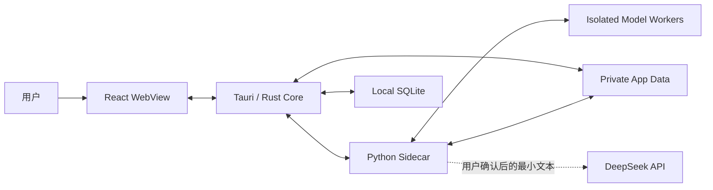
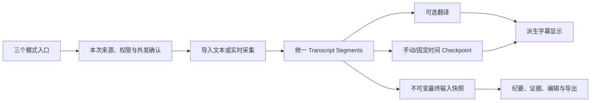
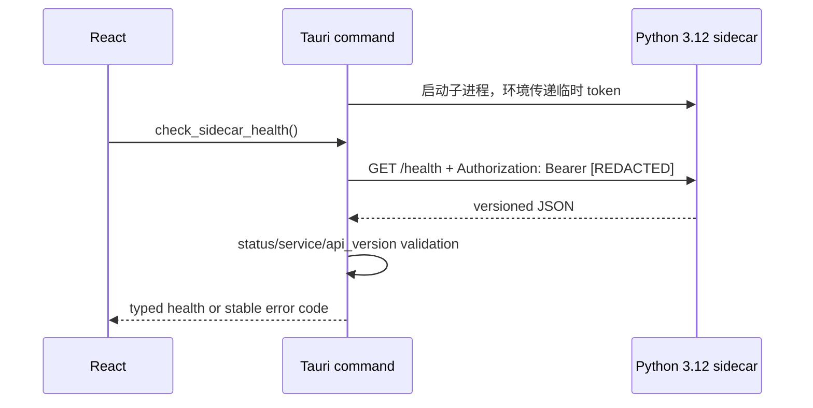
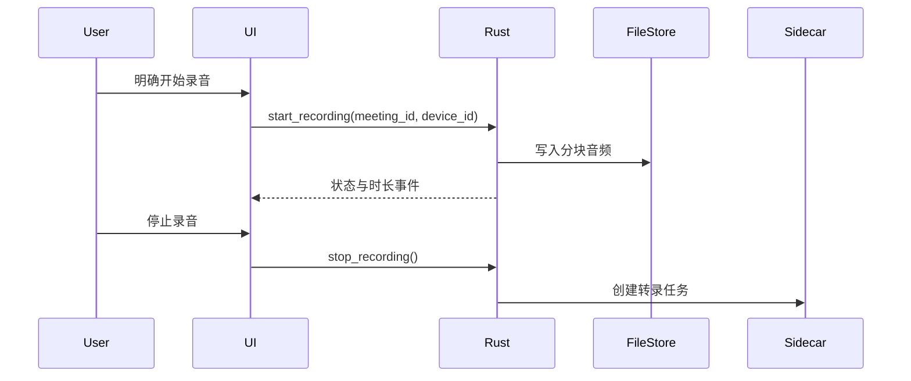
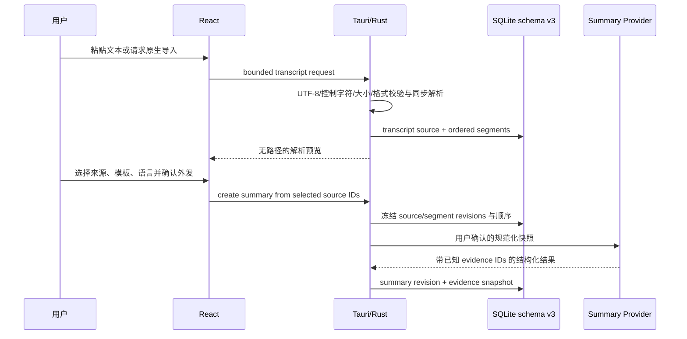
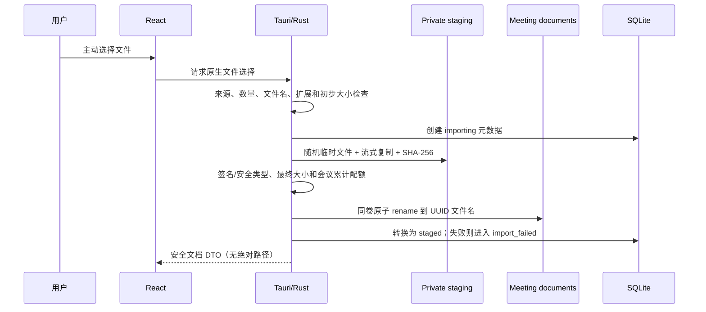
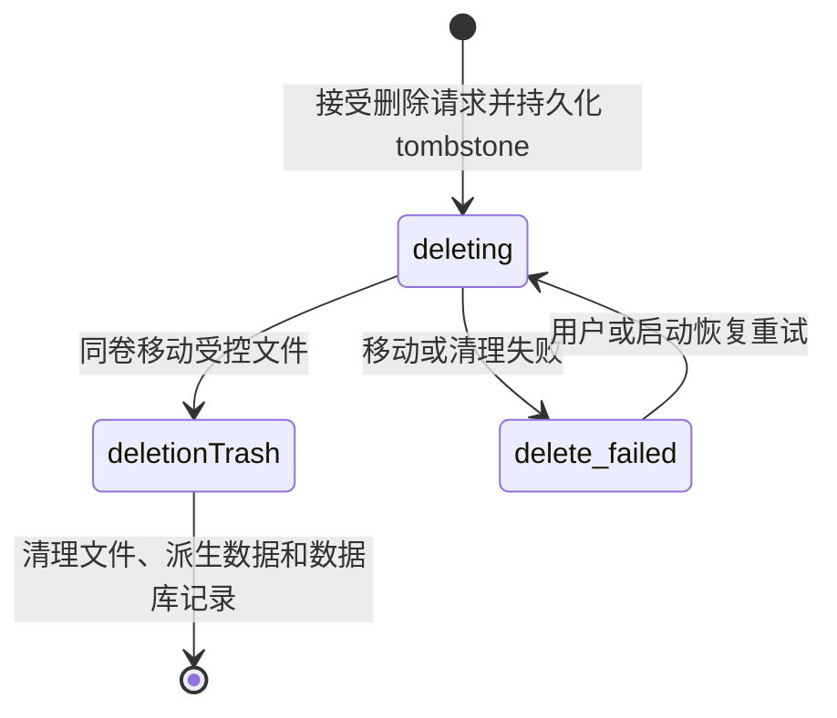

# MeetingLens 架构设计

## 1. 架构目标

MeetingLens 采用“轻量桌面壳 + 本地结构化输入 + 本地处理 sidecar + 隔离模型 worker + 本地数据库 + 可选外部 AI”的结构。Tauri/Rust 控制系统权限、转录导入和进程生命周期，React 负责交互，Python 3.12 sidecar/独立 worker 承载后续重型处理，SQLite 保存结构化元数据。

核心目标是明确权限边界、允许处理模块独立替换，并让原始会议数据默认不离开本机。

三模式产品体验与首轮范围以 `SIMPLIFIED_MODE_SPEC.md` 为准；本文件继续作为共享引擎、信任边界和组件职责的架构权威，两者不得形成第二套实现路线。

总结、翻译和会议模式是同一系统的三个界面预设，不是三个应用或三套后端。模式决定默认来源、开关和布局；统一的 meeting、transcript source/segment、translation、checkpoint、summary snapshot、evidence、consent 和 deletion pipeline 才是持久化真相。

## 2. 系统上下文



### 2.1 三模式共享处理流



翻译是派生显示数据，不作为独立事实或 evidence；最终纪要以原始 segment revision 为准。阶段摘要不得成为最终纪要的唯一输入。模式切换、权限拒绝或可选 Provider 失败时，已有本地转录和人工记录仍可沿共享管线继续处理。

## 3. 组件职责

### 3.1 React WebView

- 显示会议、录音状态、处理进度、转录、翻译和摘要。
- 只通过定义明确的 Tauri commands 访问系统能力。
- 不直接读取 `.env`、SQLite、任意文件路径或操作系统凭据。
- 不直接启动 sidecar，也不持有长期 API key。

界面国际化集中在 `src/i18n`：`i18next` 与 `react-i18next` 在应用入口初始化，`zh-CN`/`en-US` JSON 资源随 Vite bundle 打包，`en-US` 是可靠 fallback，不加载远程语言包。React 页面只使用稳定 translation key；集中 formatters 按当前 UI locale 和用户本地时区显示日期、数字与文件大小。设置页只把允许的 locale 枚举写入 `meetinglens.uiLocale`，不使用 SecretStore 或 SQLite，也不将 UI locale 复用为未来 Summary 输出语言。

### 3.2 Tauri / Rust Core

- 作为 WebView 与本机资源之间的权限边界。
- 管理窗口、文件选择、音频设备权限和应用生命周期。
- 生成每次应用启动的会话令牌，并作为唯一授权调用方管理 Sidecar 通信。
- MVP 1A-3B-1 取得安全传递令牌所需的最小开发 Sidecar 启停所有权；完整打包、监控、崩溃恢复和孤儿进程回收仍属于 `feat/sidecar-supervisor`。
- 通过 Tauri App State 管理 `SecretStore`，并在 Windows 使用当前用户的 Credential Manager；WebView 只能写入、查询配置状态和删除，不能读回值。
- 对 IPC 输入做类型、路径和大小校验。
- 负责数据库迁移、原子写入和删除协调。
- 对麦克风、系统音频、单应用屏幕、保存原始音频和外部数据发送分别维护会话级同意；应用启动不自动申请这些权限。

### 3.3 Python Sidecar

- 提供版本化 loopback API。
- 未来编排转录、隔离文档提取、翻译、说话人分离和摘要预处理；当前只提供认证健康契约，不接收用户文件。
- 任务处理器按接口解耦，单个模型失败不影响其他模块。
- Sidecar 保持无运行时第三方依赖的窄 HTTP 服务；MVP 1A-3B-1 为所有路由增加会话认证，`feat/sidecar-supervisor` 才实现 supervisor、崩溃恢复、孤儿进程回收和 Windows sidecar 打包生命周期。
- Diart、WhisperX 等不兼容模型不得装入同一个 Python 环境，由独立 worker 进程和版本化消息协议隔离。

### 3.4 SQLite 与本地文件

- SQLite 保存元数据、片段、任务状态、摘要和同意事件。
- 大型音频与上传文件保存于应用私有数据目录，数据库只保存受控相对路径和哈希。
- 凭据不进入 SQLite；开发阶段使用已忽略的 `.env`，发布阶段使用系统凭据库。
- 用户源文件保持不变；MeetingLens 使用 document UUID 生成内部文件名，不把源绝对路径或原始文件名用于存储路径拼接。
- 文件导入通过应用私有 staging 目录流式复制并计算 SHA-256，校验成功后在同一卷原子 rename；失败时清理临时文件。
- SQLite schema v2 已新增 `documents` 与统一 `deletion_jobs`；应用持有 `meeting-data/.meetinglens-storage.lock` 的生命周期独占锁，第二个写入实例 fail closed，进程内 mutation mutex 串行化导入、删除与恢复。
- schema v3 已由 PR #18 引入 `transcript_sources` 与 `transcript_segments`。粘贴文本和 TXT/SRT/VTT 使用轻量同步解析器进入 SQLite，不经过 DocumentService、Docling 或 Python Sidecar；原始转录文件首版不长期复制。

### 3.5 外部 AI 适配器

- DeepSeek 是首个翻译/摘要适配器，但业务层依赖统一 provider 接口。
- 适配器只接收用户确认的文本范围，并记录提供商、模型和请求时间，不保存密钥。
- 外部调用失败时保留本地数据和可重试任务，不阻塞会议浏览。
- 默认模型为实时翻译 `deepseek-v4-flash`、最终摘要 `deepseek-v4-pro`；base URL 可配置，默认 `https://api.deepseek.com`。

### 3.6 Provider 契约与 Runtime

MVP 1A-3A 在 React/TypeScript 应用边界定义五类能力契约：Capture、Transcription、Translation、Summary 和 DocumentParser。每个契约明确输入、输出、统一状态、稳定错误、取消和清理行为；页面只通过应用拥有的 `ProviderRegistry` 获取能力，不直接实例化第三方实现。

当前只有确定性的纯内存 Mock Provider：不访问设备、文件系统或网络，不持久化转录/翻译/摘要/文档结果，并在设置页明确标为 Mock/未启用。旧 `MockTranscriptSource` 已迁移为 `MockTranscriptionProvider`，避免两套模拟字幕架构并存。Registry 不是全局单例，可由测试注入或重置，并在应用页面关闭时统一 dispose。

当前 `TranscriptionSegment` 契约仍使用 ISO `startedAt/endedAt`，只服务现有 Mock。`feat/transcript-data-core` 实现前必须将未来持久层/API 时间语义统一为可空 `startOffsetMs/endOffsetMs`，并在 source 上使用可空 `baseStartedAt`；本纯文档阶段不修改 TypeScript。SRT/VTT 与实时 ASR 都归一化为相对毫秒，没有时间戳时以稳定 ordinal 定位证据，不保存两套竞争的时间真相。

本阶段契约只位于 TypeScript，因为尚无真实 Provider RPC。Rust 继续负责系统权限、Tauri command、数据库和未来进程/凭据边界；Python 继续只提供现有 sidecar 健康契约。真实实现出现时再在所属层增加版本化 adapter，不为形式对称提前复制无调用方的 Rust/Python 接口。

未来替换关系保持可选：Screenpipe 只能是 Capture Provider；Whisper/Diart 属于 Transcription Provider；DeepSeek 只能实现 Translation/Summary Provider；Docling 只能实现 DocumentParser Provider。会话认证由 MVP 1A-3B-1 建立；MVP 1A-3B-2 在 Rust 信任边界建立 SecretStore，但不启用真实 DeepSeek Provider；随机端口和完整 supervisor 留在 `feat/sidecar-supervisor`。

## 4. 信任边界

| 边界                    | 高信任侧           | 低信任侧         | 主要控制                                                       |
| ----------------------- | ------------------ | ---------------- | -------------------------------------------------------------- |
| WebView → Rust          | Rust core          | UI 输入          | Tauri capabilities、command allowlist、结构校验                |
| WebView → SecretStore   | Rust core          | API key 输入     | `main` 窗口 permission set、SecretKind 白名单、无读回 command  |
| Native picker → Rust    | Rust core          | 不可信源文件     | allowlist、签名/类型、配额、UUID 路径和流式复制                |
| Transcript input → Rust | Rust core          | 粘贴/TXT/SRT/VTT | 严格 UTF-8、大小/片段上限、控制字符拒绝、同步解析、无执行/网络 |
| Rust → Sidecar          | Rust session owner | 本地 HTTP 进程   | loopback、临时 bearer token、集中 Header、超时                 |
| Rust → Document Worker  | Rust coordinator   | 不可信文档       | 隔离进程、受控相对引用、取消、资源和输出限制                   |
| Audio device → Rust     | Rust core          | 麦克风/系统音频  | 用户手动启停、来源指示、句柄回收、可选保存                     |
| Window/screen → Rust    | Rust core          | 屏幕像素/结构树  | 单应用优先、目标身份复核、本地变化检测、临时帧删除             |
| 本地 → DeepSeek         | 本地数据           | 外部服务         | 明示同意、最小文本、脱敏、TLS、超时                            |

## 5. Sidecar API

### 5.1 Phase 0 健康检查

`GET /health`

```json
{
  "status": "ok",
  "service": "meetinglens-sidecar",
  "version": "0.1.0",
  "api_version": "v1"
}
```

约束：

- 默认绑定 `127.0.0.1`。
- 返回值不包含主机名、路径、环境变量、模型列表或凭据信息。
- 非法路径返回 JSON 404。
- 所有端点（包括 `/health`）都要求每次启动生成的 bearer token。

Phase 0 调用链：



Rust 使用 1 秒连接超时、2 秒总超时、禁止重定向，并且不把底层网络错误、路径、Header 或响应正文回显给 WebView。MVP 1A-3B-1 保留固定开发端口，但锁死 `127.0.0.1` 并启用每次启动轮换的高熵 token；随机端口、打包二进制和完整 supervisor 由 `feat/sidecar-supervisor` 接线。

### 5.2 规划端点

- `POST /v1/jobs/transcribe`
- `POST /v1/jobs/translate`
- `POST /v1/jobs/diarize`
- `POST /v1/jobs/extract-document`
- `POST /v1/jobs/summarize`
- `GET /v1/jobs/{job_id}`
- `DELETE /v1/jobs/{job_id}`

任务请求只传受控 artifact ID 或应用私有目录中的相对引用，不接受任意绝对路径。

## 6. 关键数据流

### 6.1 录音



### 6.2 外部摘要

1. 用户选择 transcript sources/segments、模板和输出语言，并查看发送预览。
2. Rust 验证来源可用性并创建不可变输入快照；当前 meeting 是否为 `ready` 不是唯一门槛。
3. 用户确认外发后，受信任的 Summary adapter 从 Rust SecretStore 取得 key，只发送快照中的规范化文本和必要元数据。
4. 模型输出必须引用快照内已知 evidence ID；未知引用被拒绝或标记，不能由自然语言补造证据。
5. 返回结果连同模型、提示模板版本、输入范围、revision 和 evidence snapshot 写入 SQLite。
6. UI 将 AI 输出标记为可编辑草稿。输入变化可标记 stale；重新生成创建 revision，不能静默覆盖用户编辑。

### 6.3 Meeting command 边界

MVP 1A-2-1 先建立独立的 Meeting Tauri Command API，再由 MVP 1A-2-2 的页面使用。WebView 只调用集中封装的 TypeScript `meetingApi`；Tauri command 负责 DTO 校验和稳定错误映射，再调用 Rust service，command 内不得包含 SQL。

创建会议后状态为 `draft`。`start_meeting` 执行 `draft → recording`，`end_meeting` 在合成会议阶段执行 `recording → ready`；两个生命周期时间戳均由 Rust 以 UTC ISO 8601 写入。`processing` 保留给后续受信任的异步处理流程，普通更新 command 不得修改状态或时间戳。非法转换返回 `meeting_invalid_state`，不得泄漏 SQL、路径或底层数据库错误。

`delete_meeting` 复用 service/deletion coordinator，不在 command 层访问文件系统。`draft`/`ready` 接受请求并持久化 `deleting` tombstone；`recording`、`processing`、`failed`、`archived` 拒绝；`deleting` 返回 `meeting_delete_pending`；`delete_failed` 可重试。文件和删除任务清理完成后才删除数据库记录，失败返回 `meeting_delete_failed`；不存在的会议返回 `meeting_not_found`。

### 6.4 SecretStore command 边界

`SecretKind` 当前只允许 `deepseek_api_key`，并由 Rust 固定映射为 `com.gray.meetinglens/secret/deepseek-api-key`。Windows 后端直接使用 Credential Manager Generic Credential；测试使用随机隔离 target，非 Windows 平台返回 unsupported/unavailable，绝不回退到文件、SQLite 或浏览器存储。

前端只暴露 `get_secret_status`、`set_secret` 和 `delete_secret`。`get_for_backend` 只供未来受信任 Rust Provider 使用，不注册为 Tauri command；当前也不把 key 传给 Python Sidecar。Secret response 只包含配置状态、可用性和固定后端标识，不包含值、target、路径或原生错误。

### 6.5 安全文档存储核心与原生导入边界

MVP 1B-1A 提供受信任 Rust 调用栈复用的 `DocumentService`；MVP 1B-1B 在其上注册六个最小 Document Tauri Commands，并由集中、可 mock 的 TypeScript `documentApi` 使用。文件入口只有 Rust 打开的 MeetingLens 原生文件选择器：React 只发送 meeting/document ID，不传入路径，也不取得对话框或任意文件系统权限；选择结果和源绝对路径只在 Rust 导入调用期间使用，不写入数据库，也不返回 WebView。

`select_and_import_documents` 使用有类型的 Tauri `Channel` 返回每个文件的安全阶段、已处理字节与总字节；终态 response DTO 只包含 document ID、清理后的显示名、检测类型、大小、状态、UTC 时间和稳定错误码。其他 commands 提供 list/get/delete/retry 和固定导入策略。Command 层不包含 SQL、复制或路径拼接，所有最终状态、类型、配额、去重和删除规则仍由 `DocumentService` 执行。

现有 TypeScript `DocumentParserProvider`/`DocumentReference` 和 `MockDocumentParserProvider` 只是 MVP 1A-3A 的纯内存契约，不是文件导入 API，也不授权 WebView 读取 `artifactId` 对应的文件。Mock 中 10,000,000 bytes、255 characters 和少量 MIME 的合成校验不是生产 allowlist/配额；生产边界以 `PRODUCT_SPEC.md` 的 100 MiB、UTF-8 byte 限制和完整 allowlist 为准。PR #14 的 Rust Worker client 只接受受控 staging 根目录内且 size/SHA-256 已注册的私有输入；`feat/document-parsing-orchestration` 再由 document ID 编排该边界。

### 6.6 隔离 Docling Worker 基础

PR #14 将文档解析器放在 `workers/docling` 的独立 Python 3.12/uv lock 环境，而不是现有 HTTP Sidecar。它不监听端口、不读取 SQLite、不注册 Tauri command，也不向 WebView 暴露文件或进程能力。Rust 每次请求启动一个 `python -I -m meetinglens_docling_worker` 子进程，清空继承环境后只加入离线运行所需 allowlist，并通过有界 JSON Lines stdin/stdout 完成一次 health、capabilities 或 parse 操作。

Windows 上子进程在写入请求前加入启用 `KILL_ON_JOB_CLOSE` 与内存上限的 Job Object；成功、失败、取消、150 秒超时或协议异常都会回收完整进程树。Worker 校验输入处于批准 staging 根、是普通文件且匹配已注册 size/SHA-256；固定输出 `document.json`、`content.md`、`content.txt` 和 `manifest.json` 到批准输出根，再由 Rust 重新校验相对路径、大小、总量与 SHA-256。任何绝对路径、UNC、ADS、遍历、未知产物或不匹配都 fail closed。

Docling 运行模式固定为 CPU-only、无远程服务、无插件、无隐式模型下载。模型只能通过显式脚本写入仓库外的版本化应用目录，manifest 固定 layout、TableFormer 和 RapidOCR 来源 revision 并列出每个文件的哈希。缺少、版本不兼容或被修改的模型会返回稳定错误；无模型时 TXT/Markdown/CSV/Office 仍可解析，PDF/图片/OCR fail closed。Worker Foundation 已由 PR #14 合并，但只是后续参考文档增强；`feat/document-parsing-orchestration` 才负责顺序递增的 schema、解析任务、document 状态、产物持久化和 UI 接线，不阻塞 transcript-only Summary。

### 6.7 转录输入与纪要快照边界

粘贴文本由 WebView 作为有界 UTF-8 DTO 交给 Rust；TXT/SRT/VTT 只能由 Rust 原生选择器选择，源绝对路径不返回 WebView、不写 SQLite。解析器只识别文本、明确 `姓名: 内容` 和标准 SRT/VTT cue，不执行 URL/代码/指令，不调用网络或 Docling，不猜测说话人或时间。



转录 source 删除会处理其 segments，但不影响用户原始文件；进行中的 Summary run 继续使用已经冻结的快照。删除后已有 summary 不被静默改写，evidence 保留最小安全摘录、speaker、offset/ordinal 和 revision，并将源链接显示为已删除。segment 修正增加 revision，使依赖旧输入的 summary 可被标记 stale；后台不得静默重新生成。



允许格式和配额以 `PRODUCT_SPEC.md` 为准。扩展名不是唯一判断依据；PDF/PNG/JPEG 使用签名识别，文本格式需拒绝二进制内容，OOXML 只做容器/类型基础识别且在导入阶段不解压。完整 OOXML 结构校验和内容解析留给隔离 Docling Worker。类型不一致、空文件、双重扩展、未知格式或超额输入全部 fail closed。

同一会议内以 SHA-256 识别完全相同的内容：重复导入不创建第二条记录或物理副本，而是返回已有 document ID 和稳定结果。不同会议首版不做物理去重；哈希不代表恶意软件检测。

### 6.8 文件删除协调

MVP 1B-1A 已将同步硬删除演进为持久、幂等、可恢复的协调流程：



接受会议删除后立即进入 `deleting`，冻结编辑、开始、文件集合和纪要任务。协调器枚举原始文档及未来解析、音频、截图、转写、纪要和导出产物，将文件安全移动到应用私有 `deletion-trash`（或实现等价的可恢复边界），成功后才最终删除数据库记录。失败进入 `delete_failed`、保留安全错误码并允许重试；重复请求返回稳定 pending 状态。不得先删数据库再尽力删文件，也不得先删文件再尝试删除数据库。

单文档删除使用同样模式：先进入 `deleting`，成功清理文件和 artifacts 后才移除元数据，失败进入 `delete_failed`。处于 `importing`/`parsing` 的文档必须先取消或等待安全终止。删除永远不影响用户源文件。

## 7. 仓库结构

```text
MeetingLens/
├── src/                       # React + TypeScript UI
│   └── providers/             # Provider 契约、Registry 与纯内存 Mock
├── src-tauri/                 # Tauri/Rust core、data/document service 与 capabilities
│   └── tests/                 # Windows 原生存储 smoke harness（合成文件）
├── sidecar/
│   ├── meetinglens_sidecar/   # Python 服务
│   └── tests/                 # Sidecar 自动化测试
├── workers/docling/           # 独立离线解析 Worker、锁文件与测试
├── scripts/                   # Worker 环境/模型显式准备脚本
├── .github/workflows/         # CI
├── PRODUCT_SPEC.md
├── ARCHITECTURE.md
├── DATA_MODEL.md
├── SECURITY.md
└── DEVELOPMENT_PLAN.md
```

## 8. 进程与打包策略

1. MVP 1A-3B-1 开始，`npm run tauri dev` 由 Rust 启动 Python 3.12 Sidecar，并通过子进程环境传递当前会话 token；WebView 不启动进程也不持有 token。
2. 独立启动仅用于受控协议测试，缺少父进程提供的 token 时必须 fail closed。
3. 发布阶段使用锁定版本并经 Windows 11 验证的打包工具构建 sidecar 二进制。
4. 二进制按 Tauri target triple 命名，并配置到 `bundle.externalBin`。
5. Rust 使用固定程序/module allowlist 启动进程，不允许 WebView 获得任意 shell 执行能力。
6. 当前只在正常窗口/应用退出时终止所拥有的子进程；崩溃恢复、健康监控、重启和孤儿进程回收属于 `feat/sidecar-supervisor`。

Phase 0 不提前写入 `externalBin`，因为仓库尚无可验证的平台二进制；`feat/sidecar-supervisor` 必须在产生可验证 Windows 二进制后再接入。

## 9. 可观测性

- 结构化日志只记录事件类型、任务 ID、耗时、状态码和匿名错误分类。
- 默认不记录转录正文、提示词正文、文件名、参会者、密钥或外部响应全文。
- UI 展示面向用户的错误；开发日志使用 request/correlation ID 串联 Rust 和 sidecar。
- 健康指标包括队列长度、任务耗时、重试次数和 sidecar 重启次数。

## 10. 架构决策

- **Tauri 2 + React + TypeScript**：小型桌面壳、明确 IPC 边界、前端生态成熟。
- **Python sidecar**：便于接入语音和文档处理生态，与 UI/Rust 生命周期解耦。
- **SQLite**：单机事务和迁移简单，适合本地优先元数据。
- **本地 HTTP + 会话令牌**：便于 Python 服务化测试，同时限制未授权本机进程访问。
- **Provider adapter**：避免业务逻辑与 DeepSeek 单点绑定。

### 10.1 实施顺序与模块所有权

| 阶段                                  | 架构交付                                                                                         | 明确不包含                        |
| ------------------------------------- | ------------------------------------------------------------------------------------------------ | --------------------------------- |
| 已完成基础                            | meeting CRUD/API/UI、Provider Mock、Sidecar auth、SecretStore、安全文件导入、隔离 Docling Worker | 真实采集、转录、翻译、总结        |
| 国际化基础（PR #16，已完成）          | 打包 zh-CN/en-US、受限 locale 偏好、Help 和双语预览手册                                          | schema、transcript、Provider      |
| `docs/simplified-three-mode-spec`     | 三模式预设、共享管线、权限和小 PR 边界                                                           | 产品代码                          |
| `feat/transcript-data-core`           | schema v3、转录来源/片段、同步 parser、修正/删除                                                 | UI、外部 Provider                 |
| `feat/transcript-command-api`         | Transcript commands/API、Rust 原生选择器、原子 meeting + transcript 工作流                       | 正式 UI、Summary schema、DeepSeek |
| `feat/summary-mode-input-ui`          | 总结模式入口、粘贴/导入、来源/片段预览和基础修正                                                 | Summary schema、DeepSeek          |
| `feat/summary-run-core`               | Summary run/revision、不可变快照、evidence 与 Mock                                               | SecretStore 消费、网络、正式 UI   |
| `feat/consent-data-core`              | 通用 consent events、会话失效、grant/revoke 与审计 API                                           | 设备、Provider、正式 UI           |
| `feat/summary-provider-deepseek`      | SecretStore、外发同意、受限 adapter、超时/取消                                                   | schema、正式 UI、Docling          |
| `feat/summary-mode-minutes`           | 输入/模板选择、外发预览、结果、evidence 导航和 Markdown                                          | schema、Provider、持久编辑        |
| `feat/summary-editing-export`         | 用户编辑、revision/stale、章节重生成和 DOCX                                                      | 文档解析、实时能力                |
| `feat/document-parsing-orchestration` | Docling parse jobs、状态转换、artifact 原子提交、取消/恢复                                       | Summary 重写、音频                |
| `feat/document-evidence-index`        | document chunks、页码/章节/表格定位和既有 Summary evidence 接线                                  | 重复 transcript/Summary pipeline  |
| `feat/live-session-data-core`         | mode 提示、capture session、音频 artifact/保留与删除协调                                         | 设备、进程、ASR                   |
| `feat/sidecar-supervisor`             | 随机端口、打包、监控、崩溃恢复与孤儿回收                                                         | 音频、ASR                         |
| `feat/audio-capture`                  | 麦克风/系统音频、独立同意、可见状态和资源回收                                                    | schema、ASR、翻译、屏幕           |
| `feat/realtime-transcription`         | 实时 ASR 写入既有 transcript segments                                                            | 翻译 UI、屏幕                     |
| `feat/window-context`                 | 用户确认的窗口身份、accessibility text、暂停与撤销                                               | OCR、说话人、翻译                 |
| `feat/screen-ocr`                     | 变化触发 OCR、screen evidence、临时帧清理                                                        | 说话人、翻译、模式工作区          |
| `feat/live-language-data-core`        | translations、speaker aliases、checkpoint 快照                                                   | 外部 Provider、调度、UI           |
| `feat/speaker-diarization`            | 会话级聚类、姓名校准、人工修改/合并和隔离 worker                                                 | 跨会议默认身份复用                |
| `feat/realtime-translation-provider`  | 最终片段翻译、持续外发同意、取消和脱敏                                                           | schema、checkpoint、正式 UI       |
| `feat/checkpoint-summary-runtime`     | 手动/固定时间增量快照、调度、去重与重试                                                          | 自动话题、正式 UI                 |
| `feat/topic-checkpoints`              | 可确认、忽略或修正的话题边界建议                                                                 | 自动确认决定、正式 UI             |
| `feat/translation-overlay`            | 透明度、收起/展开、滚动、置顶和多显示器交互                                                      | 数据模型、Provider                |
| `feat/translation-mode-workspace`     | 主窗口原文/译文、speaker 修正和 checkpoint UI                                                    | schema、Provider、透明浮窗        |
| `feat/meeting-notes-core`             | 转录范围书签、用户文字笔记和 evidence                                                            | 页面、屏幕、模型调用              |
| `feat/meeting-mode-workspace`         | 重点记录、阶段摘要、最终纪要和翻译开关                                                           | schema、Provider、OCR、自由图表   |
| 后续独立增强                          | 只基于可追溯数据的固定图表与产品体验加固                                                         | 组合成单一大型 PR                 |
| 产品化                                | Windows 打包、签名、升级、诊断和加固                                                             | 新核心业务范围                    |

每一行仍须按 `DEVELOPMENT_PLAN.md` 拆成指定的小型 PR。上游阶段只能通过版本化接口为下游提供能力，不得把下游实现提前塞入当前 PR。

## 11. 依赖兼容性与采用门槛

以下结论基于 2026-07-31 的官方文档、包元数据和锁定依赖。标为已采用的依赖已经通过 Windows 本机编译与测试；其余候选仍须在所属阶段复核。

| 组件            | 候选基线                                | 结论与门槛                                                                                     |
| --------------- | --------------------------------------- | ---------------------------------------------------------------------------------------------- |
| Tauri / Rust    | Tauri `2.11.5`，Tauri build `2.6.3`     | Phase 0 已精确锁定；Windows CI 执行 fmt/test/check。                                           |
| WinCred binding | `windows 0.61.3`                        | 已采用；复用 Tauri lock graph 版本，MIT/Apache-2.0，MSRV 1.74，只启用 Foundation/Credentials。 |
| Secret memory   | `zeroize 1.9.0`                         | 已采用；无运行时依赖，MIT/Apache-2.0，MSRV 1.85，当前 Rust 1.97.1 满足。                       |
| Document hash   | `sha2 0.11.0`                           | 已采用；纯 RustCrypto 实现，MIT/Apache-2.0；只用于完整性与同会议去重。                         |
| OOXML container | `zip 8.6.0`，关闭默认 features          | 已采用；MIT、MSRV 1.88；仅有界读取中央目录元数据，不解压 payload，也不启用压缩后端。           |
| Storage lock    | Rust `std::fs::File::try_lock`          | 已采用；Rust 1.89 稳定 API，Windows 使用原生文件锁，无新增依赖；第二写入实例 fail closed。     |
| Native dialog   | `tauri-plugin-dialog 2.7.2`             | 已采用并精确锁定；MIT/Apache-2.0。只从 Rust 打开选择器，WebView 未获得 dialog/fs permission。  |
| Python          | `3.12.x`                                | 项目统一基线；业务 sidecar 后续不得静默退回其他版本。                                          |
| DeepSeek        | `deepseek-v4-flash` / `deepseek-v4-pro` | 官方当前模型；旧模型名已弃用。启用前复核价格、数据条款和 base URL。                            |
| docling-slim    | `2.117.0`                               | Python 3.12/Windows 独立环境；只启用所需格式、本地模型和 RapidOCR ONNX extras。                |
| Diart           | `0.9.2`                                 | 依赖 `numpy<2`，其参考环境偏向 Python 3.10，并建议旧版 pyannote；不能直接进入主 sidecar。      |
| WhisperX        | `3.8.6`                                 | Python `>=3.10,<3.14`，但要求 `numpy>=2.1`、`pyannote-audio>=4`；与 Diart 当前依赖冲突。       |
| faster-whisper  | `1.2.1`                                 | 可用 CPU int8；GPU 路径要求 CUDA 12/cuDNN 9 并受 CTranslate2 兼容性约束。                      |
| Screenpipe      | app `2.5.139`                           | 上游变化快；商业用途需要单独核验/取得许可。采集接入前必须完成授权与隐私复审。                  |

### 11.1 强制隔离决策

Diart 的 `numpy<2` / 较旧 pyannote 约束与 WhisperX 的 `numpy>=2.1` / pyannote 4 约束不能在同一 Python 环境满足。因此后续采用以下边界：

```text
Tauri/Rust supervisor
└── orchestration sidecar (Python 3.12, lightweight API/database coordination)
    ├── realtime-diarization worker (Diart-compatible locked environment)
    ├── post-meeting-alignment worker (WhisperX-compatible locked environment)
    └── document worker (Docling locked environment, PR #14 complete; product wiring in feat/document-parsing-orchestration)
```

worker 之间只交换受控文件引用和版本化 JSON，不共享 site-packages。每个 worker 必须有独立 lockfile、许可清单、资源上限和合成数据测试。

### 11.2 延后决策

- Screenpipe 只能作为可替换的 Capture Provider；核心窗口选择、权限、事件模型和删除语义不得依赖它。采用前需用户决定商业授权、采集范围和 Windows 资源预算。
- WhisperX 的 diarization 模型可能需要 Hugging Face token 和模型条款同意；不得把该 token 写入配置或仓库。
- Docling 进程基础已由 PR #14 引入；解析持久化和文档 evidence 在 transcript-only Summary、纪要工作区与编辑导出完成后接入，并先于真实音频。第一份 transcript-only 纪要仍分别由 `feat/summary-run-core`、`feat/consent-data-core`、`feat/summary-provider-deepseek` 和 `feat/summary-mode-minutes` 实现，不依赖 Docling。不得在同一 PR 同时改变转录持久化、外部 AI、文档解析编排等信任边界。模型准备必须显式执行，外部 AI 调用仍需对应阶段授权。

### 11.3 Windows 本地验收门槛

CI 负责自动化构建与测试，但不能证明 WebView2 窗口、凭据库、文件对话框、音频设备、权限或进程回收在用户机器上可用。任何涉及上述能力的 PR 必须记录本机 `npm run tauri dev` 及阶段专用验收结果；没有本地证据时只能报告“CI 通过，本地验收待完成”。

## 12. 参考

- [Tauri 2 创建项目](https://v2.tauri.app/start/create-project/)
- [Tauri sidecar 指南](https://v2.tauri.app/develop/sidecar/)
- [Tauri capabilities](https://v2.tauri.app/security/capabilities/)
- [Tauri security](https://v2.tauri.app/security/)
- [Windows Credential Manager APIs](https://learn.microsoft.com/en-us/windows/win32/api/wincred/)
- [Rust `windows` bindings](https://github.com/microsoft/windows-rs)
- [RustCrypto `zeroize`](https://docs.rs/zeroize/1.9.0/zeroize/)
- [DeepSeek 模型与定价](https://api-docs.deepseek.com/quick_start/pricing/)
- [DeepSeek 模型列表](https://api-docs.deepseek.com/api/list-models)
- [Docling](https://github.com/docling-project/docling)
- [Diart](https://github.com/juanmc2005/diart)
- [WhisperX](https://github.com/m-bain/whisperX)
- [faster-whisper](https://github.com/SYSTRAN/faster-whisper)
- [Screenpipe](https://github.com/screenpipe/screenpipe)
