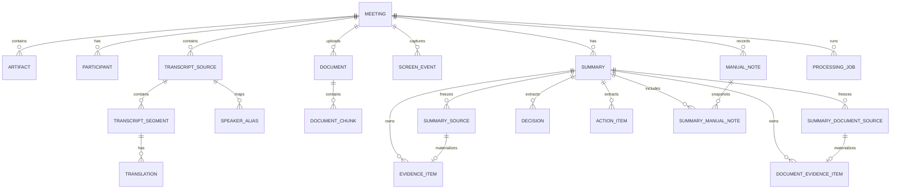

# MeetingLens 数据模型

`fix/transcript-turns` 不修改 schema v7 或既有 migration。识别出的中文说话人/时间导出文本记录 parser_name=`speaker_time_text`、parser_version=`1`，来源类型仍是 pasted_text/imported_txt。普通文本仍为 plain_text/1；规范化原文哈希和重复导入规则不变。发言起始时间写入既有 start_offset_ms，end_offset_ms 保持 NULL，不用下一发言推测结束时间。旧来源、用户修订及 Summary 快照不自动重写。

## 1. 设计原则

MeetingLens 当前采用 Personal Edition 基线，近期只推进总结模式。本文件定义当前已实现的数据真相、状态和删除语义；翻译、实时能力和独立会议模式工作区为 Frozen / Deferred，未来如解冻也不得建立平行模型。

- SQLite 保存结构化状态；大文件保存在应用私有目录。
- 所有主键使用应用生成的 UUID，避免暴露自增规模。
- 事件/实体时间保存为 UTC ISO 8601；转录位置统一保存相对 source/会议基准的毫秒 offset，展示时格式化，不保存两套竞争的时间真相。
- 外键级联只处理结构化引用，不能替代物理文件的可恢复删除协调。
- AI 输出始终带模型、模板版本和来源范围，允许重建与审计。
- API key、access token 和密码不属于业务数据模型，禁止写入数据库。
- 总结、翻译和会议模式的长期愿景只是界面/能力预设，不建立三套实体或状态机；schema v5 只追加 DeepSeek remembered Consent 的最小当前偏好表，schema v6 只扩展 source type 以加入 `imported_audio`，schema v7 只追加文档 chunks/snapshots/evidence 和 Summary 计数，不建立通用事件、会话、任务或企业审计模型。
- 原始音频、规范化逐字稿和会议纪要是三个不同的数据类别，分别拥有同意、保留、导出和删除语义。

## 2. 实体关系



上图同时包含已实现实体和明确标注为计划/Deferred 的概念实体。当前功能分支的 SQLite schema 版本为 v7；`document_chunks`、`summary_document_sources` 和 `document_evidence_items` 已实现，而 `processing_jobs`、screen/manual-note 等仍是 Deferred。`provider_consent_preferences` 是与单个 meeting 无关联的全局当前偏好，因此不画成 meeting 子实体。

## 3. 核心表

### `meetings`

| 字段                   | 类型      | 说明                                                                      |
| ---------------------- | --------- | ------------------------------------------------------------------------- |
| `id`                   | TEXT PK   | UUID                                                                      |
| `title`                | TEXT      | 用户提供的标题                                                            |
| `status`               | TEXT      | `draft/recording/processing/ready/failed/archived/deleting/delete_failed` |
| `primary_language`     | TEXT      | BCP 47 语言标签                                                           |
| `selected_window_json` | TEXT NULL | 用户选定窗口的受控标识/标题快照，不含截图                                 |
| `started_at`           | TEXT NULL | 实际开始时间                                                              |
| `ended_at`             | TEXT NULL | 实际结束时间                                                              |
| `created_at`           | TEXT      | 创建时间                                                                  |
| `updated_at`           | TEXT      | 最近更新时间                                                              |
| `deleted_at`           | TEXT NULL | 软删除/清理协调标记                                                       |
| `deletion_error_code`  | TEXT NULL | 删除失败的稳定安全错误码，不含路径或原始异常                              |

当前 schema v7（该 meeting 结构源自早期 schema，v3–v7 未增加此字段）没有独立、可编辑的会议发生日期字段。`created_at` 只表示 MeetingLens 创建该记录的时间，`started_at/ended_at` 只由真实或模拟会议生命周期写入；总结模式输入 UI 可以将 `created_at` 明确展示为创建时间，但不得把它冒充会议发生日期，也不得提供无法持久化的日期输入。若以后需要 `occurred_at` 或等价语义，必须在对应功能 PR 中定义追加式 migration、API、UI 和验收，不得改写既有 migration。

#### 会议生命周期

会议状态由 Rust service 和专用 Tauri command 控制，普通更新接口只能修改标题、主要语言等可编辑元数据，不得直接写入 `status`、`started_at` 或 `ended_at`。

| 操作                  | 前置状态    | 后置状态    | 时间规则                                    |
| --------------------- | ----------- | ----------- | ------------------------------------------- |
| 创建                  | 不适用      | `draft`     | `started_at`、`ended_at` 均为空             |
| `start_meeting`       | `draft`     | `recording` | Rust 后端写入当前 UTC ISO 8601 `started_at` |
| `end_meeting`（模拟） | `recording` | `ready`     | Rust 后端写入当前 UTC ISO 8601 `ended_at`   |

- MVP 1A-2 的合成会议没有异步处理步骤，因此结束后直接进入 `ready`。
- `processing` 保留给未来受信任的异步处理，只能由后端在建立相应受控状态后进入，WebView 不得自行设置；它不代表实时栈已进入当前路线。
- `failed` 与 `archived` 同样只能通过后续定义的专用 service 操作进入，不属于通用会议更新字段。
- `deleting` 和 `delete_failed` 只由删除协调 service 进入；普通更新、开始、结束、导入和处理接口均不得写入或绕过。
- 重复开始、重复结束、`draft → ready`、`ready → recording` 等非法转换必须原子拒绝，并返回稳定错误码 `meeting_invalid_state`。
- 时间戳由后端生成；前端传入的开始/结束时间不得作为状态转换依据。
- 生命周期相关的非法操作统一使用对外错误码 `meeting_invalid_state`；不得再引入含义重复的 `invalid_state_transition`。

#### 模式提示

当前 schema v7 不持久化模式，总结模式入口只是导航到共享 meeting/transcript 工作区。`workflow_mode` 之类的布局提示不属于当前计划；若未来解冻三模式，只能通过追加式 migration 在对应功能 PR 中评估，且不得决定权限、同意、数据保留或会议状态。

### `artifacts`（Deferred 概念实体，当前 schema v7 不存在）

| 字段            | 类型      | 说明                                 |
| --------------- | --------- | ------------------------------------ |
| `id`            | TEXT PK   | UUID                                 |
| `meeting_id`    | TEXT FK   | 所属会议                             |
| `kind`          | TEXT      | `audio/upload/extracted_text/export` |
| `relative_path` | TEXT      | 应用私有目录内的受控相对路径         |
| `media_type`    | TEXT      | 经检测的 MIME 类型                   |
| `byte_size`     | INTEGER   | 文件大小                             |
| `sha256`        | TEXT      | 内容完整性哈希                       |
| `retention`     | TEXT      | `ephemeral/user_managed/pinned`      |
| `expires_at`    | TEXT NULL | 仅自动到期策略使用的 UTC 时间        |
| `created_at`    | TEXT      | 创建时间                             |

`relative_path` 不接受 `..`、盘符、UNC 或绝对路径。原始文件名只用于用户界面显示，并经过长度与控制字符清理。

实时采集产生的音频 artifact 与其独立 `store_audio` grant 当前为 Deferred；若未来解冻，仍须默认不长期保存，并沿用 `ephemeral/user_managed/pinned` 的明确保留和协调删除语义。当前录音文件批量转写不创建 artifact：原录音只在 Rust 私有 job staging 中短暂复制并在终态清理，最终只持久化既有 transcript source/segments。

### `participants`（Deferred 概念实体）

| 字段                      | 类型      | 说明                          |
| ------------------------- | --------- | ----------------------------- |
| `id`                      | TEXT PK   | UUID                          |
| `meeting_id`              | TEXT FK   | 所属会议                      |
| `diarization_label`       | TEXT      | 例如 `speaker_01`，会议内唯一 |
| `display_name`            | TEXT NULL | 用户主动设置或修正的名称      |
| `voice_sample_path`       | TEXT NULL | 后续说话人增强的受控相对路径  |
| `voice_sample_consent_at` | TEXT NULL | 语音样本授权时间              |
| `created_at`              | TEXT      | 创建时间                      |

语音样本不用于跨会议自动识别，必须允许重录和删除。系统不得在没有独立同意与安全设计时通过声纹映射真实身份。

### `transcript_sources`（schema v3）

转录是独立于参考 `documents` 的一等公民来源。schema v3 由 `feat/transcript-data-core` 引入，schema v6 让录音文件批量转写复用同一 source/segment 模型；未来可能解冻的实时转录也不得创建竞争表。

| 字段                | 类型      | 说明                                                                                         |
| ------------------- | --------- | -------------------------------------------------------------------------------------------- |
| `id`                | TEXT PK   | source UUID                                                                                  |
| `meeting_id`        | TEXT FK   | 所属会议                                                                                     |
| `source_type`       | TEXT      | `pasted_text/imported_txt/imported_srt/imported_vtt/imported_audio/live_asr/platform_export` |
| `display_name`      | TEXT      | 安全显示名称                                                                                 |
| `original_filename` | TEXT NULL | 导入来源的显示文件名；不保存绝对路径                                                         |
| `content_sha256`    | TEXT      | 规范化内容的 SHA-256，用于同会议来源识别/去重，不代表可信或防病毒                            |
| `language`          | TEXT NULL | 可识别/用户指定的 BCP 47 标签                                                                |
| `base_started_at`   | TEXT NULL | UTC ISO 8601 基准；只在需要把相对 offset 映射到绝对时间时使用                                |
| `parser_name`       | TEXT      | 例如 `plain_text/srt/vtt/faster_whisper/live_asr`                                            |
| `parser_version`    | TEXT      | 可复现解析规则版本                                                                           |
| `imported_at`       | TEXT      | 导入或粘贴确认时间                                                                           |
| `created_at`        | TEXT      | 创建时间                                                                                     |
| `updated_at`        | TEXT      | 最近更新时间                                                                                 |

当前实现 `pasted_text/imported_txt/imported_srt/imported_vtt/imported_audio`；`live_asr` 是既有 schema v3 的预留类型，但实时 ASR 当前为 Deferred。schema v6 以追加 migration 重建两张受约束表，将 `imported_audio` 同时加入 live source 与冻结 Summary source type constraint，保留既有行、索引和外键；v1–v5 不改写。`platform_export` 只是保留类型，取得脱敏真实平台样例并实现专用 adapter 前不得对外宣称支持。

`imported_audio` 的 `original_filename` 和 `display_name` 只用于安全显示，不是路径；`parser_name` 固定为 `faster_whisper`，`parser_version` 固定为 `faster-whisper/1.2.1`，`content_sha256` 根据规范化 segments 计算并沿用同 meeting 去重。原 WAV/MP3/M4A/MP4 不持久化、不写 SQLite，源绝对路径和临时路径不进入 DTO/日志。正常、失败和取消终态都会清理 job staging，用户源文件不被修改或删除。

### `transcript_segments`（schema v3）

| 字段              | 类型         | 说明                             |
| ----------------- | ------------ | -------------------------------- |
| `id`              | TEXT PK      | segment UUID                     |
| `meeting_id`      | TEXT FK      | 所属会议                         |
| `source_id`       | TEXT FK      | 所属 `transcript_sources`        |
| `ordinal`         | INTEGER      | source 内从 0 开始的稳定顺序     |
| `speaker_label`   | TEXT NULL    | 来源中明确存在的原始标签         |
| `speaker_name`    | TEXT NULL    | 用户确认或修正后的显示名称       |
| `start_offset_ms` | INTEGER NULL | 相对 source/会议基准的开始毫秒   |
| `end_offset_ms`   | INTEGER NULL | 相对 source/会议基准的结束毫秒   |
| `original_text`   | TEXT         | 原始语言的规范化转录正文         |
| `translated_text` | TEXT NULL    | schema v3 兼容占位；当前始终为空 |
| `language`        | TEXT NULL    | BCP 47 标签                      |
| `confidence`      | REAL NULL    | 0–1，若来源提供                  |
| `is_final`        | INTEGER      | 0/1；导入来源默认为 1            |
| `revision`        | INTEGER      | 从 1 开始；用户修正递增          |
| `created_at`      | TEXT         | 创建时间                         |
| `corrected_at`    | TEXT NULL    | 最近人工修正时间                 |

约束：同一 source 的 `(source_id, ordinal)` 唯一；offset 可空，有值时满足 `start_offset_ms >= 0` 且 `end_offset_ms >= start_offset_ms`。无时间戳来源使用 ordinal 作为证据位置，不推断时间。总结模式导入阶段不创建 `speakers`/`speaker_aliases`，也不强制连接 `participants`；`speaker_label` 保留来源事实，`speaker_name` 保存用户确认。segment 不是 document chunk。schema v3 的 `translated_text` 仅用于稳定 DTO 兼容且当前始终为 `NULL`；若未来解冻实时语言能力，专用 `translations` 才能成为权威译文来源，不得把 Provider 译文写回 segment。

第一版文本输入固定为：粘贴最多 2 MiB、TXT/SRT/VTT 文件最多 10 MiB；音频输入固定为单个 WAV/MP3/M4A/含音轨 MP4、最多 2 GiB/四小时。所有来源每 source 最多 20,000 个 segments、单 segment 正文最多 64 KiB、规范化全文最多 10 MiB。文本严格 UTF-8，拒绝 UTF-16/UTF-32、NUL、孤立 CR 和除 TAB/LF 外的危险 C0 控制字符，CRLF 只规范化为 LF，超限不截断。普通文本只识别明确的 `姓名: 内容`，格式不清时 speaker 为空；SRT/VTT 保留 cue 时间和顺序。`imported_audio` segment 必须有非负且 `end_offset_ms >= start_offset_ms` 的时间范围，`speaker_label/speaker_name/confidence/translated_text` 为 NULL，`is_final=1`；首版不 diarize、不猜测身份或置信度。解析器/Worker runtime 不调用外网，也不执行输入中的 URL、代码或指令。

segment 列表必须由 SQLite 按稳定 `ordinal` 顺序分页，不允许先返回最多 20,000 条再由 React 切片。`feat/summary-mode-input-ui` 使用有界 `limit`（production 最大 200）和不泄漏路径/正文的 cursor 或 offset，请求结果至少包含当页 items、`total_count` 和后续页信息；页面切换或卸载时释放不再需要的数组。

总结模式允许用户为同一 source 中具有相同非空 `speaker_label` 的 segments 批量设置或清空 `speaker_name`。该操作在单事务内只更新目标 meeting/source/label 的 `speaker_name`，每条实际修改记录的 revision 增加并写入 `corrected_at`；`speaker_label`、正文、ordinal、offset 和归属关系保持不变。空字符串不是名称；清空使用明确的 NULL 语义。该便利能力不创建 `speaker_aliases`，不跨 source/meeting，也不推断真实姓名、声纹或身份。

去重哈希使用确定性规范化口径：去除 UTF-8 BOM、把 CRLF 统一为 LF，但不折叠大小写、不删除普通空白、不改写正文；SRT/VTT 对严格解析后的 cue 时间、speaker 与正文序列编码后计算 SHA-256。同一 meeting 的 `(meeting_id, content_sha256)` 唯一，跨 meeting 不去重。哈希只用于内容身份识别，不是信任、杀毒或安全扫描结论。

删除 source 会在同一协调操作中处理其 segments，但不影响用户原始文件。若 source 被 queued/running Summary run 使用，删除稳定拒绝并返回 `transcript_source_in_use`；run 始终读取已持久化的不可变快照。terminal run 不阻塞删除：协调事务先把依赖结果标为 `source_deleted` stale，保留实际引用的 evidence excerpt/speaker/offset/ordinal/revision，再清空 `summary_sources` 中该 source 的完整正文和显示元数据并设置 `redacted_at`，最后删除 live source/segments。修正 segment 增加 revision，并把依赖旧 revision 的 summary 标记 `segment_revised` stale；不得后台静默重新生成。

首版稳定错误包括：`transcript_invalid_input`、`transcript_empty`、`transcript_too_large`、`transcript_segment_too_large`、`transcript_segment_limit_exceeded`、`transcript_invalid_encoding`、`transcript_invalid_format`、`transcript_invalid_timestamp`、`transcript_source_not_found`、`transcript_segment_not_found`、`transcript_already_imported`、`transcript_invalid_state`、`transcript_input_insufficient`、`transcript_persistence_failed`、`transcript_revision_conflict`、`transcript_source_in_use` 和 `internal_error`。错误响应不得包含正文、源路径、文件名、说话人、parser 原始异常或用户目录。

### `screen_events`（Optional / Deferred 概念实体）

该计划实体不属于 schema v3–v6。`feat/window-context` 只有在用户确认确有需要时才启动；屏幕 OCR 与实时 ASR 均为 Deferred。未来若引入屏幕上下文，不得在独立会议工作区中临时复制一套数据模型。

| 字段                     | 类型         | 说明                                           |
| ------------------------ | ------------ | ---------------------------------------------- |
| `id`                     | TEXT PK      | UUID                                           |
| `meeting_id`             | TEXT FK      | 所属会议                                       |
| `captured_at_ms`         | INTEGER      | 相对会议开始的毫秒数                           |
| `window_ref`             | TEXT         | 用户选定窗口的稳定本地引用                     |
| `source_kind`            | TEXT         | `accessibility/ocr/user_note`                  |
| `event_type`             | TEXT         | `slide_change/code_change/decision_text/other` |
| `text`                   | TEXT         | 经确认/脱敏的结构化文字                        |
| `screenshot_artifact_id` | TEXT FK NULL | 临时截图引用，默认在提取后删除                 |
| `created_at`             | TEXT         | 创建时间                                       |

### `documents`

该表已由 schema migration v2 创建。当前 service 完整使用 `importing/staged/parsing/parsed/import_failed/parse_failed/deleting/delete_failed`；只有用户对 `staged` 文档明确启动本地解析才进入 `parsing`。

| 字段                      | 类型         | 说明                                                                                |
| ------------------------- | ------------ | ----------------------------------------------------------------------------------- |
| `id`                      | TEXT PK      | document UUID                                                                       |
| `meeting_id`              | TEXT FK      | 所属会议                                                                            |
| `original_filename`       | TEXT         | 用户原始显示名称；UTF-8 最大 255 bytes，不参与路径拼接                              |
| `safe_extension`          | TEXT         | allowlist 中的规范小写扩展名                                                        |
| `detected_media_type`     | TEXT NULL    | Rust 根据签名/安全类型识别得到的类型；`importing` 初期可为空                        |
| `size_bytes`              | INTEGER NULL | 完成流式复制后确认的大小                                                            |
| `sha256`                  | TEXT NULL    | 完整性和同会议去重哈希；复制完成前可为空，不代表文件可信                            |
| `status`                  | TEXT         | `importing/staged/parsing/parsed/import_failed/parse_failed/deleting/delete_failed` |
| `storage_relative_path`   | TEXT         | 应用私有根目录内的受控相对路径                                                      |
| `imported_at`             | TEXT NULL    | 成功进入 `staged` 的 UTC 时间                                                       |
| `updated_at`              | TEXT         | 最近状态更新时间                                                                    |
| `failure_code`            | TEXT NULL    | 稳定错误码                                                                          |
| `failure_message_safe`    | TEXT NULL    | 可展示的安全消息；不得包含绝对路径、用户名、原始异常或文件内容                      |
| `parser_version_optional` | TEXT NULL    | 解析成功时的 Docling adapter/parser 版本；其他状态为空                              |
| `page_count_optional`     | INTEGER NULL | `parsed` 后可用的页数（1–300）；无页格式可为空                                      |
| `created_at`              | TEXT         | 记录创建时间                                                                        |

源文件绝对路径不得持久化。文件内容不得写入 SQLite BLOB；解析文本和派生 artifacts 使用独立表或受控文件。`meeting_id` 使用外键，但删除不能只依赖 `CASCADE`，必须先协调物理文件。

#### 文档生命周期

| 转换                                    | 所属阶段                              | 规则                                                 |
| --------------------------------------- | ------------------------------------- | ---------------------------------------------------- |
| `importing → staged`                    | MVP 1B-1A                             | 文件完成校验并原子进入正式目录                       |
| `importing → import_failed`             | MVP 1B-1A                             | 复制、类型、配额、完整性或存储失败                   |
| `staged → parsing`                      | `feat/document-parsing-orchestration` | 用户明确启动；Rust 注册 active job 后调用隔离 Worker |
| `parsing → parsed/parse_failed`         | `feat/document-parsing-orchestration` | Rust 复验产物后持久化受控结果或稳定错误              |
| `staged/parsed → deleting`              | MVP 1B-1A 及后续                      | 接受删除请求                                         |
| `import_failed/parse_failed → deleting` | MVP 1B-1A 及后续                      | 清理失败输入或解析产物                               |
| `deleting → 记录消失`                   | MVP 1B-1A                             | 物理文件和关联 artifacts 全部清理成功后才删除元数据  |
| `deleting → delete_failed`              | MVP 1B-1A                             | 清理失败，保留安全错误和可恢复状态                   |
| `delete_failed → deleting`              | MVP 1B-1A                             | 幂等重试                                             |

页面和通用 update 不得直接修改状态。每个用户 parse 请求最多两个 attempt；只有 Worker 明确标记 retryable 的第一次失败可自动重试，其他错误直接进入 `parse_failed`。用户取消使文档回到 `staged`，启动恢复把遗留 `parsing` 转为安全中断的 `parse_failed`，不自动续跑或重放。未知状态 fail closed。

同一会议使用 `(meeting_id, sha256)` 唯一约束识别相同内容。重复时不创建第二条记录或物理副本，返回 `document_already_imported` 和已有 document ID。不同会议首版不做物理去重；文件名不参与重复判断，同名不同内容允许导入，不同名相同内容视为重复。

MVP 1B-1B 的 WebView DTO 只公开 `id`、`meeting_id`、清理后的 `original_name`、`detected_type`、`size_bytes`、`status`、稳定 `failure_code` 和 UTC 时间；明确排除 `storage_relative_path`、SHA-256、内部失败消息及源绝对路径。进度事件只公开当前文件安全显示名、阶段和有界字节计数。未知字段/状态在命令输入或前端解析边界 fail closed。

### `deletion_jobs`

schema v2 使用统一删除任务表协调 meeting/document 的文件清理：`id` 为 UUID，`entity_kind` 只能是 `meeting/document`，并保存受控 `meeting_id`、可选 `document_id`、`pending/failed` 状态、可选 trash 相对路径、0–3 的自动重试计数、安全错误码和 UTC 时间戳。partial unique indexes 保证每个 meeting 或 document 同时最多一个删除任务；实体最终删除时由外键级联移除任务。启动恢复最多自动尝试三次，显式用户重试仍可重新进入 `deleting`。

### `document_chunks`

该表由 append-only schema v7 引入，只保存经 Rust 复验的 Docling protocol-v2/chunk-schema-v1 规范化结果。它不能替代或混入 `transcript_segments`。

| 字段                   | 类型         | 说明                                                       |
| ---------------------- | ------------ | ---------------------------------------------------------- |
| `id`                   | TEXT PK      | chunk UUID                                                 |
| `document_id`          | TEXT FK      | 来源 document UUID                                         |
| `meeting_id`           | TEXT FK      | 与 document 一致的 meeting UUID；与 `document_id` 组合外键 |
| `ordinal`              | INTEGER      | document 内从 0 开始的连续顺序，0–19,999                   |
| `kind`                 | TEXT         | `heading/paragraph/list_item/table`                        |
| `text`                 | TEXT         | 非空 UTF-8 提取正文，最多 64 KiB                           |
| `content_sha256`       | TEXT         | 该规范化 chunk text 的 64 位小写 SHA-256                   |
| `page_start`           | INTEGER NULL | 1–300 的起始页；无页格式可空                               |
| `page_end`             | INTEGER NULL | 与 `page_start` 同时有值且不小于起始页                     |
| `section_path_json`    | TEXT         | 有效 JSON string array，最多 4 KiB；空路径使用 `[]`        |
| `table_ordinal`        | INTEGER NULL | `table` 必须有值，非 table 必须为空                        |
| `parser_version`       | TEXT         | 受限 parser/adapter 版本，最多 64 bytes                    |
| `chunk_schema_version` | INTEGER      | 固定为 `1`                                                 |
| `created_at`           | TEXT         | 原子提交时的 UTC 时间                                      |

`(document_id, ordinal)` 唯一，`(id, document_id, meeting_id)` 作为后续严格关联键。成功解析在单事务中写入完整 chunks 并将 document 转为 `parsed`；失败/取消不留部分 rows。单文档合计正文上限 10 MiB，页数上限 300。

### `evidence_items`

schema v4 的 `evidence_items` 只保存 transcript evidence；schema v7 不重建或改写它，而是用独立 `document_evidence_items` 保存 document evidence。screen 和 manual note evidence 仍属 Deferred。

| 字段                             | 类型         | 说明                                               |
| -------------------------------- | ------------ | -------------------------------------------------- |
| `id`                             | TEXT PK      | Provider 可引用的 evidence UUID                    |
| `summary_id`                     | TEXT FK      | evidence 所属的唯一 Summary run                    |
| `meeting_id`                     | TEXT FK      | 与 Summary/snapshot 一致的会议                     |
| `summary_source_id`              | TEXT FK      | 当前 run 内的 `summary_sources.id`                 |
| `kind`                           | TEXT         | schema v4 固定为 `transcript`                      |
| `source_id_snapshot`             | TEXT         | 当次快照中的 source UUID 值；不是 live source FK   |
| `transcript_segment_id_snapshot` | TEXT         | 当次快照中的 segment UUID 值；不是 live segment FK |
| `segment_revision`               | INTEGER      | run 实际使用的 segment revision                    |
| `label`                          | TEXT         | 面向用户的证据标签                                 |
| `speaker_snapshot`               | TEXT NULL    | 当次 run 使用的安全 speaker 显示快照               |
| `start_offset_ms`                | INTEGER NULL | 证据开始位置；无时间戳时为空                       |
| `end_offset_ms`                  | INTEGER NULL | 证据结束位置                                       |
| `ordinal`                        | INTEGER      | 原 source 内顺序                                   |
| `global_ordinal`                 | INTEGER      | 当次多 source 输入的全局顺序                       |
| `excerpt`                        | TEXT         | 最多 1,024 UTF-8 bytes 的必要摘录                  |
| `source_deleted`                 | INTEGER      | 0/1；来源删除后仍可解释已有纪要                    |
| `created_at`                     | TEXT         | 创建时间                                           |

每条 `summary_sources` 快照行在冻结时获得稳定 UUID，并与 `summary_document_sources` 共同构成仅属于该 run 的 evidence allowlist。Rust Provider 输出必须先完成版本化结构、大小和 allowlist 校验；只有结果实际引用的 ID 才会在同一完成事务中物化到对应 evidence 表。transcript evidence 的复合外键继续绑定 run/meeting/source/segment/revision/ordinal，document evidence 使用对应的快照复合外键。decision/action item 必须至少引用一条 transcript evidence；document 只证明材料内容，不能单独证明会议已达成决定。

UI 的单条 citation 读取必须同时验证 meeting、summary、evidence 三元归属，且 ID 仍被当前 `content_json` 引用；不能为了一个引用读取全部 evidence。用户编辑允许改变 claim 文字但不改变 evidence 绑定，因此 evidence 只证明冻结转录中的原始引用，不证明后续改写已重新经过 Provider 或事实校验。

### `translations`（Frozen / Deferred 概念实体）

| 字段               | 类型      | 说明                             |
| ------------------ | --------- | -------------------------------- |
| `id`               | TEXT PK   | UUID                             |
| `segment_id`       | TEXT FK   | 原始转录片段                     |
| `segment_revision` | INTEGER   | 翻译所依据的片段修订             |
| `target_language`  | TEXT      | 目标语言                         |
| `text`             | TEXT      | 译文                             |
| `provider`         | TEXT      | 本地/外部 provider 标识          |
| `model`            | TEXT NULL | 模型标识，不含凭据               |
| `status`           | TEXT      | `queued/completed/failed`        |
| `error_code`       | TEXT NULL | 稳定错误分类，不含原文或请求正文 |
| `created_at`       | TEXT      | 创建时间                         |
| `updated_at`       | TEXT      | 最近更新时间                     |

同一 segment revision 与目标语言只保留一个结果；原文被用户修正后必须为新的 segment revision 创建新译文，读取时只选择与当前 revision 精确匹配的记录，旧记录仅作历史且不得继续显示为当前译文。翻译模式只消费已经确定的转录片段，partial ASR 结果不得进入最终纪要快照。

### `speaker_aliases`（Frozen / Deferred 概念实体）

| 字段           | 类型      | 说明                       |
| -------------- | --------- | -------------------------- |
| `id`           | TEXT PK   | UUID                       |
| `meeting_id`   | TEXT FK   | 所属会议                   |
| `source_id`    | TEXT FK   | 标签所属转录来源           |
| `source_label` | TEXT      | ASR/导入来源的原始匿名标签 |
| `display_name` | TEXT NULL | 用户在本场会议设置的显示名 |
| `revision`     | INTEGER   | 从 1 开始，改名时递增      |
| `created_at`   | TEXT      | 创建时间                   |
| `updated_at`   | TEXT      | 最近更新时间               |

`(source_id, source_label)` 唯一。若未来解冻实时工作区，只能通过该映射统一显示改名，不能批量覆写历史 segment 的原始 `speaker_label`；默认不跨会议复用名称或身份。它不属于 schema v3–v6，当前不安排独立 live-language 或 speaker-diarization 数据阶段。

### `manual_notes`（Frozen / Deferred 概念实体）

| 字段               | 类型         | 说明                             |
| ------------------ | ------------ | -------------------------------- |
| `id`               | TEXT PK      | UUID                             |
| `meeting_id`       | TEXT FK      | 所属会议                         |
| `kind`             | TEXT         | `bookmark/text`                  |
| `start_segment_id` | TEXT FK NULL | 书签引用的起始最终片段           |
| `end_segment_id`   | TEXT FK NULL | 书签引用的结束最终片段           |
| `body`             | TEXT NULL    | 用户主动输入的文字，不由模型伪造 |
| `created_at`       | TEXT         | 创建时间                         |
| `updated_at`       | TEXT         | 最近更新时间                     |

`bookmark` 至少引用一个当前会议的最终 segment；`text` 必须包含通过长度/控制字符校验的正文。两者都可进入最终快照并生成 `manual_note` evidence，但必须保留来源类型，不能伪装成会议已确认的原始发言。

### `summaries`

纪要拥有独立于 `meeting.status` 的运行与修订生命周期。schema v4 状态固定为 `queued/running/completed/failed/cancelled`；PR #21 已合并的 Summary Run Core 只创建 `run_purpose=final`、`trigger_kind=manual`。只要用户选择的输入可以原子冻结，`draft`、`recording` 或 `ready` 均可创建 run；`deleting`、`delete_failed`、空输入或无法安全冻结的输入拒绝。不要新增 `content_ready`、`source_ready` 或 `summarized` meeting 状态。

| 字段                                | 类型      | 说明                                                      |
| ----------------------------------- | --------- | --------------------------------------------------------- |
| `id`                                | TEXT PK   | run UUID                                                  |
| `meeting_id`                        | TEXT FK   | 所属会议                                                  |
| `series_id`                         | TEXT      | 同一纪要重生成序列的稳定 UUID                             |
| `previous_summary_id`               | TEXT NULL | revision > 1 时的直接前一 run                             |
| `revision`                          | INTEGER   | 同一 series 中从 1 开始的修订号                           |
| `previous_revision`                 | INTEGER   | 由 `revision - 1` 生成的内部直接前驱约束列                |
| `run_purpose`                       | TEXT      | `checkpoint/final`；当前 service 固定 `final`             |
| `trigger_kind`                      | TEXT      | `manual/interval/topic/final`；当前 service 固定 `manual` |
| `meeting_title_snapshot`            | TEXT      | 冻结的会议标题                                            |
| `meeting_primary_language_snapshot` | TEXT      | 冻结的会议主语言                                          |
| `template`                          | TEXT      | `detailed/concise/actions_decisions`                      |
| `output_language`                   | TEXT      | `zh/en/bilingual`                                         |
| `status`                            | TEXT      | 独立 Summary run 状态                                     |
| `provider`                          | TEXT      | production 固定 `deepseek`；历史 Mock 值继续可读          |
| `provider_mode`                     | TEXT      | production 固定 `external`；历史 Mock 为 `mock`           |
| `model`                             | TEXT      | production 固定 `deepseek-v4-pro`                         |
| `prompt_version`                    | TEXT      | 提示/结果契约版本                                         |
| `content_json`                      | TEXT NULL | 完成后写入、最大 1 MiB 的版本化结构化结果                 |
| `error_code`                        | TEXT NULL | 失败时的稳定安全错误码                                    |
| `source_count`                      | INTEGER   | 冻结的来源数                                              |
| `input_segment_count`               | INTEGER   | 冻结的 final segment 数，1–20,000                         |
| `input_bytes`                       | INTEGER   | 冻结正文 UTF-8 bytes，1–10 MiB                            |
| `document_count`                    | INTEGER   | 已选已解析 reference document 数，0–20                    |
| `input_document_chunk_count`        | INTEGER   | 冻结 document chunk 数，0–20,000                          |
| `document_input_bytes`              | INTEGER   | 冻结 document chunk 正文 UTF-8 bytes，0–10 MiB            |
| `is_stale`                          | INTEGER   | 0/1；live 输入后续变化                                    |
| `stale_reason`                      | TEXT NULL | `segment_revised/source_deleted`                          |
| `stale_at`                          | TEXT NULL | 首次标记 stale 的时间                                     |
| `is_user_edited`                    | INTEGER   | 0/1；第一次实际正文变更后置 1，并保持 sticky              |
| `snapshot_created_at`               | TEXT      | 快照冻结完成时间                                          |
| `created_at`                        | TEXT      | run 创建时间                                              |
| `started_at`                        | TEXT NULL | 开始执行时间                                              |
| `finished_at`                       | TEXT NULL | terminal 时间                                             |
| `cancel_requested_at`               | TEXT NULL | 取消请求时间                                              |
| `updated_at`                        | TEXT      | 最近状态更新时间                                          |

`(series_id, revision)` 唯一，同一 series 同时最多一个 queued/running run；revision 1 没有 previous，后续 revision 的四列复合自外键把 `previous_summary_id` 约束为同一会议、同一 series、恰好前一 revision。Rust Service 在 IMMEDIATE 事务内额外保证 parent 已终态且仍是 latest，并重新冻结当前 live revisions，不能覆盖旧结果。状态字段与 result/error/timestamp 使用组合 `CHECK`：只有 completed 可含 `content_json`，failed 必须含安全 `error_code`，terminal 必须有 `finished_at`。正常状态机是 `queued → running → completed/failed/cancelled` 和 `queued → cancelled`；启动恢复把遗留 `running` 原子转为 `failed + summary_interrupted`，不自动重放 Provider。

schema v7 不改变 `content_json` 的版本化 schema v1，仍固定为五区：`overview`、`decisions`、`actionItems`、`risks`、`openQuestions`。Summary 必须至少冻结一个 transcript segment；document 只是默认未选的可选 reference。`input_segment_count + input_document_chunk_count <= 20,000`，`input_bytes + document_input_bytes <= 10 MiB`。受限保存仍只 overlay 现有正文和 action item owner/due date，保留 evidence ID、item status、顺序、schema、lineage 与 Provider 元数据，并原位更新当前 completed DeepSeek revision。第一次实际变更设置 `is_user_edited=1`；同一 revision 不另存 Provider 原稿、编辑历史或恢复点。

Rust 从规范 typed `SummaryContent` JSON 字节派生 SHA-256 `contentVersion`（64 位小写 hex），completed 响应返回该值，其他状态返回 null。编辑、Markdown 获取和保存必须提交当前 `expectedContentVersion`；事务内重读、版本比较和 SQL CAS 防止静默覆盖。`contentVersion` 不写入 SQLite；schema v7 没有改变该编辑契约。

历史 `deterministic_mock` 结果可读并可生成 Markdown，但严格只读；不能编辑或成为 DeepSeek revision 的 parent。整份重新生成只允许 series 中 latest terminal DeepSeek revision，重新冻结当前 live transcript 与当次明确选择的 parsed documents，而不读取用户编辑后的 `content_json`。历史同 provider/mode/model 的 `summary-deepseek-v1` terminal run 仍可作 parent；旧 revision 保留 v1 provenance，新 child 固定使用 `summary-deepseek-v2` 并冻结当前范围。`source_deleted` 阻止同 series regenerate；`segment_revised` 允许用户明确创建下一 revision。

schema v4 的通用快照约束仍允许最多 10 MiB，以保持已存在 run 可读；当前 production DeepSeek policy 只允许 1 MiB。读取历史或已经冻结的较大 run 不因新策略而损坏，但执行超过 DeepSeek 上限的 run 在网络前以 `summary_provider_input_too_large` fail closed。

Summary run 和 evidence 列表均使用有界 keyset 分页，默认 50、最大 100；run cursor 是上一页最后一个 run UUID，排序固定为 `created_at DESC, id ASC`，evidence cursor 是上一页最后一个 `global_ordinal`。Tauri wire DTO（包括嵌套结构化结果）统一 camelCase。并发 stale base 返回 `summary_revision_conflict`，未知、重复或跨 run evidence 返回 `summary_evidence_invalid`。

Checkpoint 功能当前为 Frozen / Deferred。若未来解冻，仍首先只允许 `manual` 和 `interval`；`topic` 只能是可修正建议，不得仅由屏幕变化触发。`final` run 必须重新冻结原始转录片段，不能把 checkpoint 摘要当作唯一事实来源。该冻结不修改 schema v4 已有的 `run_purpose`/`trigger_kind` 约束。

### `summary_sources`

`summary_sources` 每行是一个真实持久化的 transcript segment snapshot，而不是指向会原位更新或删除的 live segment。`source_id_snapshot`/`segment_id_snapshot` 保留历史 UUID 值但不建立 live FK，避免 source 删除级联破坏历史 run。

| 字段                              | 类型         | 说明                                                     |
| --------------------------------- | ------------ | -------------------------------------------------------- |
| `id`                              | TEXT PK      | snapshot row UUID，也是当前 run 的 evidence allowlist ID |
| `summary_id`                      | TEXT FK      | 所属 Summary run                                         |
| `meeting_id`                      | TEXT FK      | 与 Summary 一致的会议                                    |
| `source_id_snapshot`              | TEXT         | 冻结的 source UUID 值                                    |
| `segment_id_snapshot`             | TEXT         | 冻结的 segment UUID 值                                   |
| `segment_revision`                | INTEGER      | 快照使用的 revision                                      |
| `source_ordinal`                  | INTEGER      | 用户选择来源的稳定顺序                                   |
| `segment_ordinal`                 | INTEGER      | 原 source 内顺序                                         |
| `global_ordinal`                  | INTEGER      | 多 source run 内顺序                                     |
| `source_type_snapshot`            | TEXT         | 冻结的来源类型                                           |
| `source_display_name_snapshot`    | TEXT NULL    | 冻结的安全显示名；显式 source 删除后清空                 |
| `source_language_snapshot`        | TEXT NULL    | 冻结的 source language                                   |
| `source_base_started_at_snapshot` | TEXT NULL    | 冻结的可选 source 时间基准                               |
| `speaker_label_snapshot`          | TEXT NULL    | 来源原始 speaker label                                   |
| `speaker_name_snapshot`           | TEXT NULL    | 当次用户确认的显示名称                                   |
| `start_offset_ms_snapshot`        | INTEGER NULL | 冻结的开始 offset                                        |
| `end_offset_ms_snapshot`          | INTEGER NULL | 冻结的结束 offset                                        |
| `original_text_snapshot`          | TEXT NULL    | 实际复制的规范化正文；显式 source 删除后清空             |
| `language_snapshot`               | TEXT NULL    | segment BCP 47 language                                  |
| `confidence_snapshot`             | REAL NULL    | 0–1                                                      |
| `is_final_snapshot`               | INTEGER      | schema v4 固定为 1                                       |
| `snapshot_at`                     | TEXT         | 当次复制时间                                             |
| `source_deleted`                  | INTEGER      | 0/1                                                      |
| `redacted_at`                     | TEXT NULL    | 显式删除触发的安全清理时间                               |

同一 run 的 `(segment_id_snapshot, segment_revision)` 与 `global_ordinal` 分别唯一。schema v7 仍要求至少一个 final transcript segment，并在 transcript + document 合并范围上执行 20,000 items/10 MiB 上限，超限整体拒绝、不截断。Rust Provider 只能从这些 run-owned snapshots 重建请求，不能重新读取 live segment/chunk。segment 后续修正只标记依赖旧 revision 的 summary stale；显式 source 删除是唯一允许清理 snapshot 正文和显示元数据的例外，已完成结果与实际引用的最小 evidence 不被静默改写。

### `summary_document_sources` （schema v7）

每行是一个 run-owned document chunk 不可变快照，不建立指向 live `documents/document_chunks` 的外键。transcript `summary_sources.global_ordinal` 始终在前，document global ordinal 从冻结 transcript count 继续。

| 字段                             | 类型         | 说明                                                |
| -------------------------------- | ------------ | --------------------------------------------------- |
| `id`                             | TEXT PK      | snapshot UUID，同时是 Provider 可引用的 evidence ID |
| `summary_id`                     | TEXT FK      | 所属 Summary run                                    |
| `meeting_id`                     | TEXT FK      | 与 Summary 一致的 meeting                           |
| `document_id_snapshot`           | TEXT         | 历史 document UUID 值；不是 live FK                 |
| `document_chunk_id_snapshot`     | TEXT         | 历史 chunk UUID 值；不是 live FK                    |
| `document_ordinal`               | INTEGER      | 已选 document 顺序，0–19                            |
| `chunk_ordinal`                  | INTEGER      | 文档内 ordinal，0–19,999                            |
| `global_ordinal`                 | INTEGER      | 合并输入全局顺序，0–19,999                          |
| `chunk_kind_snapshot`            | TEXT         | `heading/paragraph/list_item/table`                 |
| `document_display_name_snapshot` | TEXT NULL    | 冻结安全显示名；文档删除后清空                      |
| `document_sha256_snapshot`       | TEXT         | 冻结 document SHA-256                               |
| `chunk_sha256_snapshot`          | TEXT         | 冻结 chunk text SHA-256                             |
| `page_start_snapshot`            | INTEGER NULL | 冻结起始页                                          |
| `page_end_snapshot`              | INTEGER NULL | 冻结结束页                                          |
| `section_path_json_snapshot`     | TEXT NULL    | 冻结 JSON string array；文档删除后清空              |
| `table_ordinal_snapshot`         | INTEGER NULL | 冻结 table ordinal                                  |
| `parser_version_snapshot`        | TEXT         | 冻结 parser version；删除后保留                     |
| `chunk_schema_version_snapshot`  | INTEGER      | 固定为 `1`                                          |
| `text_snapshot`                  | TEXT NULL    | 完整冻结 chunk 正文；文档删除后清空                 |
| `snapshot_at`                    | TEXT         | 快照时间                                            |
| `source_deleted`                 | INTEGER      | 0/1                                                 |
| `redacted_at`                    | TEXT NULL    | 文档删除脱敏时间                                    |

同一 run 的 `document_chunk_id_snapshot` 与 `global_ordinal` 分别唯一。`source_deleted=0` 时 display name/section path/text 必须存在且 `redacted_at` 为空；删除后三者必须清空、`source_deleted=1` 且记录 `redacted_at`。哈希、parser/chunk schema 与必要 locator provenance 保留。

### `document_evidence_items` （schema v7）

| 字段                         | 类型         | 说明                                         |
| ---------------------------- | ------------ | -------------------------------------------- |
| `id`                         | TEXT PK      | 必须等于 `summary_document_source_id`        |
| `summary_id`                 | TEXT FK      | 所属 Summary run                             |
| `meeting_id`                 | TEXT FK      | 与 Summary/snapshot 一致                     |
| `summary_document_source_id` | TEXT FK      | 被引用的 run-owned document snapshot         |
| `kind`                       | TEXT         | 固定 `document`                              |
| `document_id_snapshot`       | TEXT         | 冻结 document UUID                           |
| `document_chunk_id_snapshot` | TEXT         | 冻结 chunk UUID                              |
| `label`                      | TEXT         | 安全文档证据标签                             |
| `parser_version_snapshot`    | TEXT         | 解析 provenance                              |
| `page_start` / `page_end`    | INTEGER NULL | 可选页码范围                                 |
| `section_path_json`          | TEXT         | 有效 JSON string array                       |
| `table_ordinal`              | INTEGER NULL | 表格 locator；非表格为空                     |
| `ordinal`                    | INTEGER      | 原文档 chunk ordinal                         |
| `global_ordinal`             | INTEGER      | 合并输入全局顺序                             |
| `excerpt`                    | TEXT         | 实际引用的非空摘录，最多 1,024 UTF-8 bytes   |
| `source_deleted`             | INTEGER      | 0/1；删除后 locator/excerpt 仍可解释历史结果 |
| `created_at`                 | TEXT         | 物化时间                                     |

严格复合外键绑定 snapshot ID、summary、meeting、document/chunk 历史 ID、chunk/global ordinal，防止跨 run/meeting 伪造。UI 以 tagged union 区分 transcript/document evidence，不根据可选字段猜测 kind。

### `summary_manual_notes`（Frozen / Deferred 概念实体）

| 字段             | 类型    | 说明                           |
| ---------------- | ------- | ------------------------------ |
| `summary_id`     | TEXT FK | Summary run/revision           |
| `manual_note_id` | TEXT FK | 被冻结的用户书签或文字笔记     |
| `note_revision`  | INTEGER | 快照使用的笔记修订             |
| `ordinal`        | INTEGER | 当次输入顺序                   |
| `relation`       | TEXT    | `supports/contradicts/context` |

`summary_sources` 只冻结 transcript segments；不得把 manual note ID 塞入 transcript source/segment 字段。若未来解冻会议重点能力，只能通过本专用关联把用户笔记纳入同一 Summary run，并生成 `manual_note` evidence。

### `decisions`（Deferred 概念实体）

| 字段               | 类型         | 说明                            |
| ------------------ | ------------ | ------------------------------- |
| `id`               | TEXT PK      | UUID                            |
| `summary_id`       | TEXT FK      | 来源摘要                        |
| `description`      | TEXT         | 决策内容                        |
| `status`           | TEXT         | `proposed/confirmed/superseded` |
| `evidence_item_id` | TEXT FK NULL | 可核验证据                      |
| `is_user_edited`   | INTEGER      | 0/1                             |
| `created_at`       | TEXT         | 创建时间                        |

### `action_items`（Deferred 概念实体）

| 字段                | 类型         | 说明                         |
| ------------------- | ------------ | ---------------------------- |
| `id`                | TEXT PK      | UUID                         |
| `summary_id`        | TEXT FK      | 来源摘要                     |
| `description`       | TEXT         | 行动描述                     |
| `owner_label`       | TEXT NULL    | 文本标签，不强制映射真实身份 |
| `due_at`            | TEXT NULL    | 用户确认后的截止时间         |
| `status`            | TEXT         | `open/done/dismissed`        |
| `source_segment_id` | TEXT FK NULL | 可核验来源                   |
| `evidence_item_id`  | TEXT FK NULL | 转录/文档/屏幕的统一证据引用 |

### `processing_jobs`（Deferred 通用调度概念）

当前 schema v7 不包含通用处理任务调度器。audio transcription 和 document parsing job 只存在于 Rust 进程内，终态状态只用于安全 DTO/清理，不持久化到本表。Docling 只保留 document status/failure 作为恢复真相，不保存 attempt history、checkpoint 或调度队列。

| 字段            | 类型      | 说明                                             |
| --------------- | --------- | ------------------------------------------------ |
| `id`            | TEXT PK   | UUID                                             |
| `meeting_id`    | TEXT FK   | 所属会议                                         |
| `job_type`      | TEXT      | `transcribe/translate/diarize/extract/summarize` |
| `status`        | TEXT      | `queued/running/succeeded/failed/cancelled`      |
| `progress`      | REAL      | 0–1                                              |
| `attempt_count` | INTEGER   | 已尝试次数                                       |
| `input_json`    | TEXT      | 只含 ID 和安全参数                               |
| `error_code`    | TEXT NULL | 稳定错误分类，不含敏感正文                       |
| `created_at`    | TEXT      | 创建时间                                         |
| `started_at`    | TEXT NULL | 开始时间                                         |
| `finished_at`   | TEXT NULL | 结束时间                                         |

### `provider_consent_preferences`（schema v5）

| 字段                 | 类型    | 说明                                                              |
| -------------------- | ------- | ----------------------------------------------------------------- |
| `provider`           | TEXT PK | 当前只允许 `deepseek`；每个 Provider 最多一行当前 remembered 偏好 |
| `policy_version`     | TEXT    | 当前固定 `deepseek-summary-input-external-v2`                     |
| `policy_fingerprint` | TEXT    | 64 位小写 SHA-256，覆盖 Provider/host/model/version/数据类别顺序  |
| `consented_at`       | TEXT    | 用户记住选择的 UTC 时间                                           |
| `updated_at`         | TEXT    | 最近更新 UTC 时间，且不早于 `consented_at`                        |

该表只表示当前 remembered Consent，不是事件或审计日志。它不保存 summary/meeting/source/document ID、transcript/document text、evidence excerpt、Prompt、Provider response、API Key、SecretStore target 或路径；撤销即删除该行。v2 fingerprint 按固定顺序覆盖 transcript text、speaker、time offsets、document text、document structure/locations、evidence IDs、template 和 output language；任何 v1 remembered row 不再授权。一次性确认不写入 SQLite：它按 summary run 绑定，在 Rust 进程内最多保留 10 分钟、只能消费一次且应用重启后失效；撤销同时清除所有尚未消费的一次性确认。没有有效确认时执行 fail closed。

该设计只面向单人 Personal Edition，不足以作为团队、客户或公众分发时的企业合规审计体系；不得据此恢复独立 `feat/consent-data-core` 或通用 `consent_events`。

## 4. SQLite 约束与索引

- 启用 `PRAGMA foreign_keys = ON`。
- 使用 WAL 时，`.db-wal` 和 `.db-shm` 必须保持本地且被 Git 忽略。
- schema v2 已建立 `idx_documents_meeting_status`、`idx_documents_meeting_sha256`、两个 deletion job partial unique indexes 和 `idx_deletion_jobs_status`。
- schema v3 已建立 `transcript_sources`/`transcript_segments` 及同会议来源哈希、source ordinal、meeting/source 查询索引。
- schema v4 已由 PR #21 的 Summary Run Core 创建 `summaries`、`summary_sources` 和 transcript-only `evidence_items`。关键索引包括 `(series_id, revision)` 唯一约束、direct-previous lineage、每个 series 最多一个 active run 的 partial unique index、meeting/created、status/updated、meeting/stale、live source/segment snapshot 查询以及 evidence 的 summary/global ordinal 查询。
- schema v5 追加无 rowid 的 `provider_consent_preferences`；`provider` 主键与固定值约束使当前只存在一行 DeepSeek remembered 偏好，不增加正文索引或通用 Consent 关系。
- schema v6 事务性重建 `transcript_sources` 与 `summary_sources` 的类型约束以加入 `imported_audio`，逐行复制并验证全部既有数据，恢复原索引/外键；不增加新表或索引。升级 checksum、rollback、integrity 与 foreign-key 检查必须覆盖 v5→v6。
- schema v7 追加 `documents(id, meeting_id)` 唯一索引、`document_chunks` 的 meeting/document/ordinal 索引、`summary_document_sources` 的 summary order/live document 索引，以及 `document_evidence_items` 的 summary order/source 索引。复合外键把 document/chunk/summary/evidence 归属绑定在同一 meeting/run；升级验收覆盖 v6→v7。
- `documents(meeting_id, sha256)` 对非 NULL 哈希使用唯一约束，确保同一会议内容去重；跨会议不共享物理副本。
- 状态字段使用 `CHECK` 约束或迁移层枚举校验。
- 所有迁移在事务中执行，并在 schema 版本表中记录。

## 5. 文件布局

```text
app-data/
├── meetinglens.sqlite3
└── meeting-data/
    ├── meetings/<meeting-id>/
    │   ├── documents/<document-id>.<safe-extension>
    │   └── artifacts/                             # Deferred 概念目录
    ├── staging/<random-import-id>.tmp
    ├── audio-transcription-staging/
    │   ├── inputs/<job-id>/                       # Ephemeral：终态清理
    │   ├── outputs/<job-id>/                      # Ephemeral：终态清理
    │   └── work/<job-id>/                         # Ephemeral：终态清理
    ├── document-parser-staging/<attempt-id>/          # Ephemeral：每 attempt 终态/启动清理
    ├── deletion-trash/<deletion-id>/
    └── .meetinglens-storage.lock

%LOCALAPPDATA%/MeetingLens/transcription/models/
└── small-<pinned-revision>/                        # 显式 provision、仓库外、manifest/hash 验证

%LOCALAPPDATA%/MeetingLens/docling/models/2.117.0/
└── meetinglens-docling-models.json + pinned files # 显式 provision、仓库外、runtime offline
```

当前已实现布局包括 SQLite、受控 documents、document import/parser staging、audio job staging、deletion-trash、storage lock 和仓库外 transcription/Docling models；通用 artifacts 行仍是 Deferred 概念。audio/document parser staging 均不属于持久 meeting artifact：只有 opaque UUID job/attempt 目录，正常/失败/取消后清理，启动时协调删除遗留目录。Docling 模型固定位于 `%LOCALAPPDATA%\MeetingLens\docling\models\2.117.0`，明确不放在普通 app-data/meeting-data 或仓库。Markdown Save As 直接写入用户在原生对话框中选择的应用外位置，不创建内部 export 实体、目录或数据库路径。数据库保存相对于 `app-data` 的受控路径；本 PR 不移动现有 SQLite。任何私有文件访问必须先解析、规范化并确认最终路径仍位于批准根目录内。目标路径只由 Rust 使用 meeting/document/job UUID 构造；原始文件名不能参与路径拼接。拒绝 `..`、绝对路径、盘符、UNC、Alternate Data Streams 和任何逃逸结果。

导入在 `staging` 中创建随机临时文件，流式复制并同时计算 SHA-256；尽早检查声明大小，复制中超过限制立即停止并清理。最终大小、类型和会议累计配额验证成功后，使用同卷原子 rename 进入 `documents`。不把用户文件长期放在 Temp、Git 仓库或当前工作目录，不设置可执行权限，也不调用 Windows 文件关联程序。源文件保持不变。

Markdown 保存不是应用内 artifact 生命周期：Rust 使用当前 `contentVersion` 生成 canonical UTF-8/LF bytes，打开原生 Save As，在用户所选目录创建随机临时普通文件，经 reparse/symlink 防护、flush/sync 后原子替换 `.md` 目标，并在失败时清理临时文件。React 不传入或接收路径，SQLite 不记录目标。用户负责该外部副本的保留和删除。

## 6. 删除与保留

MVP 1A 的无文件基线曾使用事务内硬删除；schema v2 已由 MVP 1B-1A 替换为下述 tombstone + deletion job 协调流程。

MVP 1A-2-1 的当前无文件删除状态契约固定如下：

- `draft` 和 `ready` 允许事务内硬删除。
- `recording` 禁止删除；用户必须先通过 `end_meeting` 正常结束，拒绝时返回 `meeting_invalid_state`。
- `processing`、`failed` 和 `archived` 当前不能由 Meeting Command API 进入，也不允许删除；后续阶段必须先在文档中定义相应清理语义。
- 删除格式正确但不存在的会议返回 `meeting_not_found`，不得将其伪装为删除成功。

从 MVP 1B-1A 首次引入会议文件开始，删除升级为可重试的协调流程：

| meeting 状态    | 删除请求结果                                    |
| --------------- | ----------------------------------------------- |
| `draft`         | 接受并进入 `deleting`                           |
| `recording`     | 拒绝并返回 `meeting_invalid_state`              |
| `ready`         | 接受并进入 `deleting`                           |
| `processing`    | 拒绝；处理输入集合已冻结                        |
| `failed`        | 保持既有 fail-closed 行为，等待后续专用恢复语义 |
| `archived`      | 保持既有 fail-closed 行为                       |
| `deleting`      | 幂等返回删除 pending 状态，不创建第二个任务     |
| `delete_failed` | 允许重试并重新进入 `deleting`                   |
| 未知状态        | fail closed                                     |

1. 接受请求时在事务中将会议设为 `deleting`、写入 `deleted_at` tombstone，并禁止编辑、开始、导入或生成纪要。
2. 持久化协调状态必须能枚举原始文档、schema v7 document chunks、schema v6 `imported_audio` source/segments、summaries、transcript/document snapshots 与两类 evidence，以及未来译文、speaker aliases、manual notes、checkpoint、屏幕临时数据、缓存和导出产物；schema v5 的全局 Provider 偏好不属于单场会议删除范围，用户通过设置单独撤销。
3. 取消或等待任务并关闭句柄后，将受控文件同卷移动至应用私有 `deletion-trash`，或采用具备同等恢复能力的设计。
4. 只有文件和派生数据清理全部成功后，才最终删除数据库记录和 tombstone。
5. 任何步骤失败时进入 `delete_failed`，保留稳定安全错误码，不伪装成功，也不把残留重新暴露为正常会议数据。
6. 启动恢复和用户重试使用同一幂等流程；不得因崩溃留下无法识别的孤儿文件。
7. 不允许“先删数据库再尽力删文件”或“先删文件再尝试删数据库”。外部 provider 已接收的数据、系统剪贴板内容和用户通过 Save As 写到应用外的 `.md` 不能由本地会议删除撤回或清理，发送/复制/保存前必须明确提示。

音频 job 不是持久 deletion job。meeting 删除开始前必须对该 meeting 的 active transcription 发出取消并等待 Worker/文件句柄结束；Rust 随后清理该 job 的 inputs/outputs/work。已完成 `imported_audio` 只按普通 transcript source/segments 与 Summary snapshot 规则删除；用户原录音从未由 MeetingLens 持久保管，因此不受删除协调影响。

单个文档删除同样先进入 `deleting`。`staged`、`parsed`、`import_failed`、`parse_failed` 可请求删除；`importing`/`parsing` 必须先取消或等待安全终止；`deleting` 的重复请求幂等；`delete_failed` 可重试。active queued/running Summary 使用该 document snapshot 时拒绝删除；terminal Summary 不阻塞，但在删除 live document/chunks 前先标记 stale/source-deleted，清空 snapshot 正文、display name 和 section path，保留已引用 evidence excerpt 与 page/section/table locator。物理文件与关联 chunks/artifacts 清理成功后才删除元数据，删除不得影响用户源文件。

会议处于 `draft`、`recording` 或 `ready` 时允许增删文档；`processing`、`deleting`、`delete_failed`、`failed`、`archived` 和未知状态下，普通用户文档集合变更 fail closed。`delete_failed` 仅允许删除协调器重试，不允许以单文档操作绕过会议 tombstone。

MVP 1B-1A 已同时迁移删除实现和测试；MVP 1B-1B 的 `delete_meeting` command 继续只调用 Meeting service，不直接操作文件系统。list/get 可返回 `deleting`/`delete_failed` tombstone 供 UI 展示 pending 或重试，但普通编辑和文档集合变更仍被冻结。

默认保留策略在实现前由产品决策确认；首个版本不进行静默自动删除。

## 7. 稳定错误协议

| 错误码                         | Retryable | 含义                                             |
| ------------------------------ | --------- | ------------------------------------------------ |
| `document_invalid_type`        | false     | 扩展或安全类型不在 allowlist                     |
| `document_type_mismatch`       | false     | 扩展与检测类型不一致                             |
| `document_empty`               | false     | 文件为空                                         |
| `document_too_large`           | false     | 单文件超限                                       |
| `document_quota_exceeded`      | false     | 数量或会议累计配额超限                           |
| `document_filename_too_long`   | false     | UTF-8 文件名超过 255 bytes                       |
| `document_import_failed`       | true      | 复制或导入事务失败                               |
| `document_not_found`           | false     | document ID 不存在                               |
| `document_already_imported`    | false     | 同会议已存在相同内容，并同时返回已有 document ID |
| `document_invalid_state`       | false     | meeting/document 状态不允许当前操作              |
| `document_storage_unavailable` | true      | 私有存储暂不可用                                 |
| `document_integrity_failed`    | true      | 复制后的大小或哈希完整性不符合预期               |
| `document_delete_pending`      | true      | 文档删除已在进行                                 |
| `document_delete_failed`       | true      | 文档清理失败，可重试                             |
| `meeting_delete_pending`       | true      | 会议删除已在进行                                 |
| `meeting_delete_failed`        | true      | 会议清理失败，可重试                             |
| `internal_error`               | false     | 未知错误的安全回退                               |

Minutes 新增的稳定边界错误至少包括：`summary_edit_conflict`（`contentVersion` 或 SQL CAS 已过期）、`summary_edit_too_large`、`summary_markdown_too_large` 与 `summary_export_failed`。Picker cancel 是正常结果而不是错误；历史 Mock 编辑、非 latest revision 编辑/重新生成和 `source_deleted` regenerate 使用既有安全状态错误，不泄漏内容或路径。

音频转写稳定 code allowlist 为：`audio_picker_unavailable`、`audio_invalid_input`、`audio_unsupported_type`、`audio_type_mismatch`、`audio_empty`、`audio_too_large`、`audio_too_long`、`audio_stream_missing`、`audio_model_missing`、`audio_model_incompatible`、`audio_worker_unavailable`、`audio_worker_start_failed`、`audio_worker_crashed`、`audio_protocol_error`、`audio_output_too_large`、`audio_integrity_failed`、`audio_timeout`、`audio_cancelled`、`audio_transcription_busy`、`audio_persistence_failed`、`meeting_not_found`、`meeting_invalid_state` 与 `internal_error`。Picker cancel 使用 `{cancelled:true}` 的正常结果；status `errorCode` 也只可为此集合或 null。命令错误只含 stable code/safe localized message/retryable，不含文件名、路径、媒体/正文、模型路径、Worker stderr 或原生异常。

文档解析稳定 code allowlist 为：`parser_unavailable`、`parser_environment_missing`、`parser_dependency_incompatible`、`parser_models_missing`、`parser_models_incompatible`、`parser_invalid_input`、`parser_unsupported_type`、`parser_ocr_unavailable`、`parser_protocol_error`、`parser_worker_start_failed`、`parser_worker_crashed`、`parser_timeout`、`parser_cancelled`、`parser_resource_limit`、`parser_page_limit_exceeded`、`parser_output_too_large`、`parser_partial_result`、`parser_integrity_failed` 和 `parser_failed`，另复用 document/meeting 状态与 `internal_error`。只有后端明确标记 retryable 的第一次失败可自动重试；status 不含文件名、路径、chunk 正文、artifact 或 Worker stderr。

错误响应只包含稳定 `code`、安全 `message`、明确 `retryable` 和必要的安全 ID。不得返回源绝对路径、用户目录、文件内容、解析器 traceback 或底层异常；前端只根据 code 判断，未知错误 fail closed。

## 8. 数据模型版本化

- `schema_migrations(version, applied_at, checksum)` 记录数据库迁移。
- 当前功能分支的 SQLite schema 版本为 7：v1 是 meeting 数据核心；v2 创建 `documents`/`deletion_jobs`；v3 创建 `transcript_sources`/`transcript_segments`；v4 创建 Summary series/run、完整 transcript snapshot 与 run-owned transcript evidence；v5 只创建 `provider_consent_preferences`；v6 只扩展 source type 以允许 `imported_audio`；v7 追加 `document_chunks`、Summary document 计数、不可变 `summary_document_sources` 和 `document_evidence_items`。重复启动按 checksum 幂等跳过，冲突或中途失败 fail closed。
- 后续 migration 不得复用或改写 v1–v7，必须基于合并时最新版本顺序递增。
- Sidecar API 和 `content_json` 都包含独立 `api_version/schema_version`。
- 破坏性迁移必须先备份并获得用户批准，不得自动丢弃未知字段。
