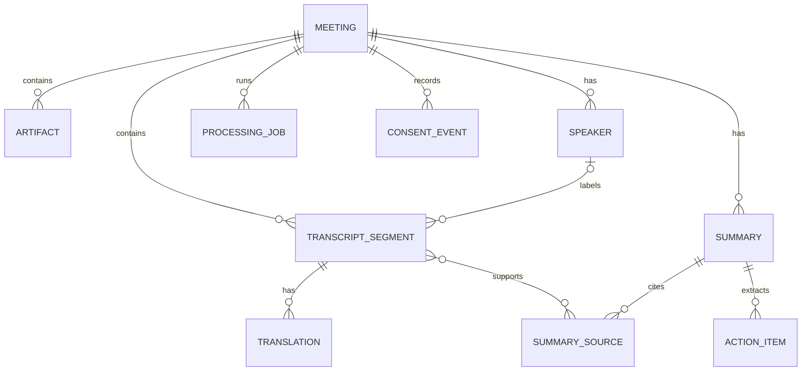

# MeetingLens 数据模型

## 1. 设计原则

- SQLite 保存结构化状态；大文件保存在应用私有目录。
- 所有主键使用应用生成的 UUID，避免暴露自增规模。
- 时间统一保存为 UTC ISO 8601 字符串，展示时再转换到本地时区。
- 删除会议时默认级联删除其派生数据与文件引用。
- AI 输出始终带模型、模板版本和来源范围，允许重建与审计。
- API key、access token 和密码不属于业务数据模型，禁止写入数据库。

## 2. 实体关系



## 3. 核心表

### `meetings`

| 字段 | 类型 | 说明 |
| --- | --- | --- |
| `id` | TEXT PK | UUID |
| `title` | TEXT | 用户提供的标题 |
| `status` | TEXT | `draft/recording/processing/ready/failed/archived` |
| `primary_language` | TEXT | BCP 47 语言标签 |
| `started_at` | TEXT NULL | 实际开始时间 |
| `ended_at` | TEXT NULL | 实际结束时间 |
| `created_at` | TEXT | 创建时间 |
| `updated_at` | TEXT | 最近更新时间 |
| `deleted_at` | TEXT NULL | 软删除/清理协调标记 |

### `artifacts`

| 字段 | 类型 | 说明 |
| --- | --- | --- |
| `id` | TEXT PK | UUID |
| `meeting_id` | TEXT FK | 所属会议 |
| `kind` | TEXT | `audio/upload/extracted_text/export` |
| `relative_path` | TEXT | 应用私有目录内的受控相对路径 |
| `media_type` | TEXT | 经检测的 MIME 类型 |
| `byte_size` | INTEGER | 文件大小 |
| `sha256` | TEXT | 内容完整性哈希 |
| `retention` | TEXT | `session/default/pinned` |
| `created_at` | TEXT | 创建时间 |

`relative_path` 不接受 `..`、盘符、UNC 或绝对路径。原始文件名只用于用户界面显示，并经过长度与控制字符清理。

### `speakers`

| 字段 | 类型 | 说明 |
| --- | --- | --- |
| `id` | TEXT PK | UUID |
| `meeting_id` | TEXT FK | 所属会议 |
| `diarization_label` | TEXT | 例如 `speaker_01` |
| `display_name` | TEXT NULL | 用户主动设置的名称 |
| `created_at` | TEXT | 创建时间 |

系统不得通过声纹自动映射真实身份，除非以后有独立的同意与安全设计。

### `transcript_segments`

| 字段 | 类型 | 说明 |
| --- | --- | --- |
| `id` | TEXT PK | UUID |
| `meeting_id` | TEXT FK | 所属会议 |
| `speaker_id` | TEXT FK NULL | 可为空的说话人 |
| `start_ms` | INTEGER | 相对会议开始的毫秒数 |
| `end_ms` | INTEGER | 结束毫秒数 |
| `language` | TEXT | BCP 47 标签 |
| `text` | TEXT | 转录正文 |
| `confidence` | REAL NULL | 0–1，若引擎提供 |
| `revision` | INTEGER | 用户修订版本 |
| `created_at` | TEXT | 创建时间 |
| `updated_at` | TEXT | 修改时间 |

约束：`start_ms >= 0`、`end_ms > start_ms`、同一会议内按时间建立索引。

### `translations`

| 字段 | 类型 | 说明 |
| --- | --- | --- |
| `id` | TEXT PK | UUID |
| `segment_id` | TEXT FK | 原始转录片段 |
| `target_language` | TEXT | 目标语言 |
| `text` | TEXT | 译文 |
| `provider` | TEXT | 本地/外部 provider 标识 |
| `model` | TEXT NULL | 模型标识，不含凭据 |
| `created_at` | TEXT | 创建时间 |

### `summaries`

| 字段 | 类型 | 说明 |
| --- | --- | --- |
| `id` | TEXT PK | UUID |
| `meeting_id` | TEXT FK | 所属会议 |
| `kind` | TEXT | `overview/decisions/actions/risks/custom` |
| `content_json` | TEXT | 版本化结构化结果 |
| `provider` | TEXT | 例如 `deepseek` 或 `local` |
| `model` | TEXT | 实际模型标识 |
| `prompt_version` | TEXT | 提示模板版本 |
| `is_user_edited` | INTEGER | 0/1 |
| `created_at` | TEXT | 创建时间 |

### `summary_sources`

| 字段 | 类型 | 说明 |
| --- | --- | --- |
| `summary_id` | TEXT FK | 摘要 |
| `segment_id` | TEXT FK | 支撑片段 |
| `relation` | TEXT | `supports/contradicts/context` |

联合主键为 `(summary_id, segment_id, relation)`。

### `action_items`

| 字段 | 类型 | 说明 |
| --- | --- | --- |
| `id` | TEXT PK | UUID |
| `summary_id` | TEXT FK | 来源摘要 |
| `description` | TEXT | 行动描述 |
| `owner_label` | TEXT NULL | 文本标签，不强制映射真实身份 |
| `due_at` | TEXT NULL | 用户确认后的截止时间 |
| `status` | TEXT | `open/done/dismissed` |
| `source_segment_id` | TEXT FK NULL | 可核验来源 |

### `processing_jobs`

| 字段 | 类型 | 说明 |
| --- | --- | --- |
| `id` | TEXT PK | UUID |
| `meeting_id` | TEXT FK | 所属会议 |
| `job_type` | TEXT | `transcribe/translate/diarize/extract/summarize` |
| `status` | TEXT | `queued/running/succeeded/failed/cancelled` |
| `progress` | REAL | 0–1 |
| `attempt_count` | INTEGER | 已尝试次数 |
| `input_json` | TEXT | 只含 ID 和安全参数 |
| `error_code` | TEXT NULL | 稳定错误分类，不含敏感正文 |
| `created_at` | TEXT | 创建时间 |
| `started_at` | TEXT NULL | 开始时间 |
| `finished_at` | TEXT NULL | 结束时间 |

### `consent_events`

| 字段 | 类型 | 说明 |
| --- | --- | --- |
| `id` | TEXT PK | UUID |
| `meeting_id` | TEXT FK | 所属会议 |
| `capability` | TEXT | `recording/screen_context/external_ai` |
| `decision` | TEXT | `granted/revoked` |
| `scope_json` | TEXT | 数据范围、用途和 provider |
| `recorded_at` | TEXT | 记录时间 |

## 4. SQLite 约束与索引

- 启用 `PRAGMA foreign_keys = ON`。
- 使用 WAL 时，`.db-wal` 和 `.db-shm` 必须保持本地且被 Git 忽略。
- 对 `transcript_segments(meeting_id, start_ms)`、`processing_jobs(status, created_at)` 和 `artifacts(meeting_id, kind)` 建索引。
- 状态字段使用 `CHECK` 约束或迁移层枚举校验。
- 所有迁移在事务中执行，并在 schema 版本表中记录。

## 5. 文件布局

```text
app-data/
├── meetinglens.sqlite3
├── meetings/<meeting-id>/
│   ├── audio/
│   ├── uploads/
│   ├── extracted/
│   └── exports/
└── tmp/<job-id>/
```

数据库保存相对于 `app-data` 的路径。任何文件访问必须先解析、规范化并确认最终路径仍位于该根目录内。

## 6. 删除与保留

1. 用户发起删除后，会议进入 `deleted_at` 状态，禁止新任务。
2. 取消/等待正在运行的任务，并关闭文件句柄。
3. 在事务中删除派生表记录，再删除 artifact 文件。
4. 若文件删除失败，保留最小 tombstone 供下次启动重试。
5. 完成后删除 meeting 记录和 tombstone。
6. 外部 provider 已接收的数据无法通过本地删除撤回，发送前必须明确提示。

默认保留策略在实现前由产品决策确认；首个版本不进行静默自动删除。

## 7. 数据模型版本化

- `schema_migrations(version, applied_at, checksum)` 记录数据库迁移。
- Sidecar API 和 `content_json` 都包含独立 `api_version/schema_version`。
- 破坏性迁移必须先备份并获得用户批准，不得自动丢弃未知字段。
