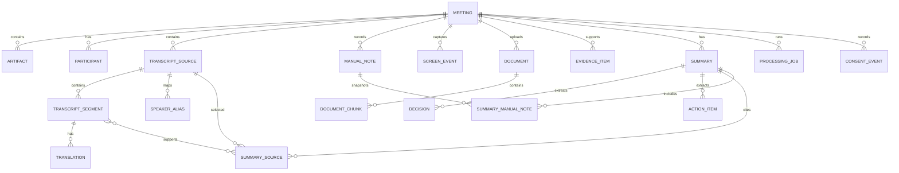

# MeetingLens 数据模型

## 1. 设计原则

三模式的产品语义以 `SIMPLIFIED_MODE_SPEC.md` 为准；本文件只定义三种入口共同复用的数据真相、状态和删除语义，不为任何模式建立平行模型。

- SQLite 保存结构化状态；大文件保存在应用私有目录。
- 所有主键使用应用生成的 UUID，避免暴露自增规模。
- 事件/实体时间保存为 UTC ISO 8601；转录位置统一保存相对 source/会议基准的毫秒 offset，展示时格式化，不保存两套竞争的时间真相。
- 外键级联只处理结构化引用，不能替代物理文件的可恢复删除协调。
- AI 输出始终带模型、模板版本和来源范围，允许重建与审计。
- API key、access token 和密码不属于业务数据模型，禁止写入数据库。
- 总结、翻译和会议模式只是界面/能力预设，不建立三套实体或状态机；来源、能力开关和同意事件才是数据处理事实。
- 原始音频、规范化逐字稿和会议纪要是三个不同的数据类别，分别拥有同意、保留、导出和删除语义。

## 2. 实体关系



## 3. 核心表

### `meetings`

| 字段                   | 类型      | 说明                                                                      |
| ---------------------- | --------- | ------------------------------------------------------------------------- |
| `id`                   | TEXT PK   | UUID                                                                      |
| `title`                | TEXT      | 用户提供的标题                                                            |
| `status`               | TEXT      | `draft/recording/processing/ready/failed/archived/deleting/delete_failed` |
| `primary_language`     | TEXT      | BCP 47 语言标签                                                           |
| `selected_window_json` | TEXT NULL | 用户选定窗口的受控标识/标题快照，不含截图                                 |
| `started_at`           | TEXT NULL | 实际开始时间                                                              |
| `ended_at`             | TEXT NULL | 实际结束时间                                                              |
| `created_at`           | TEXT      | 创建时间                                                                  |
| `updated_at`           | TEXT      | 最近更新时间                                                              |
| `deleted_at`           | TEXT NULL | 软删除/清理协调标记                                                       |
| `deletion_error_code`  | TEXT NULL | 删除失败的稳定安全错误码，不含路径或原始异常                              |

schema v3 没有独立、可编辑的会议发生日期字段。`created_at` 只表示 MeetingLens 创建该记录的时间，`started_at/ended_at` 只由真实或模拟会议生命周期写入；总结模式输入 UI 可以将 `created_at` 明确展示为创建时间，但不得把它冒充会议发生日期，也不得提供无法持久化的日期输入。若以后需要 `occurred_at` 或等价语义，必须先在独立数据模型阶段定义、迁移和验收。

#### 会议生命周期

会议状态由 Rust service 和专用 Tauri command 控制，普通更新接口只能修改标题、主要语言等可编辑元数据，不得直接写入 `status`、`started_at` 或 `ended_at`。

| 操作                  | 前置状态    | 后置状态    | 时间规则                                    |
| --------------------- | ----------- | ----------- | ------------------------------------------- |
| 创建                  | 不适用      | `draft`     | `started_at`、`ended_at` 均为空             |
| `start_meeting`       | `draft`     | `recording` | Rust 后端写入当前 UTC ISO 8601 `started_at` |
| `end_meeting`（模拟） | `recording` | `ready`     | Rust 后端写入当前 UTC ISO 8601 `ended_at`   |

- MVP 1A-2 的合成会议没有异步处理步骤，因此结束后直接进入 `ready`。
- `processing` 保留给共享实时底座及后续真实异步处理，只能由受信任后端在创建相应 job 后进入，WebView 不得自行设置。
- `failed` 与 `archived` 同样只能通过后续定义的专用 service 操作进入，不属于通用会议更新字段。
- `deleting` 和 `delete_failed` 只由删除协调 service 进入；普通更新、开始、结束、导入和处理接口均不得写入或绕过。
- 重复开始、重复结束、`draft → ready`、`ready → recording` 等非法转换必须原子拒绝，并返回稳定错误码 `meeting_invalid_state`。
- 时间戳由后端生成；前端传入的开始/结束时间不得作为状态转换依据。
- 生命周期相关的非法操作统一使用对外错误码 `meeting_invalid_state`；不得再引入含义重复的 `invalid_state_transition`。

#### 模式提示

当前 schema v3 不持久化模式，总结模式入口只是导航到共享 meeting/transcript 工作区。实时模式落地前，`feat/live-session-data-core` 可增加可空的 `workflow_mode = summary/translation/meeting` 作为历史列表和恢复布局的提示；旧会议保持 NULL。该字段不得决定权限、同意、数据保留或会议状态，实际已启用能力仍以来源、任务和 `consent_events` 为准。

### `artifacts`

| 字段            | 类型      | 说明                                 |
| --------------- | --------- | ------------------------------------ |
| `id`            | TEXT PK   | UUID                                 |
| `meeting_id`    | TEXT FK   | 所属会议                             |
| `kind`          | TEXT      | `audio/upload/extracted_text/export` |
| `relative_path` | TEXT      | 应用私有目录内的受控相对路径         |
| `media_type`    | TEXT      | 经检测的 MIME 类型                   |
| `byte_size`     | INTEGER   | 文件大小                             |
| `sha256`        | TEXT      | 内容完整性哈希                       |
| `retention`     | TEXT      | `ephemeral/user_managed/pinned`      |
| `expires_at`    | TEXT NULL | 仅自动到期策略使用的 UTC 时间        |
| `created_at`    | TEXT      | 创建时间                             |

`relative_path` 不接受 `..`、盘符、UNC 或绝对路径。原始文件名只用于用户界面显示，并经过长度与控制字符清理。

音频 artifact 只有在当前应用会话存在独立 `store_audio` grant 时才能进入长期目录；默认不创建。`ephemeral` 在转录安全提交或会话结束后清理，`user_managed` 保留到用户明确删除或其主动设置的 `expires_at`，`pinned` 跳过普通到期清理但不能阻止用户明确删除整场会议；取消 pinned 后回到用户选择的策略。保留策略必须随 artifact 持久化，变更或删除通过统一协调器执行，不能由采集线程自行遗留文件。

### `participants`

| 字段                      | 类型      | 说明                          |
| ------------------------- | --------- | ----------------------------- |
| `id`                      | TEXT PK   | UUID                          |
| `meeting_id`              | TEXT FK   | 所属会议                      |
| `diarization_label`       | TEXT      | 例如 `speaker_01`，会议内唯一 |
| `display_name`            | TEXT NULL | 用户主动设置或修正的名称      |
| `voice_sample_path`       | TEXT NULL | 后续说话人增强的受控相对路径  |
| `voice_sample_consent_at` | TEXT NULL | 语音样本授权时间              |
| `created_at`              | TEXT      | 创建时间                      |

语音样本不用于跨会议自动识别，必须允许重录和删除。系统不得在没有独立同意与安全设计时通过声纹映射真实身份。

### `transcript_sources`（schema v3）

转录是独立于参考 `documents` 的一等公民来源。schema v3 由 `feat/transcript-data-core` 引入，后续实时转录和纪要阶段复用同一模型，不得创建竞争表。

| 字段                | 类型      | 说明                                                                          |
| ------------------- | --------- | ----------------------------------------------------------------------------- |
| `id`                | TEXT PK   | source UUID                                                                   |
| `meeting_id`        | TEXT FK   | 所属会议                                                                      |
| `source_type`       | TEXT      | `pasted_text/imported_txt/imported_srt/imported_vtt/live_asr/platform_export` |
| `display_name`      | TEXT      | 安全显示名称                                                                  |
| `original_filename` | TEXT NULL | 导入来源的显示文件名；不保存绝对路径                                          |
| `content_sha256`    | TEXT      | 规范化内容的 SHA-256，用于同会议来源识别/去重，不代表可信或防病毒             |
| `language`          | TEXT NULL | 可识别/用户指定的 BCP 47 标签                                                 |
| `base_started_at`   | TEXT NULL | UTC ISO 8601 基准；只在需要把相对 offset 映射到绝对时间时使用                 |
| `parser_name`       | TEXT      | 例如 `plain_text/srt/vtt/live_asr`                                            |
| `parser_version`    | TEXT      | 可复现解析规则版本                                                            |
| `imported_at`       | TEXT      | 导入或粘贴确认时间                                                            |
| `created_at`        | TEXT      | 创建时间                                                                      |
| `updated_at`        | TEXT      | 最近更新时间                                                                  |

近期实现 `pasted_text/imported_txt/imported_srt/imported_vtt`；`live_asr` 留给真实音频阶段，`platform_export` 只是保留类型，取得脱敏真实平台样例并实现专用 adapter 前不得对外宣称支持。第一版不长期复制 TXT/SRT/VTT 原始文件，只保存规范化 segments 与上述来源元数据；重新解析需要用户重新导入，用户源文件不被修改或删除。

### `transcript_segments`（schema v3）

| 字段              | 类型         | 说明                             |
| ----------------- | ------------ | -------------------------------- |
| `id`              | TEXT PK      | segment UUID                     |
| `meeting_id`      | TEXT FK      | 所属会议                         |
| `source_id`       | TEXT FK      | 所属 `transcript_sources`        |
| `ordinal`         | INTEGER      | source 内从 0 开始的稳定顺序     |
| `speaker_label`   | TEXT NULL    | 来源中明确存在的原始标签         |
| `speaker_name`    | TEXT NULL    | 用户确认或修正后的显示名称       |
| `start_offset_ms` | INTEGER NULL | 相对 source/会议基准的开始毫秒   |
| `end_offset_ms`   | INTEGER NULL | 相对 source/会议基准的结束毫秒   |
| `original_text`   | TEXT         | 原始语言的规范化转录正文         |
| `translated_text` | TEXT NULL    | schema v3 兼容占位；当前始终为空 |
| `language`        | TEXT NULL    | BCP 47 标签                      |
| `confidence`      | REAL NULL    | 0–1，若来源提供                  |
| `is_final`        | INTEGER      | 0/1；导入来源默认为 1            |
| `revision`        | INTEGER      | 从 1 开始；用户修正递增          |
| `created_at`      | TEXT         | 创建时间                         |
| `corrected_at`    | TEXT NULL    | 最近人工修正时间                 |

约束：同一 source 的 `(source_id, ordinal)` 唯一；offset 可空，有值时满足 `start_offset_ms >= 0` 且 `end_offset_ms >= start_offset_ms`。无时间戳来源使用 ordinal 作为证据位置，不推断时间。总结模式导入阶段不创建 `speakers`/`speaker_aliases`，也不强制连接 `participants`；`speaker_label` 保留来源事实，`speaker_name` 保存用户确认。segment 不是 document chunk。schema v3 的 `translated_text` 仅用于稳定 DTO 兼容且本阶段始终为 `NULL`；实时语言阶段建立 `translations` 后，后者是唯一权威译文来源，不得把 Provider 译文写回 segment。

第一版输入固定为：粘贴最多 2 MiB、TXT/SRT/VTT 文件最多 10 MiB、每 source 最多 20,000 个 segments、单 segment 正文最多 64 KiB；严格 UTF-8，拒绝 UTF-16/UTF-32、NUL、孤立 CR 和除 TAB/LF 外的危险 C0 控制字符，CRLF 只规范化为 LF，超限不截断。普通文本只识别明确的 `姓名: 内容`，格式不清时 speaker 为空；SRT/VTT 保留 cue 时间和顺序。解析器不调用 Docling/网络，不执行文本中的 URL、代码或指令。

segment 列表必须由 SQLite 按稳定 `ordinal` 顺序分页，不允许先返回最多 20,000 条再由 React 切片。`feat/summary-mode-input-ui` 使用有界 `limit`（production 最大 200）和不泄漏路径/正文的 cursor 或 offset，请求结果至少包含当页 items、`total_count` 和后续页信息；页面切换或卸载时释放不再需要的数组。

总结模式允许用户为同一 source 中具有相同非空 `speaker_label` 的 segments 批量设置或清空 `speaker_name`。该操作在单事务内只更新目标 meeting/source/label 的 `speaker_name`，每条实际修改记录的 revision 增加并写入 `corrected_at`；`speaker_label`、正文、ordinal、offset 和归属关系保持不变。空字符串不是名称；清空使用明确的 NULL 语义。该便利能力不创建 `speaker_aliases`，不跨 source/meeting，也不推断真实姓名、声纹或身份。

去重哈希使用确定性规范化口径：去除 UTF-8 BOM、把 CRLF 统一为 LF，但不折叠大小写、不删除普通空白、不改写正文；SRT/VTT 对严格解析后的 cue 时间、speaker 与正文序列编码后计算 SHA-256。同一 meeting 的 `(meeting_id, content_sha256)` 唯一，跨 meeting 不去重。哈希只用于内容身份识别，不是信任、杀毒或安全扫描结论。

删除 source 会在同一协调操作中处理其 segments，但不影响用户原始文件。若 source 正被非终态 Summary run 使用，删除请求必须稳定拒绝或进入明确 pending，不能在 run 中途直接移除；run 读取的不可变快照不受后续编辑影响。删除完成后已有 summary 保留最小 evidence snapshot 并把来源显示为已删除。修正 segment 增加 revision，并可把依赖旧 revision 的 summary 标记 stale；不得后台静默重新生成。

首版稳定错误包括：`transcript_invalid_input`、`transcript_empty`、`transcript_too_large`、`transcript_segment_too_large`、`transcript_segment_limit_exceeded`、`transcript_invalid_encoding`、`transcript_invalid_format`、`transcript_invalid_timestamp`、`transcript_source_not_found`、`transcript_segment_not_found`、`transcript_already_imported`、`transcript_invalid_state`、`transcript_input_insufficient`、`transcript_persistence_failed`、`transcript_revision_conflict`、`transcript_source_in_use` 和 `internal_error`。错误响应不得包含正文、源路径、文件名、说话人、parser 原始异常或用户目录。

### `screen_events`

该计划实体只能在实时 ASR 已复用既有 transcript 模型后，由 `feat/window-context` 和 `feat/screen-ocr` 顺序引入；不属于 schema v3，也不得在会议模式工作区中临时复制一套屏幕数据模型。

| 字段                     | 类型         | 说明                                           |
| ------------------------ | ------------ | ---------------------------------------------- |
| `id`                     | TEXT PK      | UUID                                           |
| `meeting_id`             | TEXT FK      | 所属会议                                       |
| `captured_at_ms`         | INTEGER      | 相对会议开始的毫秒数                           |
| `window_ref`             | TEXT         | 用户选定窗口的稳定本地引用                     |
| `source_kind`            | TEXT         | `accessibility/ocr/user_note`                  |
| `event_type`             | TEXT         | `slide_change/code_change/decision_text/other` |
| `text`                   | TEXT         | 经确认/脱敏的结构化文字                        |
| `screenshot_artifact_id` | TEXT FK NULL | 临时截图引用，默认在提取后删除                 |
| `created_at`             | TEXT         | 创建时间                                       |

### `documents`

该表已由 schema migration v2 创建。当前 service 只进入 `importing/staged/import_failed/deleting/delete_failed`；解析状态仅为后续 migration 兼容预留，当前没有业务入口。

| 字段                      | 类型         | 说明                                                                                |
| ------------------------- | ------------ | ----------------------------------------------------------------------------------- |
| `id`                      | TEXT PK      | document UUID                                                                       |
| `meeting_id`              | TEXT FK      | 所属会议                                                                            |
| `original_filename`       | TEXT         | 用户原始显示名称；UTF-8 最大 255 bytes，不参与路径拼接                              |
| `safe_extension`          | TEXT         | allowlist 中的规范小写扩展名                                                        |
| `detected_media_type`     | TEXT NULL    | Rust 根据签名/安全类型识别得到的类型；`importing` 初期可为空                        |
| `size_bytes`              | INTEGER NULL | 完成流式复制后确认的大小                                                            |
| `sha256`                  | TEXT NULL    | 完整性和同会议去重哈希；复制完成前可为空，不代表文件可信                            |
| `status`                  | TEXT         | `importing/staged/parsing/parsed/import_failed/parse_failed/deleting/delete_failed` |
| `storage_relative_path`   | TEXT         | 应用私有根目录内的受控相对路径                                                      |
| `imported_at`             | TEXT NULL    | 成功进入 `staged` 的 UTC 时间                                                       |
| `updated_at`              | TEXT         | 最近状态更新时间                                                                    |
| `failure_code`            | TEXT NULL    | 稳定错误码                                                                          |
| `failure_message_safe`    | TEXT NULL    | 可展示的安全消息；不得包含绝对路径、用户名、原始异常或文件内容                      |
| `parser_version_optional` | TEXT NULL    | 未来 Docling Worker/adapter 版本                                                    |
| `page_count_optional`     | INTEGER NULL | 未来解析成功后可用的页数                                                            |
| `created_at`              | TEXT         | 记录创建时间                                                                        |

源文件绝对路径不得持久化。文件内容不得写入 SQLite BLOB；解析文本和派生 artifacts 使用独立表或受控文件。`meeting_id` 使用外键，但删除不能只依赖 `CASCADE`，必须先协调物理文件。

#### 文档生命周期

| 转换                                    | 所属阶段                              | 规则                                                |
| --------------------------------------- | ------------------------------------- | --------------------------------------------------- |
| `importing → staged`                    | MVP 1B-1A                             | 文件完成校验并原子进入正式目录                      |
| `importing → import_failed`             | MVP 1B-1A                             | 复制、类型、配额、完整性或存储失败                  |
| `staged → parsing`                      | `feat/document-parsing-orchestration` | Rust 编排器持久化任务后调用隔离 Worker              |
| `parsing → parsed/parse_failed`         | `feat/document-parsing-orchestration` | Rust 复验产物后持久化受控结果或稳定错误             |
| `staged/parsed → deleting`              | MVP 1B-1A 及后续                      | 接受删除请求                                        |
| `import_failed/parse_failed → deleting` | MVP 1B-1A 及后续                      | 清理失败输入或解析产物                              |
| `deleting → 记录消失`                   | MVP 1B-1A                             | 物理文件和关联 artifacts 全部清理成功后才删除元数据 |
| `deleting → delete_failed`              | MVP 1B-1A                             | 清理失败，保留安全错误和可恢复状态                  |
| `delete_failed → deleting`              | MVP 1B-1A                             | 幂等重试                                            |

页面和通用 update 不得直接修改状态。安全导入阶段只实现 `importing/staged/import_failed/deleting/delete_failed`；PR #14 只建立无数据库访问的 Worker 基础，`parsing/parsed/parse_failed` 由 `feat/document-parsing-orchestration` 引入。未知状态 fail closed。

同一会议使用 `(meeting_id, sha256)` 唯一约束识别相同内容。重复时不创建第二条记录或物理副本，返回 `document_already_imported` 和已有 document ID。不同会议首版不做物理去重；文件名不参与重复判断，同名不同内容允许导入，不同名相同内容视为重复。

MVP 1B-1B 的 WebView DTO 只公开 `id`、`meeting_id`、清理后的 `original_name`、`detected_type`、`size_bytes`、`status`、稳定 `failure_code` 和 UTC 时间；明确排除 `storage_relative_path`、SHA-256、内部失败消息及源绝对路径。进度事件只公开当前文件安全显示名、阶段和有界字节计数。未知字段/状态在命令输入或前端解析边界 fail closed。

### `deletion_jobs`

schema v2 使用统一删除任务表协调 meeting/document 的文件清理：`id` 为 UUID，`entity_kind` 只能是 `meeting/document`，并保存受控 `meeting_id`、可选 `document_id`、`pending/failed` 状态、可选 trash 相对路径、0–3 的自动重试计数、安全错误码和 UTC 时间戳。partial unique indexes 保证每个 meeting 或 document 同时最多一个删除任务；实体最终删除时由外键级联移除任务。启动恢复最多自动尝试三次，显式用户重试仍可重新进入 `deleting`。

### `document_chunks`

该计划实体由 `feat/document-evidence-index` 在 `feat/document-parsing-orchestration` 之后创建，并先于真实音频阶段接入既有 Summary evidence。它不属于 schema v3，也不能替代 `transcript_segments`。

| 字段           | 类型         | 说明                         |
| -------------- | ------------ | ---------------------------- |
| `id`           | TEXT PK      | UUID                         |
| `document_id`  | TEXT FK      | 来源文档                     |
| `ordinal`      | INTEGER      | 文档内顺序                   |
| `page_number`  | INTEGER NULL | 来源页码                     |
| `section_path` | TEXT NULL    | 标题/工作表/幻灯片等结构路径 |
| `text`         | TEXT         | 提取正文                     |
| `content_hash` | TEXT         | 去重与完整性校验             |

### `evidence_items`

| 字段                    | 类型         | 说明                                              |
| ----------------------- | ------------ | ------------------------------------------------- |
| `id`                    | TEXT PK      | UUID                                              |
| `meeting_id`            | TEXT FK      | 所属会议                                          |
| `kind`                  | TEXT         | `transcript/document/screen/manual_note`          |
| `source_id`             | TEXT NULL    | transcript source 或其他稳定来源 ID               |
| `transcript_segment_id` | TEXT FK NULL | 转录来源                                          |
| `segment_revision`      | INTEGER NULL | run 实际使用的 segment revision                   |
| `document_chunk_id`     | TEXT FK NULL | 文档来源                                          |
| `screen_event_id`       | TEXT FK NULL | 屏幕来源                                          |
| `label`                 | TEXT         | 面向用户的证据标签                                |
| `speaker_snapshot`      | TEXT NULL    | 当次 run 使用的安全 speaker 显示快照              |
| `start_offset_ms`       | INTEGER NULL | 证据开始位置；无时间戳时为空                      |
| `end_offset_ms`         | INTEGER NULL | 证据结束位置                                      |
| `ordinal`               | INTEGER NULL | 无时间戳或排序定位                                |
| `excerpt`               | TEXT         | 解释结果所需的最小安全摘录，不复制完整 transcript |
| `source_deleted`        | INTEGER      | 0/1；来源删除后仍可解释已有纪要                   |
| `created_at`            | TEXT         | 创建时间                                          |

具体 migration 由 Summary PR 冻结。证据必须指向当前 run 快照内已知 source/segment/revision；未知 evidence ID 不得接受，也不得根据模型自然语言生成不存在的引用。document 只证明材料内容，screen 只证明当时展示内容，manual note 是用户补充；除非 transcript 或人工确认明确支持，任何单一来源都不能自动证明会议已达成决定。

### `translations`

| 字段               | 类型      | 说明                             |
| ------------------ | --------- | -------------------------------- |
| `id`               | TEXT PK   | UUID                             |
| `segment_id`       | TEXT FK   | 原始转录片段                     |
| `segment_revision` | INTEGER   | 翻译所依据的片段修订             |
| `target_language`  | TEXT      | 目标语言                         |
| `text`             | TEXT      | 译文                             |
| `provider`         | TEXT      | 本地/外部 provider 标识          |
| `model`            | TEXT NULL | 模型标识，不含凭据               |
| `status`           | TEXT      | `queued/completed/failed`        |
| `error_code`       | TEXT NULL | 稳定错误分类，不含原文或请求正文 |
| `created_at`       | TEXT      | 创建时间                         |
| `updated_at`       | TEXT      | 最近更新时间                     |

同一 segment revision 与目标语言只保留一个结果；原文被用户修正后必须为新的 segment revision 创建新译文，读取时只选择与当前 revision 精确匹配的记录，旧记录仅作历史且不得继续显示为当前译文。翻译模式只消费已经确定的转录片段，partial ASR 结果不得进入最终纪要快照。

### `speaker_aliases`（实时语言数据阶段计划）

| 字段           | 类型      | 说明                       |
| -------------- | --------- | -------------------------- |
| `id`           | TEXT PK   | UUID                       |
| `meeting_id`   | TEXT FK   | 所属会议                   |
| `source_id`    | TEXT FK   | 标签所属转录来源           |
| `source_label` | TEXT      | ASR/导入来源的原始匿名标签 |
| `display_name` | TEXT NULL | 用户在本场会议设置的显示名 |
| `revision`     | INTEGER   | 从 1 开始，改名时递增      |
| `created_at`   | TEXT      | 创建时间                   |
| `updated_at`   | TEXT      | 最近更新时间               |

`(source_id, source_label)` 唯一。实时工作区通过该映射统一显示改名，不能批量覆写历史 segment 的原始 `speaker_label`；默认不跨会议复用名称或身份。该表在屏幕/窗口上下文之后由 `feat/live-language-data-core` 引入，再供 `feat/speaker-diarization` 和后续实时翻译使用；不属于 schema v3。

### `manual_notes`（会议模式数据阶段计划）

| 字段               | 类型         | 说明                             |
| ------------------ | ------------ | -------------------------------- |
| `id`               | TEXT PK      | UUID                             |
| `meeting_id`       | TEXT FK      | 所属会议                         |
| `kind`             | TEXT         | `bookmark/text`                  |
| `start_segment_id` | TEXT FK NULL | 书签引用的起始最终片段           |
| `end_segment_id`   | TEXT FK NULL | 书签引用的结束最终片段           |
| `body`             | TEXT NULL    | 用户主动输入的文字，不由模型伪造 |
| `created_at`       | TEXT         | 创建时间                         |
| `updated_at`       | TEXT         | 最近更新时间                     |

`bookmark` 至少引用一个当前会议的最终 segment；`text` 必须包含通过长度/控制字符校验的正文。两者都可进入最终快照并生成 `manual_note` evidence，但必须保留来源类型，不能伪装成会议已确认的原始发言。

### `summaries`

纪要拥有独立于 `meeting.status` 的运行与修订生命周期，状态至少区分 `queued/running/completed/failed/cancelled`。只要用户选择的输入可以原子冻结，`draft`、`recording` 或 `ready` 均可创建 Summary run；`deleting`、`delete_failed`、空输入或输入仍无法安全冻结时拒绝。不要新增 `content_ready`、`source_ready` 或 `summarized` meeting 状态。

| 字段              | 类型    | 说明                                      |
| ----------------- | ------- | ----------------------------------------- |
| `id`              | TEXT PK | UUID                                      |
| `meeting_id`      | TEXT FK | 所属会议                                  |
| `run_purpose`     | TEXT    | `checkpoint/final`                        |
| `trigger_kind`    | TEXT    | `manual/interval/topic/final`             |
| `kind`            | TEXT    | `overview/decisions/actions/risks/custom` |
| `content_json`    | TEXT    | 版本化结构化结果                          |
| `provider`        | TEXT    | 例如 `deepseek` 或 `local`                |
| `model`           | TEXT    | 实际模型标识                              |
| `prompt_version`  | TEXT    | 提示模板版本                              |
| `revision`        | INTEGER | 同一纪要序列的修订号                      |
| `template`        | TEXT    | `detailed/concise/actions_decisions`      |
| `output_language` | TEXT    | `zh/en/bilingual`                         |
| `status`          | TEXT    | 独立于 meeting 的 run 状态                |
| `is_stale`        | INTEGER | 输入后续变化后是否可能过期                |
| `is_user_edited`  | INTEGER | 0/1                                       |
| `created_at`      | TEXT    | 创建时间                                  |

简约版 checkpoint 首先只允许 `manual` 和 `interval`。`topic` 是后续可修正建议，不得仅由屏幕变化触发。checkpoint 只帮助会议中导航；`final` run 必须重新冻结原始转录片段，不能把 checkpoint 摘要当作唯一事实来源。固定时间触发在没有新增最终片段时必须去重。

### `summary_sources`

| 字段               | 类型    | 说明                           |
| ------------------ | ------- | ------------------------------ |
| `summary_id`       | TEXT FK | 摘要/run revision              |
| `source_id`        | TEXT FK | 被用户选择的 transcript source |
| `segment_id`       | TEXT FK | 快照包含的片段                 |
| `segment_revision` | INTEGER | 快照使用的修订                 |
| `ordinal`          | INTEGER | 当次输入顺序                   |
| `relation`         | TEXT    | `supports/contradicts/context` |

联合唯一键必须包含 summary、segment 和 revision。创建 Summary run 时冻结 source IDs、segment IDs/revisions/order、speaker、offsets、language、模板、输出语言和创建时间；模型运行期间后续编辑不影响当前 run。重新生成创建新的 summary revision，不能覆盖用户编辑。完整 transcript 不重复复制到每个 evidence item，仅保存稳定引用和必要摘录。

### `summary_manual_notes`（会议重点阶段计划）

| 字段             | 类型    | 说明                           |
| ---------------- | ------- | ------------------------------ |
| `summary_id`     | TEXT FK | Summary run/revision           |
| `manual_note_id` | TEXT FK | 被冻结的用户书签或文字笔记     |
| `note_revision`  | INTEGER | 快照使用的笔记修订             |
| `ordinal`        | INTEGER | 当次输入顺序                   |
| `relation`       | TEXT    | `supports/contradicts/context` |

`summary_sources` 只冻结 transcript segments；不得把 manual note ID 塞入 transcript source/segment 字段。`feat/meeting-notes-core` 通过本专用关联把用户笔记纳入同一 Summary run，并生成 `manual_note` evidence。

### `decisions`

| 字段               | 类型         | 说明                            |
| ------------------ | ------------ | ------------------------------- |
| `id`               | TEXT PK      | UUID                            |
| `summary_id`       | TEXT FK      | 来源摘要                        |
| `description`      | TEXT         | 决策内容                        |
| `status`           | TEXT         | `proposed/confirmed/superseded` |
| `evidence_item_id` | TEXT FK NULL | 可核验证据                      |
| `is_user_edited`   | INTEGER      | 0/1                             |
| `created_at`       | TEXT         | 创建时间                        |

### `action_items`

| 字段                | 类型         | 说明                         |
| ------------------- | ------------ | ---------------------------- |
| `id`                | TEXT PK      | UUID                         |
| `summary_id`        | TEXT FK      | 来源摘要                     |
| `description`       | TEXT         | 行动描述                     |
| `owner_label`       | TEXT NULL    | 文本标签，不强制映射真实身份 |
| `due_at`            | TEXT NULL    | 用户确认后的截止时间         |
| `status`            | TEXT         | `open/done/dismissed`        |
| `source_segment_id` | TEXT FK NULL | 可核验来源                   |
| `evidence_item_id`  | TEXT FK NULL | 转录/文档/屏幕的统一证据引用 |

### `processing_jobs`

| 字段            | 类型      | 说明                                             |
| --------------- | --------- | ------------------------------------------------ |
| `id`            | TEXT PK   | UUID                                             |
| `meeting_id`    | TEXT FK   | 所属会议                                         |
| `job_type`      | TEXT      | `transcribe/translate/diarize/extract/summarize` |
| `status`        | TEXT      | `queued/running/succeeded/failed/cancelled`      |
| `progress`      | REAL      | 0–1                                              |
| `attempt_count` | INTEGER   | 已尝试次数                                       |
| `input_json`    | TEXT      | 只含 ID 和安全参数                               |
| `error_code`    | TEXT NULL | 稳定错误分类，不含敏感正文                       |
| `created_at`    | TEXT      | 创建时间                                         |
| `started_at`    | TEXT NULL | 开始时间                                         |
| `finished_at`   | TEXT NULL | 结束时间                                         |

### `consent_events`

该通用表由 `feat/consent-data-core` 在任何真实外部 Provider 或设备采集前创建；后续阶段只通过受控 capability 扩展和 service 使用，不得各自建立不可审计的授权存储。

| 字段          | 类型    | 说明                                                                                                             |
| ------------- | ------- | ---------------------------------------------------------------------------------------------------------------- |
| `id`          | TEXT PK | UUID                                                                                                             |
| `meeting_id`  | TEXT FK | 所属会议                                                                                                         |
| `capability`  | TEXT    | `microphone/system_audio/screen_context/store_audio/live_translation/checkpoint_external_ai/summary_external_ai` |
| `decision`    | TEXT    | `granted/revoked`                                                                                                |
| `scope_json`  | TEXT    | 数据范围、用途和 provider                                                                                        |
| `recorded_at` | TEXT    | 记录时间                                                                                                         |

不同 capability 不得捆绑授权。`scope_json` 至少记录本次应用会话、目标设备/窗口的安全标识、Provider、用途、数据类别、checkpoint 频率/发送窗口和是否持续外发；不得包含凭据、正文、绝对路径或原始屏幕内容。撤销事件不覆盖历史 granted 记录，运行中的对应采集或发送必须立即停止。采集与持续外发的 grant 在应用重启后失效，历史事件只作审计。

## 4. SQLite 约束与索引

- 启用 `PRAGMA foreign_keys = ON`。
- 使用 WAL 时，`.db-wal` 和 `.db-shm` 必须保持本地且被 Git 忽略。
- schema v2 已建立 `idx_documents_meeting_status`、`idx_documents_meeting_sha256`、两个 deletion job partial unique indexes 和 `idx_deletion_jobs_status`。
- 当前 schema v3 已建立 `transcript_sources`/`transcript_segments` 及同会议来源哈希、source ordinal、meeting/source 查询索引；其他计划表在所属 migration 中建立对应索引，原 Docling 编排 migration 顺延到 v4 或更高并按落地顺序递增。
- `documents(meeting_id, sha256)` 对非 NULL 哈希使用唯一约束，确保同一会议内容去重；跨会议不共享物理副本。
- 状态字段使用 `CHECK` 约束或迁移层枚举校验。
- 所有迁移在事务中执行，并在 schema 版本表中记录。

## 5. 文件布局

```text
app-data/
├── meetinglens.sqlite3
└── meeting-data/
    ├── meetings/<meeting-id>/
    │   ├── documents/<document-id>.<safe-extension>
    │   ├── audio/<artifact-id>.<safe-extension>   # 仅在用户单独选择保存时
    │   ├── exports/<export-id>.<safe-extension>
    │   └── artifacts/
    ├── staging/<random-import-id>.tmp
    ├── deletion-trash/<deletion-id>/
    └── .meetinglens-storage.lock
```

数据库保存相对于 `app-data` 的路径；本 PR 不移动现有 SQLite。任何文件访问必须先解析、规范化并确认最终路径仍位于应用私有根目录内。目标路径只由 Rust 使用 meeting/document UUID 构造；原始文件名不能参与路径拼接。拒绝 `..`、绝对路径、盘符、UNC、Alternate Data Streams 和任何逃逸结果。

导入在 `staging` 中创建随机临时文件，流式复制并同时计算 SHA-256；尽早检查声明大小，复制中超过限制立即停止并清理。最终大小、类型和会议累计配额验证成功后，使用同卷原子 rename 进入 `documents`。不把用户文件长期放在 Temp、Git 仓库或当前工作目录，不设置可执行权限，也不调用 Windows 文件关联程序。源文件保持不变。

## 6. 删除与保留

MVP 1A 的无文件基线曾使用事务内硬删除；schema v2 已由 MVP 1B-1A 替换为下述 tombstone + deletion job 协调流程。

MVP 1A-2-1 的当前无文件删除状态契约固定如下：

- `draft` 和 `ready` 允许事务内硬删除。
- `recording` 禁止删除；用户必须先通过 `end_meeting` 正常结束，拒绝时返回 `meeting_invalid_state`。
- `processing`、`failed` 和 `archived` 当前不能由 Meeting Command API 进入，也不允许删除；后续阶段必须先在文档中定义相应清理语义。
- 删除格式正确但不存在的会议返回 `meeting_not_found`，不得将其伪装为删除成功。

从 MVP 1B-1A 首次引入会议文件开始，删除升级为可重试的协调流程：

| meeting 状态    | 删除请求结果                                    |
| --------------- | ----------------------------------------------- |
| `draft`         | 接受并进入 `deleting`                           |
| `recording`     | 拒绝并返回 `meeting_invalid_state`              |
| `ready`         | 接受并进入 `deleting`                           |
| `processing`    | 拒绝；处理输入集合已冻结                        |
| `failed`        | 保持既有 fail-closed 行为，等待后续专用恢复语义 |
| `archived`      | 保持既有 fail-closed 行为                       |
| `deleting`      | 幂等返回删除 pending 状态，不创建第二个任务     |
| `delete_failed` | 允许重试并重新进入 `deleting`                   |
| 未知状态        | fail closed                                     |

1. 接受请求时在事务中将会议设为 `deleting`、写入 `deleted_at` tombstone，并禁止编辑、开始、导入或生成纪要。
2. 持久化协调状态必须能枚举原始文档，以及未来解析、音频、转写、译文、speaker aliases、manual notes、checkpoint、屏幕临时数据、纪要、证据、缓存和导出产物。
3. 取消或等待任务并关闭句柄后，将受控文件同卷移动至应用私有 `deletion-trash`，或采用具备同等恢复能力的设计。
4. 只有文件和派生数据清理全部成功后，才最终删除数据库记录和 tombstone。
5. 任何步骤失败时进入 `delete_failed`，保留稳定安全错误码，不伪装成功，也不把残留重新暴露为正常会议数据。
6. 启动恢复和用户重试使用同一幂等流程；不得因崩溃留下无法识别的孤儿文件。
7. 不允许“先删数据库再尽力删文件”或“先删文件再尝试删数据库”。外部 provider 已接收的数据不能由本地删除撤回，发送前必须明确提示。

单个文档删除同样先进入 `deleting`。`staged`、`parsed`、`import_failed`、`parse_failed` 可请求删除；`importing`/`parsing` 必须先取消或等待安全终止；`deleting` 的重复请求幂等；`delete_failed` 可重试。物理文件与关联 artifacts 清理成功后才删除元数据，失败则保留 `delete_failed`。删除不得影响用户源文件。

会议处于 `draft`、`recording` 或 `ready` 时允许增删文档；`processing`、`deleting`、`delete_failed`、`failed`、`archived` 和未知状态下，普通用户文档集合变更 fail closed。`delete_failed` 仅允许删除协调器重试，不允许以单文档操作绕过会议 tombstone。

MVP 1B-1A 已同时迁移删除实现和测试；MVP 1B-1B 的 `delete_meeting` command 继续只调用 Meeting service，不直接操作文件系统。list/get 可返回 `deleting`/`delete_failed` tombstone 供 UI 展示 pending 或重试，但普通编辑和文档集合变更仍被冻结。

默认保留策略在实现前由产品决策确认；首个版本不进行静默自动删除。

## 7. 文档错误协议

| 错误码                         | Retryable | 含义                                             |
| ------------------------------ | --------- | ------------------------------------------------ |
| `document_invalid_type`        | false     | 扩展或安全类型不在 allowlist                     |
| `document_type_mismatch`       | false     | 扩展与检测类型不一致                             |
| `document_empty`               | false     | 文件为空                                         |
| `document_too_large`           | false     | 单文件超限                                       |
| `document_quota_exceeded`      | false     | 数量或会议累计配额超限                           |
| `document_filename_too_long`   | false     | UTF-8 文件名超过 255 bytes                       |
| `document_import_failed`       | true      | 复制或导入事务失败                               |
| `document_not_found`           | false     | document ID 不存在                               |
| `document_already_imported`    | false     | 同会议已存在相同内容，并同时返回已有 document ID |
| `document_invalid_state`       | false     | meeting/document 状态不允许当前操作              |
| `document_storage_unavailable` | true      | 私有存储暂不可用                                 |
| `document_integrity_failed`    | true      | 复制后的大小或哈希完整性不符合预期               |
| `document_delete_pending`      | true      | 文档删除已在进行                                 |
| `document_delete_failed`       | true      | 文档清理失败，可重试                             |
| `meeting_delete_pending`       | true      | 会议删除已在进行                                 |
| `meeting_delete_failed`        | true      | 会议清理失败，可重试                             |
| `internal_error`               | false     | 未知错误的安全回退                               |

错误响应只包含稳定 `code`、安全 `message`、明确 `retryable` 和必要的安全 ID。不得返回源绝对路径、用户目录、文件内容、解析器 traceback 或底层异常；前端只根据 code 判断，未知错误 fail closed。

## 8. 数据模型版本化

- `schema_migrations(version, applied_at, checksum)` 记录数据库迁移。
- 当前 SQLite schema 版本为 3：v1 是 meeting 数据核心；v2 以事务方式保留既有 meeting 数据并扩展删除状态，同时创建 `documents`、`deletion_jobs` 和相关索引；v3 创建 `transcript_sources` 与 `transcript_segments`。重复启动按 checksum 幂等跳过，冲突或中途失败 fail closed。
- 后续 Docling parsing、summary/evidence 或其他 migration 不得再使用 v3，必须基于合并时最新版本顺序递增。
- Sidecar API 和 `content_json` 都包含独立 `api_version/schema_version`。
- 破坏性迁移必须先备份并获得用户批准，不得自动丢弃未知字段。
