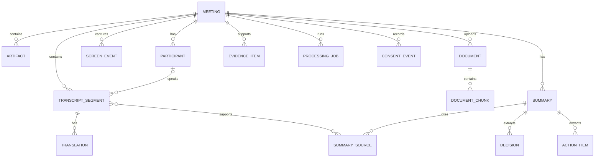

# MeetingLens 数据模型

## 1. 设计原则

- SQLite 保存结构化状态；大文件保存在应用私有目录。
- 所有主键使用应用生成的 UUID，避免暴露自增规模。
- 时间统一保存为 UTC ISO 8601 字符串，展示时再转换到本地时区。
- 外键级联只处理结构化引用，不能替代物理文件的可恢复删除协调。
- AI 输出始终带模型、模板版本和来源范围，允许重建与审计。
- API key、access token 和密码不属于业务数据模型，禁止写入数据库。

## 2. 实体关系



## 3. 核心表

### `meetings`

| 字段                   | 类型      | 说明                                                                      |
| ---------------------- | --------- | ------------------------------------------------------------------------- |
| `id`                   | TEXT PK   | UUID                                                                      |
| `title`                | TEXT      | 用户提供的标题                                                            |
| `status`               | TEXT      | `draft/recording/processing/ready/failed/archived/deleting/delete_failed` |
| `primary_language`     | TEXT      | BCP 47 语言标签                                                           |
| `selected_window_json` | TEXT NULL | 用户选定窗口的受控标识/标题快照，不含截图                                 |
| `started_at`           | TEXT NULL | 实际开始时间                                                              |
| `ended_at`             | TEXT NULL | 实际结束时间                                                              |
| `created_at`           | TEXT      | 创建时间                                                                  |
| `updated_at`           | TEXT      | 最近更新时间                                                              |
| `deleted_at`           | TEXT NULL | 软删除/清理协调标记                                                       |
| `deletion_error_code`  | TEXT NULL | 删除失败的稳定安全错误码，不含路径或原始异常                              |

#### 会议生命周期

会议状态由 Rust service 和专用 Tauri command 控制，普通更新接口只能修改标题、主要语言等可编辑元数据，不得直接写入 `status`、`started_at` 或 `ended_at`。

| 操作                  | 前置状态    | 后置状态    | 时间规则                                    |
| --------------------- | ----------- | ----------- | ------------------------------------------- |
| 创建                  | 不适用      | `draft`     | `started_at`、`ended_at` 均为空             |
| `start_meeting`       | `draft`     | `recording` | Rust 后端写入当前 UTC ISO 8601 `started_at` |
| `end_meeting`（模拟） | `recording` | `ready`     | Rust 后端写入当前 UTC ISO 8601 `ended_at`   |

- MVP 1A-2 的合成会议没有异步处理步骤，因此结束后直接进入 `ready`。
- `processing` 保留给 MVP 1C 及后续真实异步处理，只能由受信任后端在创建相应 job 后进入，WebView 不得自行设置。
- `failed` 与 `archived` 同样只能通过后续定义的专用 service 操作进入，不属于通用会议更新字段。
- `deleting` 和 `delete_failed` 只由未来删除协调 service 进入；普通更新、开始、结束、导入和处理接口均不得写入或绕过。
- 重复开始、重复结束、`draft → ready`、`ready → recording` 等非法转换必须原子拒绝，并返回稳定错误码 `meeting_invalid_state`。
- 时间戳由后端生成；前端传入的开始/结束时间不得作为状态转换依据。
- 生命周期相关的非法操作统一使用对外错误码 `meeting_invalid_state`；不得再引入含义重复的 `invalid_state_transition`。

### `artifacts`

| 字段            | 类型    | 说明                                 |
| --------------- | ------- | ------------------------------------ |
| `id`            | TEXT PK | UUID                                 |
| `meeting_id`    | TEXT FK | 所属会议                             |
| `kind`          | TEXT    | `audio/upload/extracted_text/export` |
| `relative_path` | TEXT    | 应用私有目录内的受控相对路径         |
| `media_type`    | TEXT    | 经检测的 MIME 类型                   |
| `byte_size`     | INTEGER | 文件大小                             |
| `sha256`        | TEXT    | 内容完整性哈希                       |
| `retention`     | TEXT    | `session/default/pinned`             |
| `created_at`    | TEXT    | 创建时间                             |

`relative_path` 不接受 `..`、盘符、UNC 或绝对路径。原始文件名只用于用户界面显示，并经过长度与控制字符清理。

### `participants`

| 字段                      | 类型      | 说明                          |
| ------------------------- | --------- | ----------------------------- |
| `id`                      | TEXT PK   | UUID                          |
| `meeting_id`              | TEXT FK   | 所属会议                      |
| `diarization_label`       | TEXT      | 例如 `speaker_01`，会议内唯一 |
| `display_name`            | TEXT NULL | 用户主动设置或修正的名称      |
| `voice_sample_path`       | TEXT NULL | Phase 2 可选的受控相对路径    |
| `voice_sample_consent_at` | TEXT NULL | 语音样本授权时间              |
| `created_at`              | TEXT      | 创建时间                      |

语音样本不用于跨会议自动识别，必须允许重录和删除。系统不得在没有独立同意与安全设计时通过声纹映射真实身份。

### `transcript_segments`

| 字段             | 类型         | 说明                 |
| ---------------- | ------------ | -------------------- |
| `id`             | TEXT PK      | UUID                 |
| `meeting_id`     | TEXT FK      | 所属会议             |
| `participant_id` | TEXT FK NULL | 可为空的说话人       |
| `start_ms`       | INTEGER      | 相对会议开始的毫秒数 |
| `end_ms`         | INTEGER      | 结束毫秒数           |
| `language`       | TEXT         | BCP 47 标签          |
| `text`           | TEXT         | 转录正文             |
| `confidence`     | REAL NULL    | 0–1，若引擎提供      |
| `revision`       | INTEGER      | 用户修订版本         |
| `created_at`     | TEXT         | 创建时间             |
| `updated_at`     | TEXT         | 修改时间             |

约束：`start_ms >= 0`、`end_ms > start_ms`、同一会议内按时间建立索引。

### `screen_events`

| 字段                     | 类型         | 说明                                           |
| ------------------------ | ------------ | ---------------------------------------------- |
| `id`                     | TEXT PK      | UUID                                           |
| `meeting_id`             | TEXT FK      | 所属会议                                       |
| `captured_at_ms`         | INTEGER      | 相对会议开始的毫秒数                           |
| `window_ref`             | TEXT         | 用户选定窗口的稳定本地引用                     |
| `source_kind`            | TEXT         | `accessibility/ocr/user_note`                  |
| `event_type`             | TEXT         | `slide_change/code_change/decision_text/other` |
| `text`                   | TEXT         | 经确认/脱敏的结构化文字                        |
| `screenshot_artifact_id` | TEXT FK NULL | 临时截图引用，默认在提取后删除                 |
| `created_at`             | TEXT         | 创建时间                                       |

### `documents`

该表是未来 migration 的规范草案；PR #11 不创建或迁移数据库。

| 字段                      | 类型         | 说明                                                                                |
| ------------------------- | ------------ | ----------------------------------------------------------------------------------- |
| `id`                      | TEXT PK      | document UUID                                                                       |
| `meeting_id`              | TEXT FK      | 所属会议                                                                            |
| `original_filename`       | TEXT         | 用户原始显示名称；UTF-8 最大 255 bytes，不参与路径拼接                              |
| `safe_extension`          | TEXT         | allowlist 中的规范小写扩展名                                                        |
| `detected_media_type`     | TEXT NULL    | Rust 根据签名/安全类型识别得到的类型；`importing` 初期可为空                        |
| `size_bytes`              | INTEGER NULL | 完成流式复制后确认的大小                                                            |
| `sha256`                  | TEXT NULL    | 完整性和同会议去重哈希；复制完成前可为空，不代表文件可信                            |
| `status`                  | TEXT         | `importing/staged/parsing/parsed/import_failed/parse_failed/deleting/delete_failed` |
| `storage_relative_path`   | TEXT         | 应用私有根目录内的受控相对路径                                                      |
| `imported_at`             | TEXT NULL    | 成功进入 `staged` 的 UTC 时间                                                       |
| `updated_at`              | TEXT         | 最近状态更新时间                                                                    |
| `failure_code`            | TEXT NULL    | 稳定错误码                                                                          |
| `failure_message_safe`    | TEXT NULL    | 可展示的安全消息；不得包含绝对路径、用户名、原始异常或文件内容                      |
| `parser_version_optional` | TEXT NULL    | 未来 Docling Worker/adapter 版本                                                    |
| `page_count_optional`     | INTEGER NULL | 未来解析成功后可用的页数                                                            |
| `created_at`              | TEXT         | 记录创建时间                                                                        |

源文件绝对路径不得持久化。文件内容不得写入 SQLite BLOB；解析文本和派生 artifacts 使用独立表或受控文件。`meeting_id` 使用外键，但删除不能只依赖 `CASCADE`，必须先协调物理文件。

#### 文档生命周期

| 转换                                    | 所属阶段         | 规则                                                |
| --------------------------------------- | ---------------- | --------------------------------------------------- |
| `importing → staged`                    | MVP 1B-1A        | 文件完成校验并原子进入正式目录                      |
| `importing → import_failed`             | MVP 1B-1A        | 复制、类型、配额、完整性或存储失败                  |
| `staged → parsing`                      | MVP 1B-2         | 隔离 Worker 接受解析任务                            |
| `parsing → parsed/parse_failed`         | MVP 1B-2         | Worker 返回受控结果或稳定错误                       |
| `staged/parsed → deleting`              | MVP 1B-1A 及后续 | 接受删除请求                                        |
| `import_failed/parse_failed → deleting` | MVP 1B-1A 及后续 | 清理失败输入或解析产物                              |
| `deleting → 记录消失`                   | MVP 1B-1A        | 物理文件和关联 artifacts 全部清理成功后才删除元数据 |
| `deleting → delete_failed`              | MVP 1B-1A        | 清理失败，保留安全错误和可恢复状态                  |
| `delete_failed → deleting`              | MVP 1B-1A        | 幂等重试                                            |

页面和通用 update 不得直接修改状态。安全导入阶段只实现 `importing/staged/import_failed/deleting/delete_failed`；`parsing/parsed/parse_failed` 由 MVP 1B-2 引入。未知状态 fail closed。

同一会议使用 `(meeting_id, sha256)` 唯一约束识别相同内容。重复时不创建第二条记录或物理副本，返回 `document_already_imported` 和已有 document ID。不同会议首版不做物理去重；文件名不参与重复判断，同名不同内容允许导入，不同名相同内容视为重复。

### `document_chunks`

| 字段           | 类型         | 说明                         |
| -------------- | ------------ | ---------------------------- |
| `id`           | TEXT PK      | UUID                         |
| `document_id`  | TEXT FK      | 来源文档                     |
| `ordinal`      | INTEGER      | 文档内顺序                   |
| `page_number`  | INTEGER NULL | 来源页码                     |
| `section_path` | TEXT NULL    | 标题/工作表/幻灯片等结构路径 |
| `text`         | TEXT         | 提取正文                     |
| `content_hash` | TEXT         | 去重与完整性校验             |

### `evidence_items`

| 字段                    | 类型         | 说明                         |
| ----------------------- | ------------ | ---------------------------- |
| `id`                    | TEXT PK      | UUID                         |
| `meeting_id`            | TEXT FK      | 所属会议                     |
| `kind`                  | TEXT         | `transcript/document/screen` |
| `transcript_segment_id` | TEXT FK NULL | 转录来源                     |
| `document_chunk_id`     | TEXT FK NULL | 文档来源                     |
| `screen_event_id`       | TEXT FK NULL | 屏幕来源                     |
| `label`                 | TEXT         | 面向用户的证据标签           |
| `created_at`            | TEXT         | 创建时间                     |

三种来源 ID 必须且只能有一个非空，使用 `CHECK` 约束保证。

### `translations`

| 字段              | 类型      | 说明                    |
| ----------------- | --------- | ----------------------- |
| `id`              | TEXT PK   | UUID                    |
| `segment_id`      | TEXT FK   | 原始转录片段            |
| `target_language` | TEXT      | 目标语言                |
| `text`            | TEXT      | 译文                    |
| `provider`        | TEXT      | 本地/外部 provider 标识 |
| `model`           | TEXT NULL | 模型标识，不含凭据      |
| `created_at`      | TEXT      | 创建时间                |

### `summaries`

| 字段             | 类型    | 说明                                      |
| ---------------- | ------- | ----------------------------------------- |
| `id`             | TEXT PK | UUID                                      |
| `meeting_id`     | TEXT FK | 所属会议                                  |
| `kind`           | TEXT    | `overview/decisions/actions/risks/custom` |
| `content_json`   | TEXT    | 版本化结构化结果                          |
| `provider`       | TEXT    | 例如 `deepseek` 或 `local`                |
| `model`          | TEXT    | 实际模型标识                              |
| `prompt_version` | TEXT    | 提示模板版本                              |
| `is_user_edited` | INTEGER | 0/1                                       |
| `created_at`     | TEXT    | 创建时间                                  |

### `summary_sources`

| 字段         | 类型    | 说明                           |
| ------------ | ------- | ------------------------------ |
| `summary_id` | TEXT FK | 摘要                           |
| `segment_id` | TEXT FK | 支撑片段                       |
| `relation`   | TEXT    | `supports/contradicts/context` |

联合主键为 `(summary_id, segment_id, relation)`。

### `decisions`

| 字段               | 类型         | 说明                            |
| ------------------ | ------------ | ------------------------------- |
| `id`               | TEXT PK      | UUID                            |
| `summary_id`       | TEXT FK      | 来源摘要                        |
| `description`      | TEXT         | 决策内容                        |
| `status`           | TEXT         | `proposed/confirmed/superseded` |
| `evidence_item_id` | TEXT FK NULL | 可核验证据                      |
| `is_user_edited`   | INTEGER      | 0/1                             |
| `created_at`       | TEXT         | 创建时间                        |

### `action_items`

| 字段                | 类型         | 说明                         |
| ------------------- | ------------ | ---------------------------- |
| `id`                | TEXT PK      | UUID                         |
| `summary_id`        | TEXT FK      | 来源摘要                     |
| `description`       | TEXT         | 行动描述                     |
| `owner_label`       | TEXT NULL    | 文本标签，不强制映射真实身份 |
| `due_at`            | TEXT NULL    | 用户确认后的截止时间         |
| `status`            | TEXT         | `open/done/dismissed`        |
| `source_segment_id` | TEXT FK NULL | 可核验来源                   |
| `evidence_item_id`  | TEXT FK NULL | 转录/文档/屏幕的统一证据引用 |

### `processing_jobs`

| 字段            | 类型      | 说明                                             |
| --------------- | --------- | ------------------------------------------------ |
| `id`            | TEXT PK   | UUID                                             |
| `meeting_id`    | TEXT FK   | 所属会议                                         |
| `job_type`      | TEXT      | `transcribe/translate/diarize/extract/summarize` |
| `status`        | TEXT      | `queued/running/succeeded/failed/cancelled`      |
| `progress`      | REAL      | 0–1                                              |
| `attempt_count` | INTEGER   | 已尝试次数                                       |
| `input_json`    | TEXT      | 只含 ID 和安全参数                               |
| `error_code`    | TEXT NULL | 稳定错误分类，不含敏感正文                       |
| `created_at`    | TEXT      | 创建时间                                         |
| `started_at`    | TEXT NULL | 开始时间                                         |
| `finished_at`   | TEXT NULL | 结束时间                                         |

### `consent_events`

| 字段          | 类型    | 说明                                   |
| ------------- | ------- | -------------------------------------- |
| `id`          | TEXT PK | UUID                                   |
| `meeting_id`  | TEXT FK | 所属会议                               |
| `capability`  | TEXT    | `recording/screen_context/external_ai` |
| `decision`    | TEXT    | `granted/revoked`                      |
| `scope_json`  | TEXT    | 数据范围、用途和 provider              |
| `recorded_at` | TEXT    | 记录时间                               |

## 4. SQLite 约束与索引

- 启用 `PRAGMA foreign_keys = ON`。
- 使用 WAL 时，`.db-wal` 和 `.db-shm` 必须保持本地且被 Git 忽略。
- 对 `transcript_segments(meeting_id, start_ms)`、`screen_events(meeting_id, captured_at_ms)`、`documents(meeting_id, status)`、`document_chunks(document_id, ordinal)`、`processing_jobs(status, created_at)` 和 `artifacts(meeting_id, kind)` 建索引。
- `documents(meeting_id, sha256)` 对非 NULL 哈希使用唯一约束，确保同一会议内容去重；跨会议不共享物理副本。
- 状态字段使用 `CHECK` 约束或迁移层枚举校验。
- 所有迁移在事务中执行，并在 schema 版本表中记录。

## 5. 文件布局

```text
app-data/
├── meetinglens.sqlite3
└── meeting-data/
    ├── meetings/<meeting-id>/
    │   ├── documents/<document-id>.<safe-extension>
    │   └── artifacts/
    ├── staging/<random-import-id>.tmp
    └── deletion-trash/<deletion-id>/
```

数据库保存相对于 `app-data` 的路径；本 PR 不移动现有 SQLite。任何文件访问必须先解析、规范化并确认最终路径仍位于应用私有根目录内。目标路径只由 Rust 使用 meeting/document UUID 构造；原始文件名不能参与路径拼接。拒绝 `..`、绝对路径、盘符、UNC、Alternate Data Streams 和任何逃逸结果。

导入在 `staging` 中创建随机临时文件，流式复制并同时计算 SHA-256；尽早检查声明大小，复制中超过限制立即停止并清理。最终大小、类型和会议累计配额验证成功后，使用同卷原子 rename 进入 `documents`。不把用户文件长期放在 Temp、Git 仓库或当前工作目录，不设置可执行权限，也不调用 Windows 文件关联程序。源文件保持不变。

## 6. 删除与保留

MVP 1A-1 尚无会议所有的 artifact、后台 job 或文件句柄。当前实现可在同一事务内设置 `deleted_at` 后硬删除 meeting；任一步失败则整笔回滚。此时 `deleted_at` 是删除协调边界的预留字段，不要求留下持久 tombstone。

MVP 1A-2-1 的当前无文件删除状态契约固定如下：

- `draft` 和 `ready` 允许事务内硬删除。
- `recording` 禁止删除；用户必须先通过 `end_meeting` 正常结束，拒绝时返回 `meeting_invalid_state`。
- `processing`、`failed` 和 `archived` 当前不能由 Meeting Command API 进入，也不允许删除；后续阶段必须先在文档中定义相应清理语义。
- 删除格式正确但不存在的会议返回 `meeting_not_found`，不得将其伪装为删除成功。

从 MVP 1B-1A 首次引入会议文件开始，删除升级为可重试的协调流程：

| meeting 状态    | 删除请求结果                                    |
| --------------- | ----------------------------------------------- |
| `draft`         | 接受并进入 `deleting`                           |
| `recording`     | 拒绝并返回 `meeting_invalid_state`              |
| `ready`         | 接受并进入 `deleting`                           |
| `processing`    | 拒绝；处理输入集合已冻结                        |
| `failed`        | 保持既有 fail-closed 行为，等待后续专用恢复语义 |
| `archived`      | 保持既有 fail-closed 行为                       |
| `deleting`      | 幂等返回删除 pending 状态，不创建第二个任务     |
| `delete_failed` | 允许重试并重新进入 `deleting`                   |
| 未知状态        | fail closed                                     |

1. 接受请求时在事务中将会议设为 `deleting`、写入 `deleted_at` tombstone，并禁止编辑、开始、导入或生成纪要。
2. 持久化协调状态必须能枚举原始文档，以及未来解析、音频、截图、转写、纪要、缓存和导出产物。
3. 取消或等待任务并关闭句柄后，将受控文件同卷移动至应用私有 `deletion-trash`，或采用具备同等恢复能力的设计。
4. 只有文件和派生数据清理全部成功后，才最终删除数据库记录和 tombstone。
5. 任何步骤失败时进入 `delete_failed`，保留稳定安全错误码，不伪装成功，也不把残留重新暴露为正常会议数据。
6. 启动恢复和用户重试使用同一幂等流程；不得因崩溃留下无法识别的孤儿文件。
7. 不允许“先删数据库再尽力删文件”或“先删文件再尝试删数据库”。外部 provider 已接收的数据不能由本地删除撤回，发送前必须明确提示。

单个文档删除同样先进入 `deleting`。`staged`、`parsed`、`import_failed`、`parse_failed` 可请求删除；`importing`/`parsing` 必须先取消或等待安全终止；`deleting` 的重复请求幂等；`delete_failed` 可重试。物理文件与关联 artifacts 清理成功后才删除元数据，失败则保留 `delete_failed`。删除不得影响用户源文件。

会议处于 `draft`、`recording` 或 `ready` 时允许增删文档；`processing`、`deleting`、`delete_failed`、`failed`、`archived` 和未知状态下，普通用户文档集合变更 fail closed。`delete_failed` 仅允许删除协调器重试，不允许以单文档操作绕过会议 tombstone。

引入文件的 PR 必须同时迁移删除实现和测试，不得继续把无文件阶段的同事务硬删除语义当作完整删除流程。当前 PR #11 只定义语义，不修改现有 `delete_meeting` Command。

默认保留策略在实现前由产品决策确认；首个版本不进行静默自动删除。

## 7. 文档错误协议

| 错误码                         | Retryable | 含义                                             |
| ------------------------------ | --------- | ------------------------------------------------ |
| `document_invalid_type`        | false     | 扩展或安全类型不在 allowlist                     |
| `document_type_mismatch`       | false     | 扩展与检测类型不一致                             |
| `document_empty`               | false     | 文件为空                                         |
| `document_too_large`           | false     | 单文件超限                                       |
| `document_quota_exceeded`      | false     | 数量或会议累计配额超限                           |
| `document_filename_too_long`   | false     | UTF-8 文件名超过 255 bytes                       |
| `document_import_failed`       | true      | 复制或导入事务失败                               |
| `document_not_found`           | false     | document ID 不存在                               |
| `document_already_imported`    | false     | 同会议已存在相同内容，并同时返回已有 document ID |
| `document_invalid_state`       | false     | meeting/document 状态不允许当前操作              |
| `document_storage_unavailable` | true      | 私有存储暂不可用                                 |
| `document_integrity_failed`    | true      | 复制后的大小或哈希完整性不符合预期               |
| `document_delete_pending`      | true      | 文档删除已在进行                                 |
| `document_delete_failed`       | true      | 文档清理失败，可重试                             |
| `meeting_delete_pending`       | true      | 会议删除已在进行                                 |
| `meeting_delete_failed`        | true      | 会议清理失败，可重试                             |
| `internal_error`               | false     | 未知错误的安全回退                               |

错误响应只包含稳定 `code`、安全 `message`、明确 `retryable` 和必要的安全 ID。不得返回源绝对路径、用户目录、文件内容、解析器 traceback 或底层异常；前端只根据 code 判断，未知错误 fail closed。

## 8. 数据模型版本化

- `schema_migrations(version, applied_at, checksum)` 记录数据库迁移。
- Sidecar API 和 `content_json` 都包含独立 `api_version/schema_version`。
- 破坏性迁移必须先备份并获得用户批准，不得自动丢弃未知字段。
